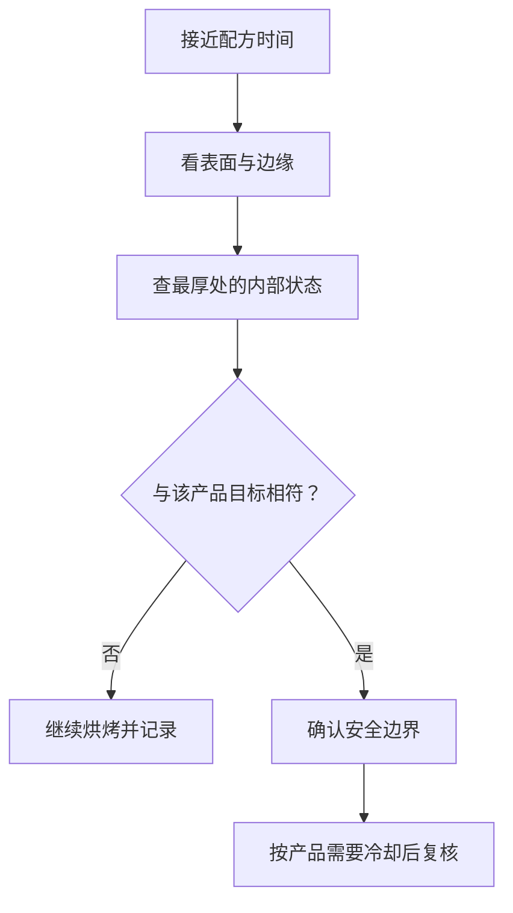

# 第 32 章 怎么判断烤好了：内部温度与状态判据，不是只看时间

配方中的时间是作者那台烤箱、那只模具、那一份装填量下的记录；它不是成品内部发生变化的直接证据。判断出炉要同时看：中心是否已定型、表面是否达到目标、产品是否满足安全条件，以及冷却后是否仍能站住。

## 32.1 一炉里有不止一个“熟”

| 你真正想问的 | 可观察或可测的证据 | 不能替代它的东西 |
|--------------|--------------------|------------------|
| 中心是否定型 | 最厚处的内部状态、适合该品类的中心测量与冷却后切面 | 仅看表面颜色 |
| 表皮是否到目标 | 颜色、干燥、脆度、与模具的分离状态 | 中心温度单独一个数 |
| 是否安全 | 按所在地、原料类别的现行官方指引验证 | “闻起来像烤好了” |
| 冷却后能否支撑 | 回缩、切面、冷却后的质地 | 刚出炉时的外观 |

面包芯是高含水环境，研究中的面包芯接近水的沸点后不会继续像表皮那样升高；表皮则能在失水后远高于此。于是“金黄”报告的是表面失水和褐变，不保证中心已定型；“中心很热”也不保证表皮已经符合你要的脆度或颜色。

## 32.2 内部温度有用，但不是万能终点

探针温度计能把“中心是否达到目标状态”变成可记录的变量，尤其适用于厚的、高含水的面包类产品。应测**最厚、最后受热的位置**，避开模具壁、烤盘与大气孔；测量点错了，数字再精确也没有意义。

本书不为所有蛋糕、饼干、面包给一张万能终温表：糖、脂肪、含水量、体积、模具与目标质地会改变定型路径。现有研究可以支持“面包芯接近沸点”这一湿芯的物理边界，却不支持把一个产品的终温机械移植到另一种产品。

| 产品特征 | 优先的组合判据 |
|----------|----------------|
| 厚、湿、酵母面包 | 中心测量 + 声音 / 表皮 + 冷却后切面 |
| 蛋糕 / 快速面包 | 中心状态、回弹 / 插签情况、边缘与冷却后回缩一起看 |
| 薄脆类 | 表面干燥、颜色、冷却后变硬的趋势；中心温度信息有限 |
| 含需充分加热原料的成品 | 先遵从所在地现行食品安全指引；口感判据不能覆盖安全 |

## 32.3 “出炉时好看”也可能是未完成

出炉后仍会发生热量再分配、水分迁移和结构回稳。尤其是高含水、靠蛋白与淀粉定型的产品，过早切开会同时改变散热和水分路径，使你难以判断是烤不足、冷却不足还是配方问题。

| 现象 | 可能的阶段 | 下次如何区分 |
|------|------------|--------------|
| 表面正常、中心湿黏 | 中心热量 / 时间不足，或面糊厚度不同 | 固定模具与装填，只记录中心状态和炉温 |
| 出炉高、冷却后明显回缩 | 结构在冷却后无法支撑，原因可在膨发、定型或配方 | 不要只补时间；对照记录膨发、出炉与冷却三个时点 |
| 表皮过深、中心仍不足 | 表面受热过快、模具 / 炉位 / 配方改变 | 先确认炉温、炉位与遮挡 / 传热路径，别只加总时间 |

## 32.4 常见说法辨析

| 说法 | 判定 | 说明 |
|------|------|------|
| “按配方时间到就一定烤好了” | ❌ | 时间不可跨烤箱、模具和装填量直接移植；它只能提醒你开始检查。 |
| “插签干净就适用于所有成品” | ⚠️ | 它是某些产品的辅助现象，不等同于所有结构与安全判断。 |
| “表面金黄就说明中心熟了” | ❌ | 表皮与中心处在不同的水分、温度环境。 |
| “内部温度一个数字可判断所有烘焙品” | ❌ | 产品体系和目标质地不同；温度应与状态和安全条件并用。 |

## 32.5 思考题

1. 为什么表面颜色无法单独证明中心已经定型？
2. 厚蛋糕表面变深、中心湿黏，为什么不能只延长时间？
3. 为什么探针插到模具壁附近的读数不能作为中心熟度依据？

> 📖 **参考答案**（想清楚再看）：[Q1](../../qa/32-doneness-qa.md#q1) · [Q2](../../qa/32-doneness-qa.md#q2) · [Q3](../../qa/32-doneness-qa.md#q3)

## 32.6 本章实操

### 🅐 零成本版：重写一条出炉条件

找一份带“烤 N 分钟”的配方，把它改写为至少两个状态判据，再标注哪个是安全、哪个是品质。

| 原配方时间 | 中心 / 结构判据 | 表面判据 | 冷却后复核 | 安全确认要查什么 |
|------------|----------------|----------|------------|------------------|
| | | | | |

### 🅑 开火版：给一种常做成品建立出炉卡

有烤箱时做：用一款熟悉产品，维持配方、模具与炉位不变。临近原时间时开始检查并记录，不为实验吃生面糊或生面粉制品；含蛋等原料按所在地当前安全指引处理。

| 检查时点 | 表面 / 边缘 | 最厚处状态或读数 | 出炉决定 | 冷却后状态 |
|----------|-------------|--------------------|----------|-------------|
| 原时间前 | | | | |
| 原时间 | | | | |
| 需要时追加 | | | | |

## 32.7 🔎 下次烤之前的用处

下次看到“烤 25 分钟”，把它当作**开始观察的提醒**。先为这类成品写下中心、表面、冷却后三个停点；这样你才会知道该改炉温、模具、装填量，还是烘烤过程本身。

## 32.8 本章依据

- 面包烘烤研究与模拟：高含水面包芯接近水的沸点，表皮则随失水升至更高温度；具体产品、炉温和时间不可外推。
- 美国 FDA 的蛋与生面糊相关安全资料，以及各地现行食品安全指引：安全条件与口感判断分开处理。
- 第 21、23、28、29 章：定型时间轴、探针测量、传热和炉温标定。

出处与限制见[参考书目与出处登记](../../standards.md)。
