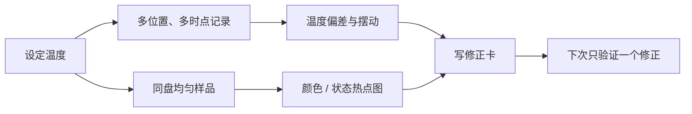

# 🛠 项目 P3：给你的烤箱做一次标定

> **这是第五部分的验收。**
> 目标不是证明烤箱“准”或“不准”，而是得到一张你能在下次使用的地图：设定温度大致对应什么实际范围、哪里先上色、预热和转盘能修正什么。

## P3.1 交付物与边界

| 交付物 | 要写下什么 | 用处 |
|--------|------------|------|
| **① 温度记录** | 设定值、位置、多个时点的读数 | 看见摆动而非相信一次读数 |
| **② 热点地图** | 同盘样品各位置的颜色 / 状态 | 决定炉位与是否转盘 |
| **③ 修正卡** | 预热、炉位、转盘与下一次的验证计划 | 把经验变成可复用规则 |

烤箱传感器只测有限位置，炉温也会摆动；一次读数不能代表整个炉腔。标定的结论只属于这台设备、这套器具和这次条件，设备模式或环境改变后应复查。



## P3.2 🅐 零成本版：纸上建立“我不知道什么”清单

没有温度计或不想开炉，也能完成第一版。查你的烤箱说明书，填写已知信息；未知项不要猜。

| 项目 | 我知道什么 | 我不知道什么 | 将来怎样测 |
|------|------------|--------------|------------|
| 加热方式 / 风扇模式 | | | |
| 预热提示代表什么 | | | |
| 温控探头位置 | | | |
| 常用炉位 | | | |
| 最常见失败位置 | | | |

然后读一份常做配方，把它的“温度 / 时间”翻译为三个待验证的问题：表面先深了吗？中心是否后熟？同盘是否有前后差？这比抄一个修正数字更有用。

## P3.3 🅑 开火版：温度与热点两次最小测试

### A. 温度记录

需要：能放入炉腔的独立温度计（或可靠探针），纸笔。空炉时按设备说明安全使用，避免接触加热元件或阻挡风道。

1. 选一个常用设定温度；
2. 记录预热提示出现时的读数，再继续记录多个时点；
3. 将温度计换到前后 / 左右 / 上下的不同位置，**不要一次只测一个点就下结论**；
4. 记录炉门是否开启、是否有烤盘或烤石，因为它们都会改变热环境。

| 设定 | 位置 | 预热提示时 | 后续读数 1 | 后续读数 2 | 器具 / 炉门备注 |
|------|------|------------|------------|------------|----------------|
| | | | | | |
| | | | | | |

不必从这些读数计算一个虚假的精确平均值；先写“前部通常较快 / 后部通常较慢”“提示后仍在爬升”“波动很大”等能指导操作的描述。

### B. 热点地图

用同一盘、大小厚度尽量一致的低风险烘焙样品做测试；不要品尝生面糊或生面粉制品。保持配方、烤盘、炉位和总量相同，给每个位置编号。

| 位置 | 上色 | 底部 | 中心状态 | 我认为的热路径线索 |
|------|------|------|----------|--------------------|
| 前左 | | | | |
| 前右 | | | | |
| 后左 | | | | |
| 后右 | | | | |
| 中心 | | | | |

如果要测试转盘，下一次只改变“是否在同一时点转盘”，不要同时更换温度、烤盘和配方。

## P3.4 写出你的修正卡（交付物③）

```text
【我的烤箱修正卡】 日期：______
常用模式 / 炉位：________________
预热：提示后我会再确认 ______，因为 ______。
热点：______ 位置更容易 ______；我会 ______。
常用烤盘 / 模具：________________
我不再把 ______ 当成唯一出炉依据；还会看 ______。
下一次只验证：________________。
```

修正卡要写“观察 → 动作”，不要写没有测过的万能偏移量。例如“后排更深，所以中途转盘”比“我的烤箱永远高 N °C”更诚实也更可用。

## P3.5 自检清单

| 做到了 | 说明 |
|--------|------|
| 温度有多时点、多位置记录 | 你没把炉温摆动误当成一个固定数字 |
| 热点来自同盘相同样品 | 你没把配方差异误认成位置差 |
| 修正卡只写观察支持的动作 | 你没从一次测试过度外推 |
| 下次只验证一个修正 | 你能继续积累因果证据 |

## P3.6 本项目依据

本项目复用第 28～33 章：炉内辐射、对流、传导与蓄热；预热和炉温摆动；模具与接触面；出炉状态；冷却后的复核。第 29 章已说明一次读数不足以代表炉腔，且烤盘、炉壁与开门会改变热环境。出处与限制见[参考书目与出处登记](../../standards.md)。

---

**第五部分到此结束。**

你现在不必再把配方的温度和时间当命令。它们是起点；你的烤箱地图、状态判据与记录，才是把它翻译成自己条件的工具。
