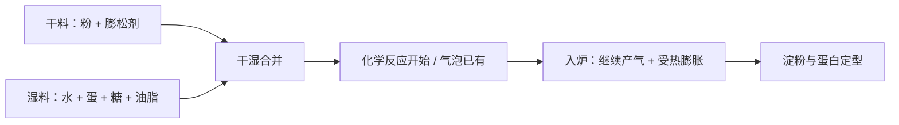

# 第 34 章 快速面包与马芬：化学膨发 + 最少搅拌

快速面包和马芬的“快”，不是随便混一混就能成功，而是它们把发酵的时间换成了化学膨发的时间窗口：气在加水和进炉时出现，面糊必须在气跑掉前完成定型。这里的搅拌不是追求面筋最大化，而是让干湿原料刚好合并、膨松剂分布足够均匀。

## 34.1 先拆成两条同时发生的线

| 过程 | 要完成什么 | 主要风险 |
|------|------------|----------|
| 干湿分开 | 让膨松剂、粉与液体各自先均匀 | 干料局部不匀 |
| 合并 | 让粉被湿润、面糊连续 | 等待太久，已有气体先流失 |
| 入炉 | 产气、受热膨胀与定型接力 | 炉温、面糊状态和模具使窗口错位 |

这不是一种固定配方。以面粉总量为 100% 的烘焙百分比语言里，水、糖、油脂、蛋和膨松剂都可能不同；它们争水、争结构、争定型时机，因此不能从一份马芬的比例直接推出另一份的用量。

## 34.2 “最少搅拌”真正保护什么

干湿合并后继续机械作用，确实会继续改变小麦体系的网络与气泡分布；但“搅拌过度一定形成隧道”的直接实验，本书尚未核到。正确的做法不是补造一个机制，而是把它写成可检验假设：在同一配方中，只改变搅拌程度，记录组织、体积和口感。

| 操作状态 | 可观察判据 | 不要写成 |
|----------|------------|----------|
| 合并不足 | 干粉块、局部干湿不一 | “越少搅越好” |
| 刚好合并 | 看不见明显干粉，面糊仍保留自身质地 | “必须搅 N 下” |
| 继续搅拌 | 作为可记录变量，而非道德错误 | “一定会形成隧道” |

> **判断规则**：快速面糊的目标是“均匀到能定型”，不是“把面筋做得最强”；合并后越早入炉，越少让产气和结构定型脱节。

## 34.3 配方改动该问什么

| 想改什么 | 它会抢走谁的什么 | 先预测的连带变化 |
|----------|------------------|--------------------|
| 增加液体 | 粉、淀粉和蛋白可用的水更多 | 流动性、定型时间与结构承载都会改变 |
| 减糖 | 少了竞争水、保湿和褐变的一部分 | 甜度、颜色、定型窗口和冷却后质地可能一起变 |
| 换液态油 / 融化黄油 | 改变短化与风味路径，不提供打发空气 | 面筋阻断、口感与面糊流动性会变 |
| 改膨松剂 | 改了气从何时产生、残余酸碱平衡 | 不可把小苏打与泡打粉按重量互换 |

化学膨松剂的酸碱配平和释放时机见第 13 章；单用碳酸氢钠可能留下碱性、皂味和颜色改变。这里最重要的不是背某个替换比例，而是先确认配方中是否有足以配平的酸，以及气应在哪个阶段出现。

## 34.4 常见说法辨析

| 说法 | 判定 | 说明 |
|------|------|------|
| “马芬搅出隧道就是面筋过度形成” | 缺乏直接证据 | 这是广泛流传的解释，但本书未核到直接验证；只建议单变量记录。 |
| “只要看不见干粉，怎么搅都一样” | ❌ | 混合程度、等待与入炉时机都会改变气与结构的关系。 |
| “小苏打和泡打粉可按重量互换” | ❌ | 二者产气路径、酸碱配平与释放时机不同。 |
| “快速面包不用称量” | ❌ | 它仍是配方配平；水、糖、油和膨松剂的改动会同时影响多个变量。 |

## 34.5 思考题

1. 为什么快速面包的“快”反而要求干湿合并后尽快入炉？
2. 一份马芬面糊看起来太稠，为什么不能直接多加液体？
3. 为什么本章没有把“搅拌 N 下”写成通用规则？

> 📖 **参考答案**（想清楚再看）：[Q1](../../qa/34-quick-breads-muffins-qa.md#q1) · [Q2](../../qa/34-quick-breads-muffins-qa.md#q2) · [Q3](../../qa/34-quick-breads-muffins-qa.md#q3)

## 34.6 本章实操

### 🅐 零成本版：解码一份快速面包配方

找一份马芬或快速面包配方，换成烘焙百分比（以面粉总量为 100%），并写出每样原料在争什么。

| 原料 | 烘焙百分比 | 角色 | 改动它先影响谁 | 我还不知道的条件 |
|------|------------|------|----------------|------------------|
| | | | | |

### 🅑 开火版：只改搅拌程度

有烤箱时做：同一份面糊分成两份，保持配方、模具、炉位与装填一致；A 组在看不见明显干粉后立即停，B 组额外继续搅拌固定一段时间。记录的是相关现象，不把一次家庭对照当成机制证明；也不要品尝生面糊。

| 组别 | 搅拌状态 | 入炉前外观 | 出炉高度 | 冷却后组织 | 下次只改什么 |
|------|----------|------------|----------|------------|--------------|
| A | | | | | |
| B | | | | | |

## 34.7 🔎 下次烤之前的用处

下次做马芬时，先问“这一步是在让原料均匀，还是只是在继续搅动？”把干湿合并、入炉等待和搅拌程度都记下来；它们比照抄“搅几下”更能解释成品差异。

## 34.8 本章依据

- 第 8、10、13 章：化学膨发的产气、配平与保气框架。
- 第 16、20、22 章：含水量、机械作用和面糊的变量边界。
- “马芬搅拌过度形成隧道”的直接实验仍未核到，见[参考书目与出处登记](../../standards.md)的已知缺口。

所有比例示例均应以面粉总量为 100%；本章不新设固定配方百分比。
