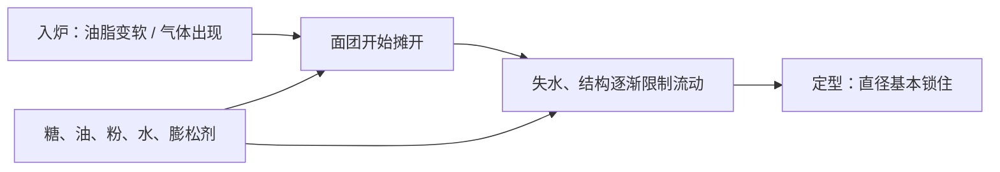

# 第 35 章 饼干：一份配方的六种改法

饼干最容易让人误会的地方，是把“摊开、薄脆、颜色深”各归因给一个原料。真实情况是：它先流动和摊开，随后才定型；糖、油脂、面粉、气体和水共同决定这两段各持续多久。

## 35.1 先看形状怎样被锁住

糖酥饼干的延时摄影研究显示：直径先增长，随后突然定住。因此最终直径可以理解为**摊开速率 × 定型之前可摊开的时间**。软质小麦粉样品摊得更大，研究中的差异与蛋白质有关，却不止蛋白质一个因素。

| 改动 | 已有研究支持的方向 | 需要同时问 |
|------|--------------------|------------|
| 增加糖 | 在研究范围内，直径变大、厚度变小；定型可被推迟 | 糖种、含水与颜色怎么变？ |
| 增加油脂 | 在研究范围内，直径变大、厚度变小；气孔受影响 | 脂肪是固态还是液态、何时熔化？ |
| 增加面筋 | 摊开较小、开始摊开更晚；完全无面筋则结构不可接受 | 不是只改“高低筋”标签 |
| 换膨松剂 | 可显著改变摊开、脆裂性和风味谱 | 酸碱配平、低水分产品的残留边界 |

所有配方改动仍用烘焙百分比表达，以面粉总量为 100%。本章不提供所谓“标准饼干比例”，因为该类成品的糖油比例、面粉、形状和目标差异很大。

## 35.2 六种常见改法，先预测再动手

| 想做的改动 | 它抢走 / 放开了什么 | 先记录的结果 |
|------------|----------------------|----------------|
| 换软质 / 硬质粉 | 改变蛋白、吸水与定型路径 | 直径、厚度、边缘与口感 |
| 增减糖 | 糖争水，推迟面筋交联与定型；糖种还改颜色 | 摊开、颜色、冷却后硬度 |
| 换糖种 | 不只换甜度，也可能换颜色与质地 | 颜色、扩散、脆度 |
| 换固态 / 液态油脂 | 熔化与微结构改变面团流动和气孔 | 入炉前软硬、直径、成品硬度 |
| 改膨松剂 | 改产气、pH 和挥发性风味 | 孔隙、摊开、颜色与异味 |
| 改大小 / 厚度 | 改中心到表面的热与水路径 | 边缘、中心和定型时点 |

一项油脂比较研究中，面团最软、摊开最大的葵花籽油组，成品反而最硬；这提醒我们“面团软”不等于“成品软”。另一项研究也发现糖和油脂分别以不同方式改变气孔：油脂主要影响孔隙率和气孔大小，糖还影响气孔壁厚度。

## 35.3 低水分不是“小面包”

高糖、低水分饼干体系中，淀粉糊化可被推到烘烤过程中几乎不发生，因此不能沿用“面包靠淀粉糊化定型”的简单解释。饼干结构的完整一手机制本书尚未核到；本章只使用已证实的摊开、定型、油脂和糖的观察，不用听起来合理的故事填补空白。

## 35.4 常见说法辨析

| 说法 | 判定 | 说明 |
|------|------|------|
| “饼干摊不开就是粉太多” | ⚠️ | 粉、糖、油脂、膨松剂、厚度和炉温都可能参与；先做单变量对照。 |
| “液态油一定做出更软的饼干” | ❌ | 已有油脂研究显示面团软硬与成品硬度可走相反方向。 |
| “饼干靠淀粉糊化定型” | ❌ | 在高糖低水分体系，研究显示糊化可被推迟到烘烤中几乎不发生。 |
| “换糖只是甜度变化” | ❌ | 不同糖可同时改变颜色与质地。 |

## 35.5 思考题

1. 为什么“饼干最后直径”比“面团一开始软不软”更有信息？
2. 为什么把液态油换成固态油脂时，不能只预测“会更硬或更软”？
3. 为什么本章拒绝给一张通用的饼干糖油百分比表？

> 📖 **参考答案**（想清楚再看）：[Q1](../../qa/35-cookies-qa.md#q1) · [Q2](../../qa/35-cookies-qa.md#q2) · [Q3](../../qa/35-cookies-qa.md#q3)

## 35.6 本章实操

### 🅐 零成本版：六种改法预测卡

选一份饼干配方，先以面粉为 100% 换算，再任选一种改动写预测，不能只写“更好吃”。

| 当前原料（烘焙百分比） | 我只改什么 | 它影响的竞争关系 | 我预测的形状 / 颜色 / 口感 | 如何验证 |
|------------------------|------------|------------------|----------------------------|----------|
| | | | | |

### 🅑 开火版：只改一种糖或油脂

有烤箱时做：同一批面团分两组，保持面粉基准、重量、厚度、烤盘、炉位和烘烤过程一致，只改变一种糖或油脂。不要尝生面团。

| 组别 | 唯一改动 | 入炉前尺寸 | 出炉尺寸 | 颜色 | 冷却后硬度 / 脆度 |
|------|----------|------------|----------|------|------------------|
| A | | | | | |
| B | | | | | |

## 35.7 🔎 下次烤之前的用处

想让饼干更摊或更厚时，不要先改三样。先问：我要改变的是**摊开速度**，还是**定型发生的时刻**？选择一个相关变量，记录直径、厚度、颜色和冷却后的口感，再写下一版。

## 35.8 本章依据

- 糖酥饼干摊开与面粉研究（1997）、面筋 + 淀粉重组研究（2008）：摊开和定型时间。
- 糖、油脂对糖酥饼干研究（2009）与蔗糖—面筋研究（2009）：糖油的方向与低水分糊化边界。
- 油脂与饼干研究（2018、2016）：油脂种类、面团与成品的非直觉关系。
- 不同膨松剂饼干对照（2020）与糖种对照（2021）：膨松剂和糖种不只是单一变量。

出处和适用范围见[参考书目与出处登记](../../standards.md)。
