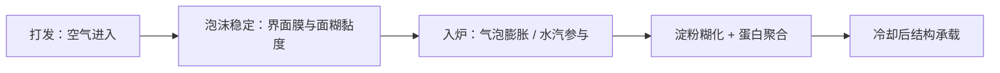

# 第 36 章 戚风与海绵：靠蛋撑起来的结构

戚风与海绵蛋糕的核心不是“打发到某个神秘状态”，而是让空气先进入体系，再让泡沫在混合、入炉膨胀和定型过程中活下来。蛋在这里同时承担起泡、乳化与凝胶；少掉其中任一角色，都不是简单的“少一个蛋”。

## 36.1 四段接力：空气进来，结构留下

| 阶段 | 主要任务 | 失败不只可能来自 |
|------|----------|------------------|
| 打发 | 形成足够、分布合适的气泡 | 不是只看体积 |
| 混合 | 让粉、油、水进入又尽量保留气室 | 不是只怪翻拌手法 |
| 入炉 | 气泡膨胀并维持到定型 | 不是只看膨发高度 |
| 定型 / 冷却 | 蛋白与淀粉网络接住结构 | 不是只看是否倒扣 |

蛋清泡沫研究表明，能快速起泡的蛋白与长期稳泡的蛋白并不完全相同；所以“打得起来”不等于“能站住”。海绵蛋糕研究也显示，蛋黄 LDL 的完整性影响充气与气室稳定，而结构定型的时刻和程度未必同步改变。

## 36.2 糖、脂肪与黏度都在改气泡的命运

| 变量 | 已有证据支持的方向 | 不可简化为 |
|------|--------------------|------------|
| 糖 | 蔗糖使蛋清更难打发，但打成后更稳定；糖也改变蛋糕气泡 | 糖只负责甜 |
| 脂肪 | 高比例脂肪替换可降低黏度、充气量并拉宽气泡分布 | 脂肪只会让蛋糕湿润 |
| 蛋黄 LDL | 与充气和气室稳定有关 | 蛋黄只会毁蛋清泡沫 |
| 面糊黏度 | 较高黏度可减少排液、合并与上浮；另有研究中更流动面糊对应更大体积 | 存在一个已知的万能“最佳黏度” |

最后一行是本书必须保留的张力：不同研究测的对象不同，不能把“更稳定”和“体积更大”强行拼成同一个最佳点。对家庭烘焙更可用的做法是记录面糊比重、体积和冷却后回缩，建立自己的序列。

## 36.3 变体推演：改动会抢走谁的什么

所有比例用烘焙百分比描述，以面粉总量为 100%。

| 改动 | 首先改变的竞争关系 | 连带要观察 |
|------|--------------------|------------|
| 减糖 | 少了稳定泡沫、竞争水与延迟定型的一部分 | 打发过程、气泡、颜色与冷却回缩 |
| 增油 | 改变乳化、气泡界面和结构承载 | 面糊比重、气泡、成品柔软度 |
| 换蛋 / 减蛋 | 同时改变水、蛋白、乳化与气源承载 | 体积、组织、定型与风味 |
| 换粉 | 改变面糊流动与结构材料 | 气室稳定、体积与口感 |

蛋替代研究显示，没有一种植物蛋白原料能完整匹配蛋的多功能性。因此“等量替换”不是原则；必须先说清这份配方主要需要蛋提供什么，再设计小份对照。

## 36.4 常见说法辨析

| 说法 | 判定 | 说明 |
|------|------|------|
| “打发越久，蛋糕越高” | ❌ | 充气更多不必然变成更高成品；气泡分布、混合和定型都参与。 |
| “一滴蛋黄一定让蛋清完全打不发” | ⚠️ | 有工业体系研究显示脂质残留存在阈值，但本书不外推成“一滴”的绝对规则。 |
| “糖只增加甜度” | ❌ | 糖会改变泡沫稳定、竞争水与定型窗口。 |
| “戚风塌陷一定是没倒扣” | ⚠️ | 冷却支撑是变量之一，但膨发、混合、定型与配方都可能在更早阶段造成问题。 |

## 36.5 思考题

1. 为什么“打发体积大”不能单独预测最终蛋糕高度？
2. 减糖时，为什么不应只预测成品更不甜？
3. 蛋替代实验为什么需要先写明这份蛋糕依赖蛋的哪种功能？

> 📖 **参考答案**（想清楚再看）：[Q1](../../qa/36-chiffon-sponge-qa.md#q1) · [Q2](../../qa/36-chiffon-sponge-qa.md#q2) · [Q3](../../qa/36-chiffon-sponge-qa.md#q3)

## 36.6 本章实操

### 🅐 零成本版：泡沫型蛋糕解码表

找一份戚风或海绵配方，以面粉总量为 100% 写出烘焙百分比；标出每种原料为气泡、乳化、定型和水分别做什么。

| 原料 | 烘焙百分比 | 气泡 / 乳化 / 定型 / 水中的角色 | 改动它会先影响什么 |
|------|------------|----------------------------------|--------------------|
| | | | |

### 🅑 开火版：只记录一个泡沫变量

有烤箱时做：做一款熟悉的泡沫型蛋糕，不改配方，只新增记录。测面糊比重或以相同容器比较体积，记录入炉前、出炉和冷却后的高度；不尝生蛋液或生面糊。

| 时点 | 面糊体积 / 比重 | 高度 | 表面 | 冷却后回缩 | 我下次只验证什么 |
|------|-----------------|------|------|------------|------------------|
| 打发后 | | | | | |
| 混合后 | | | | | |
| 出炉 | | | | | |
| 冷却后 | | | | | |

## 36.7 🔎 下次烤之前的用处

下次看到泡沫蛋糕塌陷，不要先问“倒扣了吗”。先沿四段追踪：空气是否进来、混合后还剩多少、入炉有没有继续膨胀、结构是否在冷却时承住。每次只验证其中一段。

## 36.8 本章依据

- 蛋清起泡与稳泡蛋白研究（2025）、糖—蛋清泡沫研究（2007）：起泡与稳定不是同一件事。
- 海绵蛋糕蛋黄 LDL 研究（2021）：充气、气室稳定与定型的关系。
- 蛋糕气泡与脂肪替代研究（1994、2013）：气泡分布和黏度变化。
- 蛋与植物蛋白替代研究（2024、2026）：蛋的多功能性不能按等量简单复制。

出处与限制见[参考书目与出处登记](../../standards.md)。
