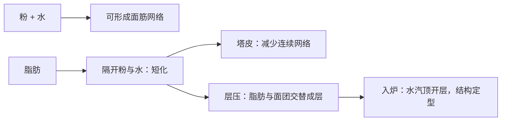

# 第 38 章 酥皮、塔皮与派：固态脂肪、层与“短”

酥皮、塔皮和派都需要脂肪改变面筋与水的相遇方式，但目标不同：塔皮通常希望短、易碎而不缩；层压酥皮还要求脂肪在擀压中保持独立层，入炉后才让水汽把层顶开。液态油能带来短化，却无法自动替代固态脂肪建立的层。

## 38.1 两个目标，不是一种面团

| 类型 | 脂肪要做什么 | 最怕什么 |
|------|--------------|----------|
| 塔皮 / 派皮 | 先隔开一部分粉和水，限制连续面筋 | 过度让水与粉、机械作用建立连续网络 |
| 千层 / 可颂类 | 保持面团—脂肪界面，直到入炉膨胀 | 脂肪过软被吸入，或过硬断裂穿层 |

“短（short）”说的是成品不易拉成长链、易碎的质地方向，不是一个可由单一温度或单一油脂百分比定义的参数。

## 38.2 为什么必须关注脂肪的固态与可塑性

层压油脂需要既能被擀开又不被面团吸收的可塑状态。可颂类裹入油使用量可以很高，但研究里的比例以面团重量为基准，不能直接移植为其他配方的烘焙百分比。脂肪的结晶网络、微观结构和温度敏感性共同决定操作表现。

| 脂肪状态 | 过程中的可能结果 | 可观察信号 |
|----------|------------------|------------|
| 过硬 / 脆 | 擀压时可能断裂、穿层 | 片状脂肪碎裂，边缘不连续 |
| 可塑 | 能随面团延展而保持界面 | 能弯折、能铺开、不明显出油 |
| 过软 / 液化 | 容易被吸入面团，层界面变弱 | 出油、渗漏、面团与脂肪难区分 |

研究可支持“可塑性有利于层压涨发”和“机械加工也可能伤害某些结构化油脂”；但家庭条件下反复软化—再冷却、具体擀折次数与层厚的可推广对照，本书未核到。因此用手感和一次只改一个变量的记录，胜过背固定数字。

## 38.3 变体推演：换脂肪、换水、换操作

所有比例以面粉总量为 100% 记录；层压油脂若按面团重量表达，必须另行注明基准。

| 改动 | 它先改变的竞争关系 | 预期并记录什么 |
|------|--------------------|----------------|
| 换固态脂肪为液态油 | 少了可保持的层界面，但仍有短化 | 面团吸油、层次、摊开与口感 |
| 增加水 | 粉可获得水更多，面筋更易连续 | 延展、回缩、塔皮硬度 |
| 增加机械作用 | 改变面筋与脂肪分布 | 操作阻力、缩边、断层 |
| 改变脂肪状态 | 改变可塑性与熔化路径 | 擀压是否穿层、出油、入炉涨发 |

不要把“冷”本身当作目标。冷的用途是让脂肪保持适合当前操作的状态；如果脂肪已经脆裂，继续降温不会自动修好层。

## 38.4 常见说法辨析

| 说法 | 判定 | 说明 |
|------|------|------|
| “液态油和黄油可等量互换做千层” | ❌ | 液态油缺少固态脂肪在层压中提供的界面与可塑性功能。 |
| “越冷层越清楚” | ⚠️ | 过硬脂肪会断裂穿层；目标是可塑，不是最低温。 |
| “多擀几折一定更多层、更酥” | 缺乏可推广证据 | 未核到家庭条件下擀折次数与层厚的通用对照；应记录自己的面团状态。 |
| “塔皮不需要结构” | ❌ | 它只是追求较短的结构，仍需足够承载馅料和切分。 |

## 38.5 思考题

1. 为什么“短化”与“层压”都需要脂肪，却不能用同一条操作规则？
2. 为什么脂肪过硬和过软都可能损坏层？
3. 液态油替换固态脂肪时，除了风味还应预测什么？

> 📖 **参考答案**（想清楚再看）：[Q1](../../qa/38-pastry-pie-qa.md#q1) · [Q2](../../qa/38-pastry-pie-qa.md#q2) · [Q3](../../qa/38-pastry-pie-qa.md#q3)

## 38.6 本章实操

### 🅐 零成本版：给两份派皮 / 酥皮配方分类

找一份塔皮和一份层压酥皮配方，以面粉总量为 100% 记录烘焙百分比；若来源以面团总量表达，另行标明基准。填写脂肪是在短化还是在做层。

| 配方 | 脂肪状态 / 基准 | 主要目标 | 它要隔开什么 | 最怕的操作失误 |
|------|-----------------|----------|--------------|----------------|
| | | | | |

### 🅑 开火版：只比较一个脂肪状态变量

有烤箱时做：选择熟悉的小份派皮或简化层压面团，保持配方、擀压与烘烤条件一致，只改变一次脂肪的操作状态。记录的是相关结果；不要把单次对照外推为所有脂肪和所有配方。

| 组别 | 唯一改变 | 擀压时状态 | 入炉前层 / 边缘 | 出炉层次 / 缩边 | 下次只验证什么 |
|------|----------|------------|----------------|----------------|------------------|
| A | | | | | |
| B | | | | | |

## 38.7 🔎 下次烤之前的用处

下次面团粘、裂或出油时，别只说“温度不对”。先问你要的是短化还是层压；再记录脂肪是过硬、可塑还是过软，并只调整一个能改变界面的变量。

## 38.8 本章依据

- 层压油脂双凝胶研究（2025）、可塑性与涨发研究（2023、2024）：固态脂肪、可塑性和机械加工的方向。
- 脂肪结晶研究（2026）：晶型与晶体尺寸是烘焙应用变量。
- 第 5、16、19、25 章：短化、面筋、脂肪层与操作变量。
- 家庭条件下擀折次数、层厚和反复软化—冷却的定量对照尚未核到，本章不提供固定参数。

出处与限制见[参考书目与出处登记](../../standards.md)。
