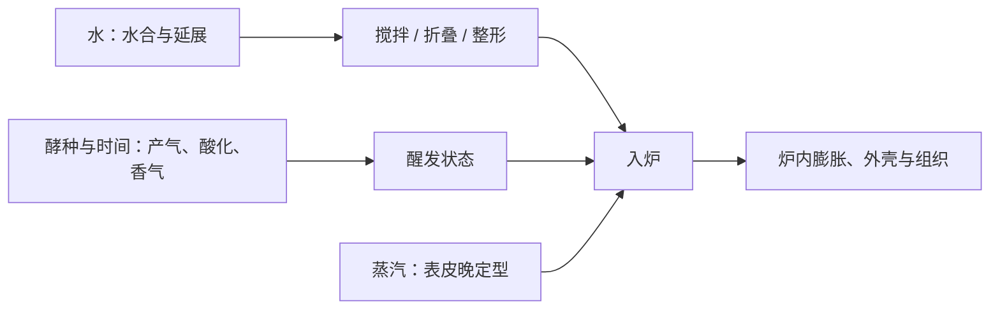

# 第 40 章 欧包与酵种面包：高含水、长发酵与蒸汽

欧包与酵种面包常被一并说成“高水、慢发、蒸汽”。这不是三个独立按钮：水改变面团的可操作性与网络承受的负担，发酵改变产气、酸度和风味，蒸汽则改变表皮定型的时间窗口。先把三者拆开，才知道该改哪一个。

## 40.1 三个变量，三段不同的过程

| 变量 | 它首先改变什么 | 不能单独保证什么 |
|------|----------------|------------------|
| 增水 | 水合、延展与操作难度 | 一定有大孔或更高体积 |
| 拉长发酵 | 产气历程、酸化与香气路径 | 一定“更好吃”或不失气 |
| 增加前段蒸汽 | 表皮保持塑性的时间 | 面团内部一定能撑住气 |
| 换酵种 | 微生物组成及其发酵表现 | 可复制的固定发酵时钟 |

因此，“高含水 + 长发酵 + 蒸汽”是一个要逐项记录的组合，不是一条配方口令。

## 40.2 高含水买到什么，也交出什么

增加水，通常让面团更易延展；但水不会只服务于“开放气孔”。它也改变面筋、淀粉与其他组分的水分竞争，并使操作和保气的容错空间改变。

一项水合研究中，较高水合有利于面筋分布更均匀；最高水合组则在发酵中出现纤维断裂，虽然体积提高，咀嚼性与黏性下降。该结果说明方向与代价可以同时出现，但其具体配方不是欧包的推荐比例。

| 如果你想要 | 应同时看 | 不要只看 |
|------------|----------|----------|
| 更易延展的面团 | 面团是否还能被折叠、整形与保气 | 水量数字 |
| 更开放的组织 | 网络、发酵状态、整形和炉内定型 | 切面大孔 |
| 更湿润的面包心 | 烘烤失水、冷却与保存 | 入炉前的黏手程度 |

所有要比较的配方仍以面粉总量为 100% 的烘焙百分比记录。只有把水、盐、酵种投料和其他液体放到同一基准上，才有资格讨论“谁更高”。

## 40.3 长发酵不是一个计时器

研究已显示：即使把面团发到相同高度，改变酵母浓度或温度，香气仍会不同；较高醒发温度还会让失气更早出现。对酵种而言，全球样本的共同园实验也显示，不同接种源的涨发速率与最大高度并不相同，醋酸菌丰度还与平均涨发速率负相关。

这不意味着某一种酵种“更好”，而是说明同一小时数不能充当不同面粉、环境与酵种的共同终点。

| 记录 | 用来回答 | 不能替代 |
|------|----------|----------|
| 室温与面团温度 | 本次速度所处的环境 | 下次的固定时间 |
| 高度与体积变化 | 当前膨胀进程 | 气室是否稳定 |
| 气味、酸感与面团张力 | 发酵与结构的现场线索 | 单一“翻倍”口令 |
| 酵种来源 / 喂养记录 | 接种源这个变量 | 对微生物组成的臆测 |

## 40.4 蒸汽只负责表皮这一边

蒸汽在较冷的面团表面凝结，使表皮较晚变干、变硬和定型，给内部已有的气体更多膨胀窗口。它不代替面团内部的产气和网络，也不能修复已经失气或无法整形的面团。

已有烘烤研究表明，蒸汽量会同时改变体积、表皮、颜色与水分迁移，关系并非“越多越好”。家用条件下，更值得记录的是蒸汽如何提供、持续多久，以及你的烤箱与容器如何改变这个环境；关于具体揭盖时点，本书没有可推广的对照数据。

## 40.5 常见说法辨析

| 说法 | 判定 | 说明 |
|------|------|------|
| “水越高，孔一定越大” | ❌ | 水合会同时改变延展、操作与保气；气孔还受发酵、整形和定型影响。 |
| “酵种发得慢，所以按时间等就行” | ❌ | 接种源、温度与面粉都会改变发酵表现；时间是记录量，不是通用终点。 |
| “蒸汽能救所有欧包问题” | ❌ | 蒸汽主要延后表皮定型，不能替代内部产气或网络。 |
| “长发酵一定更香” | ⚠️ | 发酵条件会改香气，但“更好”取决于目标，且失气风险也需一起观察。 |

## 40.6 思考题

1. 为什么想要开放气孔时，不能只增加水？
2. 为什么同一发酵时长不能作为不同酵种面团的共同终点？
3. 蒸汽为何能帮助炉内膨胀，却不能弥补面团内部保气失败？

> 📖 **参考答案**（想清楚再看）：[Q1](../../qa/40-artisan-sourdough-qa.md#q1) · [Q2](../../qa/40-artisan-sourdough-qa.md#q2) · [Q3](../../qa/40-artisan-sourdough-qa.md#q3)

## 40.7 本章实操

### 🅐 零成本版：拆解一份欧包配方

找一份带酵种的欧包配方，把所有原料换算成烘焙百分比（以面粉总量为 100%），并把每一句操作归入下表。没有写明的项目不要脑补，标为“未提供”。

| 配方信息 | 原文 / 换算 | 它主要影响什么 | 仍缺什么记录 |
|----------|-------------|----------------|--------------|
| 水与其他液体 | | 水合与操作 | |
| 酵种投料与发酵安排 | | 产气、酸化、香气 | |
| 折叠 / 整形 | | 网络与气室重排 | |
| 蒸汽 / 加盖安排 | | 表皮定型窗口 | |

### 🅑 开火版：一次只比较一个变量

用熟悉的配方做两次，不要同时改水、发酵和蒸汽。任选其中一个变量，其余保持不变；记录的是现象，不急着归因。

| 本次唯一变量 | 保持不变的项目 | 入炉前状态 | 炉内涨幅 / 表皮 | 切面与风味 | 下次要验证什么 |
|--------------|----------------|------------|-----------------|------------|----------------|
| | | | | | |

## 40.8 🔎 下次烤之前的用处

当面团太黏、组织不开放或表皮过早定住时，先把问题归到水合、发酵 / 保气、整形或蒸汽中的一项，再安排只改一个变量的下一炉；不要以“高水慢发欧包”这个标签一次动完四件事。

## 40.9 本章依据

- 水合与面筋结构研究（2024）：较高水合的收益与网络断裂风险可同时出现；具体体系不外推为推荐比例。
- 酵母浓度 / 温度与香气研究（2013）、醒发温度与失气研究（2007）。
- 全球酵种共同园研究（2021）与酵种醋酸菌研究（2024）：接种源与发酵表现、酸化和挥发物有关。
- 蒸汽量与面包品质研究（2011、2012）及加湿烘烤研究（2013）；详细机制见[第 30 章](../05-oven-heat/30-steam-in-the-oven.md)。

出处与限制见[参考书目与出处登记](../../standards.md)。
