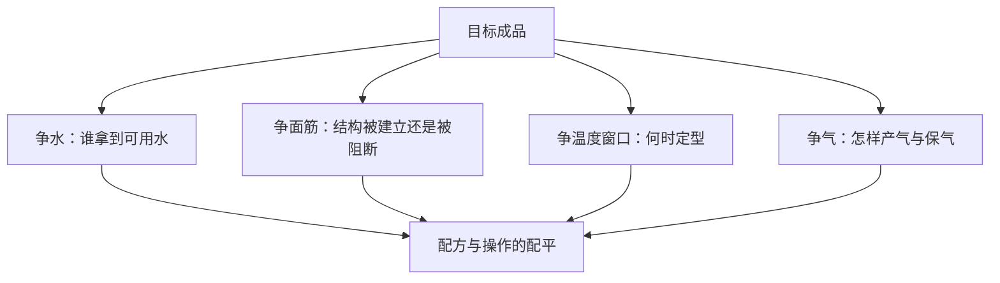

# 第 41 章 配方平衡：一份配方是几组竞争关系的配平

“配方平衡”不是存在一组适合所有成品的神秘比例。它是：为了你要的成品，在水、结构、定型和气之间做出一组能自洽的取舍。先确定目标，再看这份配方让谁优先。

## 41.1 四本账要同时算

| 账 | 要问的问题 | 例子 |
|----|------------|------|
| 水 | 水被谁占用、谁还需要水合？ | 糖、盐、蛋白和淀粉不会各自独立用水 |
| 结构 | 网络要建立、减弱还是分层？ | 面筋、蛋白、脂肪与搅拌共同决定 |
| 定型 | 膨胀窗口何时关闭？ | 水量、糖、热与模具共同影响 |
| 气 | 气从哪来、由谁留住？ | 酵母、膨松剂、泡沫或蒸汽都仍需结构 |

同一个原料可能同时进入几本账。糖既竞争水又推迟糊化；油脂既能阻断面筋，也会影响气室；盐同时影响水合、网络与发酵。因此，不能用“只改甜度”理解减糖。

## 41.2 平衡只对目标成立

| 目标 | 通常更优先的关系 | 可能牺牲的关系 |
|------|------------------|----------------|
| 有支撑的面包 | 保气网络与恰当定型 | 过度柔软或过度摊开 |
| 酥松饼干 | 受限的面筋与较晚定型 | 高大、弹韧组织 |
| 轻盈蛋糕 | 泡沫、乳化与定型接力 | 长时间操作容错 |
| 分层酥皮 | 固态脂肪维持边界 | 面团的自由延展 |

这张表不是配方推荐。它只说明：目标不同，“平衡”的含义不同。把饼干按面包的结构目标修正，或把欧包按蛋糕的泡沫目标修正，都会把问题带偏。

## 41.3 用一张平衡卡读配方

先把配方换算为烘焙百分比（面粉总量为 100%），再填空。未知信息保留为空，不用经验补齐。

| 项目 | 这份配方中的证据 | 我的判断 | 要验证的观察 |
|------|------------------|----------|--------------|
| 目标成品 | | | |
| 水的主要去向 | | | |
| 主要结构来源 | | | |
| 定型的主要路径 | | | |
| 气源与保气者 | | | |
| 一个最可能的代价 | | | |

研究可为方向提供证据，但不能替你跳过这张卡：例如盐在不同面粉条件下同时改变吸水、网络和发酵表现；糖会占水并抬高淀粉糊化温度；高水合的收益也可能伴随网络在发酵中断裂。配平必须放回具体配方与实际操作中读。

## 41.4 常见说法辨析

| 说法 | 判定 | 说明 |
|------|------|------|
| “平衡配方就是各原料比例平均” | ❌ | 平衡由目标决定；原料承担的角色并不对等。 |
| “只要水、粉比例对，其他都能随意换” | ❌ | 糖、油、蛋、盐和膨松体系同时改水、结构、定型与气。 |
| “一次成功就证明比例最佳” | ⚠️ | 一次结果只属于该原料、设备和操作条件；应复做或单变量比较。 |
| “数字越精确，配方越平衡” | ❌ | 精确称量有价值，但它不能替代对机制、目标和状态的判断。 |

## 41.5 思考题

1. 为什么减糖不只是改甜度？
2. 为什么“平衡”不能用一组跨品类的固定比例表示？
3. 若一份配方膨胀很好却冷却后回缩，应先查看哪两本账？

> 📖 **参考答案**：[Q1](../../qa/41-formulation-balance-qa.md#q1) · [Q2](../../qa/41-formulation-balance-qa.md#q2) · [Q3](../../qa/41-formulation-balance-qa.md#q3)

## 41.6 本章实操

### 🅐 零成本版：写一张平衡卡

从第 34～40 章任选一款成品的配方，完成 41.3 的表。最后写一句：若只能改一个变量，我改什么、预计它会连带影响哪两本账。

### 🅑 开火版：验证一个连带影响

做熟悉的配方时，只改一个明确的配方或操作变量；除目标现象外，至少记录一个连带结果。

| 唯一改动 | 预测的主变化 | 预测的连带变化 | 实际主变化 | 实际连带变化 | 下次验证 |
|----------|--------------|----------------|------------|--------------|----------|
| | | | | | |

## 41.7 🔎 下次烤之前的用处

别先问“该加多少”。先写目标成品，再问这项改动会动哪几本账；若无法回答，先做小批量、单变量的验证。

## 41.8 本章依据

- 第 1 章的四组竞争关系及第 2～9 章原料机制。
- 盐对水合、网络与发酵影响研究（2020、2026）；糖对小麦淀粉糊化与饼干定型的研究（2007、2009、2022）；水合与网络研究（2024）。
- 职业教材关于配方平衡的书目信息已登记，但页码级内容尚待核到纸本；本章不据此给跨品类的典型比例区间。

出处与限制见[参考书目与出处登记](../../standards.md)。
