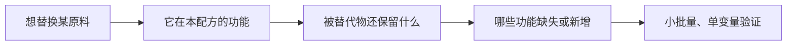

# 第 42 章 替换规则与代价：减糖、换油、换粉、换液体

替换不是寻找“长得像”的原料，而是逐项核对被替走的功能。等量只说明重量相同，不说明水、脂肪、蛋白、气泡、酸碱和定型路径相同。

## 42.1 先做功能账，再动配方

| 替换 | 不能只看 | 要核对的账 |
|------|----------|--------------|
| 减糖 / 换甜味剂 | 甜度 | 水、体积、糊化 / 定型、上色、发酵 |
| 黄油换油 | 脂肪克数 | 固态结构、打发、分层与水分 |
| 换粉 | 蛋白质标签 | 吸水、颗粒、损伤淀粉、面筋结构 |
| 换液体 | 液体体积 | 水、脂肪、蛋白、糖、盐与酸度 |
| 换蛋 | “一只蛋” | 起泡、乳化、凝胶与带入的水 |

## 42.2 四类常见替换

### 减糖：补的是功能，不是甜味

糖会竞争水、影响糊化和蛋白变性、参与上色，也会改变酵母环境与泡沫。研究指出，蔗糖抬高小麦淀粉糊化温度的能力强于许多甜味剂；因此按甜度 1:1 替换不能自动保住体积与定型。先写清此配方依赖糖的哪一项，再小步比较。

### 黄油换油：保留了一部分，失去了一部分

液态油可提供脂肪的部分“短化”作用，却不能替代固态黄油在打发充气或分层时的角色；黄油还带入水与乳固形物。能否接受取决于成品是否依赖这些功能，而非两者是否同重。

### 换粉：先适配水，再判断结构

全麦与白粉不只是颜色不同：颗粒、吸水和麸皮对网络的影响都会变。面粉吸水还受蛋白、损伤淀粉与非淀粉多糖共同影响。因此先保留部分液体、按面团状态记录，再决定是否需要动结构或操作；不把一次调整外推为通用换算。

### 换液体 / 换蛋：别把“有水”误判为“就是水”

液体可同时带入脂肪、蛋白、糖、盐和风味。蛋尤其同时提供起泡、乳化和凝胶；一项磅蛋糕研究中，所测商品蛋替代物均与全蛋对照有显著差异。若配方依赖打发，替换风险通常更高，应先小批量测试。

## 42.3 常见说法辨析

| 说法 | 判定 | 说明 |
|------|------|------|
| “按重量等量替换就行” | ❌ | 重量相同不等于功能相同。 |
| “代糖按甜度顶替砂糖” | ❌ | 甜度不能补回水、体积、糊化和上色功能。 |
| “全麦粉可以直接 1:1 换白粉” | ❌ | 吸水、颗粒和结构均已改变。 |
| “蛋替代品效果会完全一样” | ⚠️ | 能否使用取决于配方目标；已测产品与全蛋仍有显著差异。 |

## 42.4 思考题

1. 为什么黄油换油不只是“换一种脂肪”？
2. 为什么换粉时应先记录水合状态？
3. 为什么蛋替换必须先判断配方是否依赖打发？

> 📖 **参考答案**：[Q1](../../qa/42-substitution-tradeoffs-qa.md#q1) · [Q2](../../qa/42-substitution-tradeoffs-qa.md#q2) · [Q3](../../qa/42-substitution-tradeoffs-qa.md#q3)

## 42.5 本章实操

### 🅐 零成本版：替换前检查单

| 原料 | 本配方中它的功能 | 拟替代物保留什么 | 会缺失 / 新增什么 | 我先验证什么 |
|------|------------------|------------------|------------------|--------------|
| | | | | |

### 🅑 开火版：小批量单变量比较

保留基线配方；一次只替换一项，记录主目标和一个连带结果。涉及比例时，以面粉总量为 100% 写明烘焙百分比。

| 替换 | 其他保持不变 | 预测 | 实际 | 连带观察 | 下一次只改 |
|------|--------------|------|------|----------|--------------|
| | | | | | |

## 42.6 🔎 下次烤之前的用处

看到“可替换”先问：它替的是这份配方里的哪项功能？若答案不止一项，就别期待一个原料能无代价顶上全部。

## 42.7 本章依据

- 糖与小麦淀粉糊化研究（2022）、糖在饼干中推迟定型的研究（2009）。
- 面粉颗粒、吸水与面筋研究，见第 2、3、16 章。
- 脂质与面筋 / 气室关系综述（2011、2026），见第 5 章。
- 蛋与植物基替代物综述（2026）及商品蛋替代物磅蛋糕研究（2024）。

本章不提供通用换算比例；出处与限制见[参考书目与出处登记](../../standards.md)。
