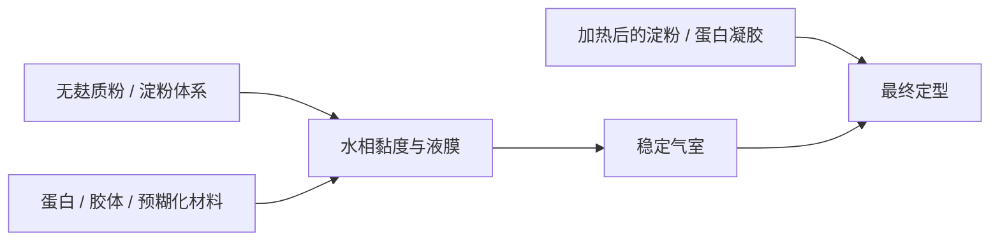

# 第 43 章 无麸质与特殊需求：只讲工艺与代价

本章只讨论无麸质烘焙的结构问题，不提供医疗、诊断或饮食治疗建议；是否需要避免麸质及具体食品安全要求，应遵循当地医疗专业人士与监管机构的现行指引。

没有小麦面筋，不等于没有结构；问题变成：谁提供黏度、谁稳定气室、谁在烘烤中定型，以及这些替代会带来什么口感与操作代价。

## 43.1 把“面筋”拆回它原来做的事

| 原先由面筋参与的任务 | 无麸质体系要另行解决的问题 |
|------------------------|------------------------------|
| 延展又不断裂的网络 | 面糊 / 面团是否有合适的黏度与流动性 |
| 气室壁 | 液膜、蛋白和胶体能否暂时保气 |
| 烘烤后的骨架 | 淀粉糊化、蛋白凝胶或其他结构何时接手 |
| 操作容错 | 水合、搅拌、静置和模具如何配合 |

气室并非只由面筋稳定：综述指出，面筋网络局部破裂后，非淀粉多糖与表面活性蛋白、脂质构成的液膜仍可参与稳定。这解释了无麸质体系为什么常需要把“谁当气室壁”写得更清楚。

## 43.2 替代材料不是单一答案

| 材料角色 | 可能承担的工艺任务 | 代价 / 待验证项 |
|----------|------------------|----------------|
| 淀粉与粉类 | 主体、吸水、受热定型 | 水合与口感会随来源变化 |
| 胶体 | 增黏、持水、帮助液膜 | 可能改变强度、弹性与口感 |
| 蛋白 | 起泡或热凝胶结构 | pH、糖、盐和加热条件都会改变表现 |
| 预糊化材料 / 汤种 | 预先组织一部分水 | 需连带调整总水量 |
| 乳蛋白（非纯素方案） | 可作为结构材料之一 | 不等于能复刻小麦面筋 |

现有研究中，黄原胶在蛋清凝胶模型里提高持水性但降低硬度与强度；无麸质面包综述也将酪蛋白酸盐与乳清浓缩蛋白列为结构化配料。它们说明可替代的是部分功能，不说明存在通用“最佳胶体”或固定用量。

## 43.3 读无麸质配方时的三问

1. **气从哪里来？** 酵母、化学膨松、打发或蒸汽仍各有不同路径。
2. **入炉前谁在保气？** 看黏度、胶体、蛋白和操作，而不是默认“像面团就行”。
3. **进炉后谁来定型？** 看淀粉、蛋白、预糊化材料和烘烤条件是否接力。

米粉主体方包的研究显示，加入水 roux 后含水量与比容提高、硬度等指标下降；但消费者接受度分成两派。它是“结构改善仍需接受目标检验”的例子，不是可直接移植到所有无麸质配方的比例。

## 43.4 常见说法辨析

| 说法 | 判定 | 说明 |
|------|------|------|
| “无麸质就无法保气” | ❌ | 液膜、胶体、蛋白与定型接力仍可参与保气。 |
| “加一种胶就能复制小麦面包” | ❌ | 胶体只承担部分功能，水合、气源和热定型仍需一起配平。 |
| “无麸质配方可直接套小麦面团操作” | ⚠️ | 目标黏度、操作和定型路径可能不同，应以状态与小试验证。 |
| “无麸质必然更健康” | 不在本书范围 | 这是营养 / 医疗命题，本章不作判断。 |

## 43.5 思考题

1. 无麸质体系为什么仍需同时考虑产气、保气与定型？
2. 为什么胶体不能被理解为“面筋替身”的完整等号？
3. 为什么无麸质配方的总水量不能照搬小麦配方？

> 📖 **参考答案**：[Q1](../../qa/43-gluten-free-structure-qa.md#q1) · [Q2](../../qa/43-gluten-free-structure-qa.md#q2) · [Q3](../../qa/43-gluten-free-structure-qa.md#q3)

## 43.6 本章实操

### 🅐 零成本版：结构地图

找一份无麸质烘焙配方，按下表标出原料功能；配方没写的信息标“未知”。

| 原料 / 步骤 | 水合与黏度 | 气源 / 保气 | 热定型 | 我不确定的地方 |
|-------------|------------|-------------|--------|----------------|
| | | | | |

### 🅑 开火版：只验证一个结构环节

选熟悉的配方，仅改变一个已明确的变量，其他条件保持一致。不要将结果解释成医疗或营养结论。

| 唯一变量 | 入炉前流动 / 保气状态 | 出炉体积 / 表皮 | 冷却后结构 | 下次验证 |
|----------|------------------------|-----------------|------------|----------|
| | | | | |

## 43.7 🔎 下次烤之前的用处

别问“用什么替代面筋”就结束。把它改写成四个具体问题：主体粉类、可用水、气室壁和热定型分别由谁负责；这会让配方缺口立刻可见。

## 43.8 本章依据

- 气室稳定与液膜综述，见第 10 章。
- 蛋清凝胶中胶体对持水 / 强度影响的研究（2019）。
- 无麸质面包质构综述（2026）：乳蛋白可作为结构化材料之一。
- 米粉方包水 roux 研究（2016）：只采用方向，不外推配比。

出处与限制见[参考书目与出处登记](../../standards.md)。
