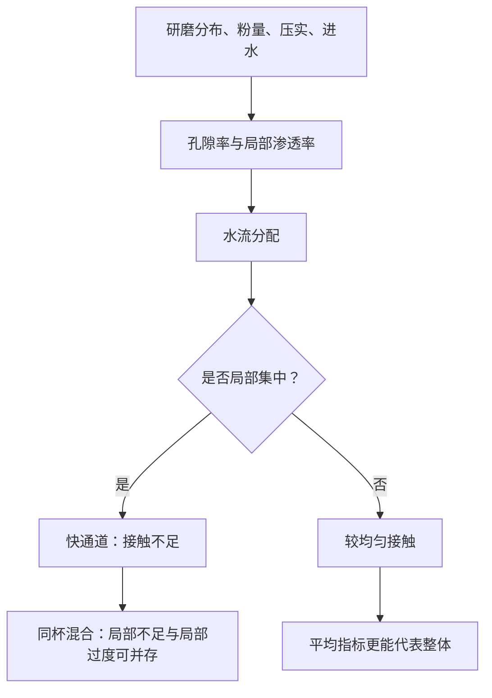

# 第 25 章 床层力学与通道效应：为什么“均匀”常常比参数正确更重要

滤过与意式冲煮不是水穿过一堆静止粉末那么简单。咖啡粉形成一个多孔床层；水会优先经过阻力较小的路径，
于是同一杯中可同时存在局部萃取不足与局部萃取过度。杯中平均 TDS 或平均萃取率因此不能独自证明萃取均匀。

## 25.1 床层把研磨、压实和流动连在一起

床层的孔隙率、颗粒形状与粒径分布共同决定渗透率；渗透率再影响流速、接触时间和对流传质。2023 年意式
实验表明，即使平均粒径较大，较低的床层孔隙率也可能带来低渗透率；压实力、平均粒径与分布均匀性必须一起
理解，不能只用“磨细/磨粗”解释流速。[^bed]

## 25.2 “通道”是流动不均，不是单一肉眼症状

通道效应指水流在床层中空间分配不均，优先经过低阻力区域。它可能由进水不均、床层高度/几何、局部裂缝、
粒径分层、压实差异或冲煮过程中的结构变化共同造成。CFD 研究指出，进水分布与床层几何产生的非均匀流动会
影响局部萃取图；这是滤过与意式等多孔床冲煮共有的问题。[^cfd]

看到底部喷溅、流速忽快忽慢、粉床局部凹陷或口感同时尖酸与粗苦，只能把它们当作**排查线索**，不能单独
宣判“发生通道”。先记录配方和过程，再做单变量对照。

## 25.3 细粉：既能降流速，也会增加不均匀风险

2024 年关于意式细粉的研究发现，细粉比例提高会降低渗透率、减慢流速并延长萃取时间。[^fines] 这并不推出
“细粉越少越好”或“慢流一定均匀”：细粉、压实、粉量和篮筐几何会共同改变床层。对滤杯，细粉在滤纸附近的
行为和注水造成的扰动还可能使流动更复杂；本书不把未经直接比较的民间“细粉迁移位置图”当作定论。

## 25.4 排查顺序：先稳定输入，再判断味道

| 现象 | 先固定什么 | 下一步只改一个变量 |
|------|------------|--------------------|
| 同配方流速波动大 | 粉量、研磨、投水、器具清洁与秤 | 布粉/湿润/注水分布 |
| 既尖酸又粗苦 | 总配方、温度与成品重量 | 床层准备或研磨分布，不先盲目拉长时间 |
| 明显堵塞/极慢流 | 磨豆机状态、细粉、滤纸和粉量 | 稍粗研磨或调整粉量，观察流速与口感 |
| 底部喷溅/局部凹陷 | 记录视频、进水与压实方式 | 优先改善均匀湿润/进水，不用单一外观下结论 |

## 25.5 常见说法辨析

| 说法 | 判定 | 说明 |
|------|------|------|
| “时间对了就一定萃得均匀” | ❌ 明确错误 | 相同总时间下，局部流速和接触仍可不同。 |
| “慢流就是通道” | ⚠️ 不准确 | 慢流也可来自细粉、低渗透率或粉量；通道是空间分配问题。 |
| “压粉越重越均匀” | 缺乏通用证据 | 压实会改变孔隙率，但与粒径分布、篮筐和进水共同作用。 |
| “底部喷溅就能诊断全部问题” | ⚠️ 只是线索 | 外观不替代对配方、口感与重复性的对照。 |

## 25.6 🔎 买豆与冲煮时的用处

当配方数字看似正确但每杯表现不稳定，先停止同时改研磨、粉量、时间和注水。用同一支豆固定输入，优先让
湿润、布粉与进水更可重复；再一次只动一个变量，才能分辨是平均萃取不足还是床层不均。

## 25.7 思考题

1. 为什么平均萃取率不能单独证明床层萃取均匀？
2. 为什么“流速慢”不能直接等同于通道？
3. 【案例】同一配方有时尖酸、有时粗苦，时间相近。你怎样设计下一轮对照？

> 📖 **参考答案**（想清楚再看）：[Q1](../../qa/25-bed-mechanics-channeling-qa.md#q1) · [Q2](../../qa/25-bed-mechanics-channeling-qa.md#q2) · [Q3](../../qa/25-bed-mechanics-channeling-qa.md#q3)

## 25.8 本章实操

### 🅐 无器具版

用已有冲煮记录建立“输入—流速—口感”三栏表。挑两次表现差异大的记录，只标出已知事实与未知项，不用
“通道”替代原因；为下一次只选择一个要改变的变量。

### 🅑 有条件版

备齐秤、计时器与手机：连续录制注水/萃取过程，固定粉量、水量、研磨和温度，连续三次只比较一种布粉或
湿润方式。记录总时间、出液重量、可见过程和口感；不要用破坏粉饼或单一视频画面作鉴定结论。

## 25.9 本章主要参考

| 来源 | 本章用途 |
|------|----------|
| [Vaca Guerra et al., *Journal of Food Engineering* (2023)](https://doi.org/10.1016/j.jfoodeng.2022.111301) | 粒径分布、压实、孔隙率、渗透率与流速的实验/模型关系 |
| [Moroney et al., *PLOS ONE* (2019)](https://doi.org/10.1371/journal.pone.0219906) | 进水、几何与非均匀流动/萃取的 CFD 分析 |
| [The role of fines in espresso extraction dynamics (2024)](https://pubmed.ncbi.nlm.nih.gov/38453983/) | 细粉比例、渗透率、流速和时间的关系 |

[^bed]: 该研究是特定意式床层和设备条件下的结果，不能直接转换成所有手冲或所有磨豆机的固定参数。
[^cfd]: CFD 模型用于解释机制与设备设计，不等于对任一家庭冲煮的直接诊断。
[^fines]: 细粉定义和比例取决于测量方法与磨豆机；比较时先统一测量口径。
