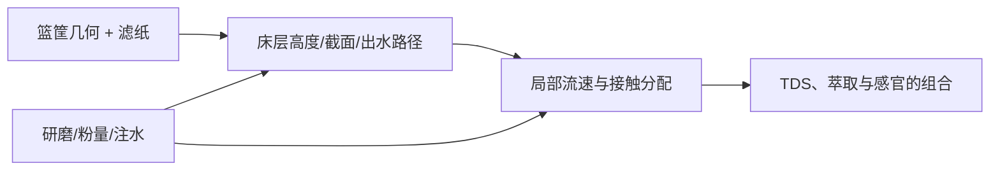

# 第 26 章 手冲①：滤杯几何、滤材与流速

锥形、半锥形、平底和挂耳不是“更甜/更清晰”的固定风味开关。它们改变床层形状、进出水路径、滤纸接触与
流动阻力；最终结果还取决于研磨、粉量、注水、水和具体滤材。

## 26.1 几何改变的是流场

一项以半锥形和平底滴滤篮筐作对照的受训评审研究发现，在相同咖啡、水温与流速条件下，仅改变篮筐几何就能
产生统计上可分辨的感官差异；它没有宣布哪种“更好”。[^geometry]

因此，换滤杯后不能照抄旧研磨、旧注水和旧总时间；先把它当成一套新水力系统重新标定。

## 26.2 滤纸不只是“过滤渣”

滤纸会保留一部分悬浮颗粒和油脂相关组分，也提供流动阻力；纸张、折法、贴合、预湿及细粉在纸面附近的堆积
都会影响出液。可靠的方向性结论是：滤纸与床层共同构成流动阻力，细粉增加会降低床层渗透率、使流速变慢。[^fines]
本书未找到可跨品牌通用的“滤纸快慢排序”同行评议表，不把纸张厚薄或价格直接翻译成风味结论。

## 26.3 调试顺序

| 换了什么 | 先固定 | 再调整 |
|----------|--------|--------|
| 换滤杯/篮筐 | 豆、粉量、总水量、水温 | 先研磨，再注水结构 |
| 换滤纸 | 滤杯、粉量、注水 | 记录总时间与口感，微调研磨 |
| 由锥形换平底 | 不照搬旧时间 | 重新建立可接受流速范围 |

## 26.4 常见说法辨析

| 说法 | 判定 | 说明 |
|------|------|------|
| “锥形一定更均匀/平底一定更甜” | ❌ 明确错误 | 几何可造成可分辨差异，但无跨豆、跨参数的固定优劣。 |
| “滤纸只影响口感，不影响流速” | ❌ 明确错误 | 滤纸与床层共同提供阻力，细粉堆积也会改变出液。 |
| “换滤杯仍能照抄同一研磨刻度” | ⚠️ 不可靠 | 几何和滤材改变流动条件，应重新标定。 |

## 26.5 🔎 买豆与冲煮时的用处

新滤杯的第一杯不是拿来评判豆子，而是拿来建立基线：记录粉量、研磨、滤纸、注水、总时间与口感。只要换了
几何或滤材，就把旧配方视为起点，不是标准答案。

## 26.6 思考题

1. 为什么篮筐几何能改变感官，而不等于一种几何更好？
2. 为什么换滤纸后应重新观察流速？
3. 【案例】同一豆换平底滤杯后明显变慢，你先改什么？

> 📖 **参考答案**（想清楚再看）：[Q1](../../qa/26-filter-geometry-qa.md#q1) · [Q2](../../qa/26-filter-geometry-qa.md#q2) · [Q3](../../qa/26-filter-geometry-qa.md#q3)

## 26.7 本章实操

### 🅐 无器具版

搜集两种滤杯的结构图，写下床层形状、出水口和滤纸接触差异；为任一商品页列出它没有告诉你的研磨与注水条件。

### 🅑 有条件版

用同一支豆、粉量、水量、水温和注水方式，分别冲两种滤杯；记录总时间和感官。第二轮只调研磨，不同时改注水。

## 26.8 本章主要参考

| 来源 | 本章用途 |
|------|----------|
| [Frost et al., *Journal of Food Science* (2019)](https://doi.org/10.1111/1750-3841.14696) | 半锥形/平底篮筐对滴滤感官与 TDS 的对照研究 |
| [SCA：Flat vs. Cone](https://sca.coffee/sca-news/25-magazine/issue-8/english/flat-vs-cone-basket-shape-is-as-important-as-grind-size-in-drip-brew-coffee-25-magazine-issue-8-lpgsg) | 研究团队对几何、流动与“没有万能最佳”的说明 |
| [细粉与意式流动研究](https://pmc.ncbi.nlm.nih.gov/articles/PMC10920694/) | 细粉、渗透率与流速关系的直接实验 |

[^geometry]: 该研究测试的是特定装置与条件；可分辨差异不等于能从外观预测每支豆的偏好。
[^fines]: 细粉效应与床层、研磨分布、器具有关；第 25 章展开其边界。
