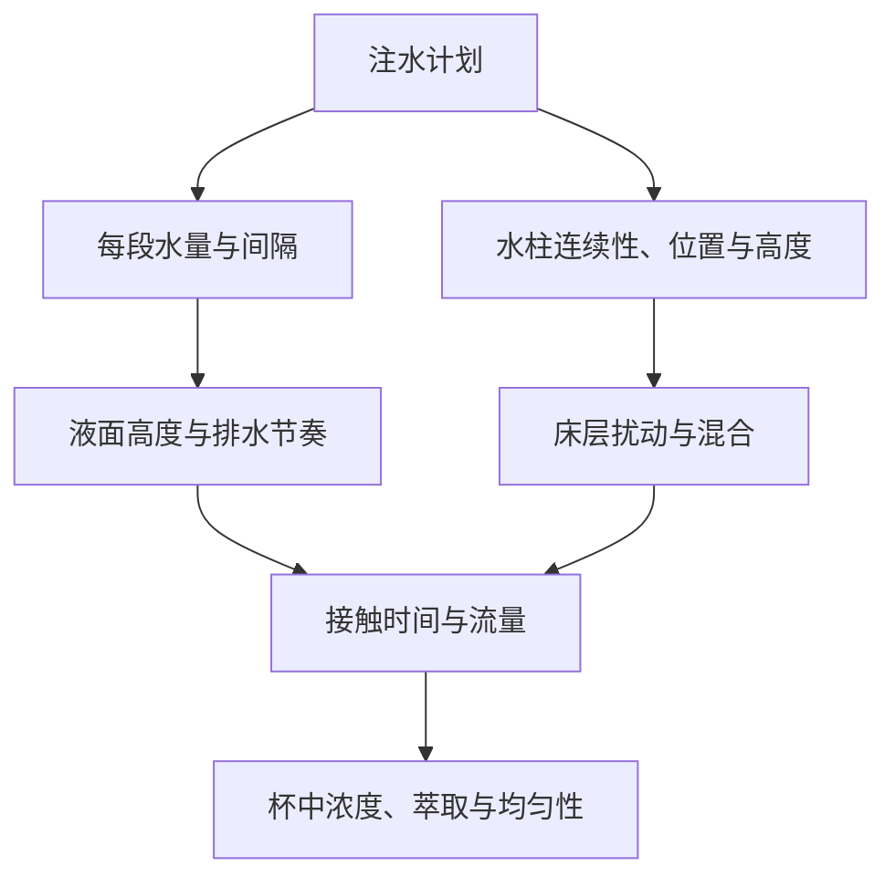
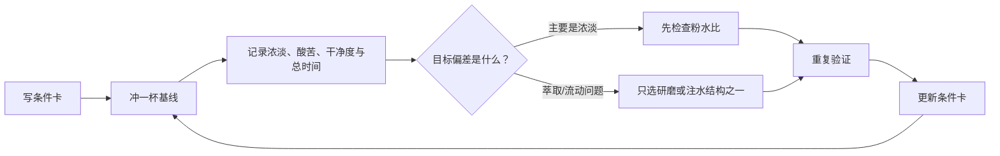

# 第 27 章 手冲②：注水法与配方设计

配方不是一串可以跨器具、跨豆子照抄的数字，而是一张可复现的**条件卡**：在特定豆子、研磨、滤杯、水和
注水方式下，得到某种杯中表现。它的价值在于下一次能复现，也能知道失败时先改哪一个变量。

## 27.1 注水在控制什么

手冲的注水至少同时改变三个东西：给粉层补多少水、以什么流态冲击床层、以及床层在何时排空。水柱冲击颗粒床
可引起“雪崩式”混合；2025 年的流体研究指出，连续而不破碎的水柱比破碎成水滴的水柱更能产生这种混合。[^jet]
这不等于“越高、越猛越好”：过强冲击也可能扰动床层，最终仍须以重复性和杯中结果检验。

“闷蒸”“绕圈”“中心注水”“几段水”是描述动作的词，不是机制结论。对同一动作，滤杯几何、粉床深度、研磨和
水柱状态都可能改变结果。

## 27.2 先写条件卡，再谈配方

一张最小可复现条件卡至少有以下字段；没有记录，所谓“配方”只是一次记忆。

| 类别 | 必填记录 | 为什么 |
|------|----------|--------|
| 原料 | 豆、烘焙日期、粉量 | 原料变化会改变可溶物与流动 |
| 固定硬件 | 滤杯、滤纸、磨豆机刻度 | 几何与粒径分布不能省略 |
| 水 | 总水量、温度、水源/配方 | 决定浓度与传质条件 |
| 注水 | 各段累计水量、开始/结束时间、主要动作 | 让水流输入可复现 |
| 输出 | 总时间、杯中感受；有条件再测 TDS | 用输出检验，而非迷信过程数字 |

粉水比首先定义目标浓淡；研磨、温度、注水和流速共同影响萃取与均匀性。不要把总时间单独当“正确性”证明：它是
上述输入共同产生的结果。

## 27.3 一个低成本调试循环

先选一个可喝的基线，不追求第一杯就“最佳”。随后每次只改变一个计划内变量，并至少复做一次确认。

| 观察 | 先问的问题 | 下一杯的单变量动作 |
|------|------------|--------------------|
| 明显太浓或太淡 | 目标粉水比是否合适？ | 只改总水量或粉量，保留其余条件 |
| 同配方每杯时间差很大 | 注水、研磨、称量是否稳定？ | 先重复，不急着改刻度 |
| 流速异常慢且杯感不干净 | 床层/细粉/滤纸是否改变？ | 检查第 25、26 章条件；只微调研磨或注水之一 |
| 结果稳定但不合口味 | 是浓淡，还是成分格局？ | 先用粉水比调浓淡；再单变量调萃取条件 |

## 27.4 常见说法辨析

| 说法 | 判定 | 说明 |
|------|------|------|
| “三段注水一定比一段更甜” | ❌ 明确错误 | 尚无可跨豆、跨器具成立的固定优劣；分段只是不同输入。 |
| “总时间到了，配方就成功” | ❌ 明确错误 | 同样时间可能来自不同流量分配与均匀性。 |
| “每杯只改一个变量” | ✅ 有用的方法 | 它提高归因能力；前提是其余输入确实可重复。 |
| “水柱越高越好” | ⚠️ 过度外推 | 连续水柱的混合机制有依据，但高度与冲击仍受器具、床层和水柱是否破碎限制。 |

## 27.5 🔎 买豆与冲煮时的用处

新豆第一杯只做一件事：建立基线条件卡。若更换烘焙批次、滤纸或磨豆机，不要宣称“旧配方失效”；先记录变化，
用一两次单变量调整把它重新接上。这样也能区分是豆子本身的差异，还是流程漂移。

## 27.6 思考题

1. 为什么“分三段注水”本身不是一个可比较的配方？
2. 同一条件卡连续两杯总时间相差很大，为什么不应先调研磨？
3. 【案例】一杯既觉得淡又觉得涩，你如何决定先调粉水比还是研磨？

> 📖 **参考答案**（想清楚再看）：[Q1](../../qa/27-pouring-recipes-qa.md#q1) · [Q2](../../qa/27-pouring-recipes-qa.md#q2) · [Q3](../../qa/27-pouring-recipes-qa.md#q3)

## 27.7 本章实操

### 🅐 无器具版

任选一份网上手冲“配方”，把它改写为条件卡：补出它遗漏的豆、滤杯、滤纸、磨豆机、注水动作和判断标准。然后写出
其中至少两个无法由原文复现的空白。

### 🅑 有条件版

固定豆、粉量、水量、温度、滤杯和研磨，连续冲两杯同一注水计划，记录每段累计水量、总时间和口感。只有两杯足够
接近时，第三杯才只改变一项注水变量（例如段数或水柱位置），再与基线比较。

## 27.8 本章主要参考

| 来源 | 本章用途 |
|------|----------|
| [Park, Young & Mathijssen, *Physics of Fluids* (2025)](https://doi.org/10.1063/5.0257924) | 水柱冲击颗粒床与雪崩式混合的物理机制 |
| [第 24 章：水温、时间与搅拌](../04-extraction/24-temperature-time-agitation.md) | 速度变量与滤过式水柱混合的边界 |
| [第 25 章：床层力学与通道效应](../04-extraction/25-bed-mechanics-channeling.md) | 以重复性和均匀性诊断流动问题 |

[^jet]: 本书编号 [WT4]：Park、Young & Mathijssen（2025），论文全文未开放；机制由作者机构公开说明逐句核对。它说明的是特定实验体系中的混合，不提供万能的注水高度或流量数值。
