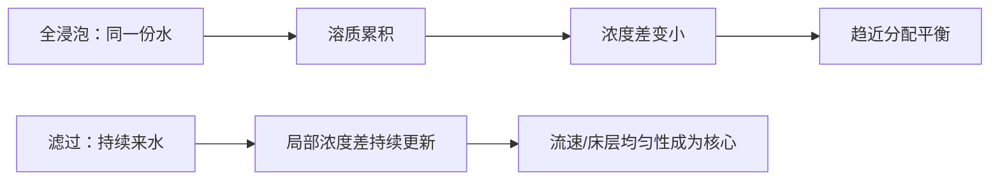

# 第 28 章 浸泡式：法压壶、聪明杯与冷萃

浸泡式的关键不是“泡得久”，而是水与咖啡在同一容器内逐渐接近平衡；滤过式则不断以较低浓度的新水穿过床层。
法压壶、聪明杯的浸泡阶段与冷萃共享这个底层结构，但滤材、排液方式、温度和保存方式仍会显著改变杯中结果。

## 28.1 从流动结构区分器具

| 类型 | 水如何接触咖啡 | 主要控制点 | 典型边界 |
|------|----------------|------------|----------|
| 法压壶 | 全程浸泡，金属网分离粉渣 | 粉水比、浸泡到何时分离、滤网 | 更多微粒与油脂相关组分进入杯中 |
| 聪明杯等阀门滤杯 | 先浸泡，开阀后滤过 | 浸泡阶段 + 排液顺畅度 | 仍有滤纸过滤，排液阶段不可忽略 |
| 冷萃 | 低温、长时间浸泡后分离 | 温度、接触时间、卫生与保存 | 不等于把热萃配方“拉长” |

Liang 等对全浸泡体系的实验与模型表明，在其测试条件内，达到平衡后萃取率对冲煮比基本不敏感；粉水比主要改变
的是浓度。[^immersion] 所以若法压壶太淡，首先问粉水比，而不是无限延长浸泡。

## 28.2 滤材改变的不只是“干净程度”

金属滤网与滤纸对微粒和油脂相关组分的保留不同；这会改变口感和杯中组成。实测中，滤纸冲煮的咖啡醇与咖啡豆醇
浓度远低于煮沸类样品，说明“过滤方式不同”有物质层面的含义。[^filter] 这不是“哪种更高级”，而是选择你要的
质地、清晰度与清洁便利性。

聪明杯一类器具将浸泡与纸滤串联：浸泡阶段遵循平衡逻辑，开阀后的纸滤则重新引入流动阻力。因此应记录“何时开阀、
排液是否异常”，不能只记录总时间。

## 28.3 冷萃：慢，但不是无限慢

一项室温（21–25 ℃）冷萃研究对 3-CGA 和咖啡因测得：两者在约 6–7 小时达到平衡；该研究中研磨粗细对两种成分的
平衡浓度未呈显著影响。[^cold] 这只说明特定原料与两种分析物，不能推出所有风味物、所有温度或所有冷萃配方都在
同一时刻完成。

低温会放慢传质，且与热萃得到的成分与感官格局并不相同；把“低温”自动翻译为“低酸”“更顺口”或“更健康”都超出
现有证据。需要更浓时，先设计粉水比与是否稀释；需要更干净时，考虑分离方式与滤材，而不是只加长时间。

## 28.4 卫生与保存不是配方变量

冷萃是即饮饮品的家庭制备，不应把长时间室温放置当作“保鲜工艺”。器具要洗净；制成后及时冷藏、使用带盖容器，并
按当地食品安全指引处理。FDA 的一般食品安全建议是：冰箱应维持在 4 ℃ 或以下，冷藏会减缓而不是消灭微生物；它也
不替代当地监管要求或商业产品的工艺验证。[^safety]

## 28.5 常见说法辨析

| 说法 | 判定 | 说明 |
|------|------|------|
| “法压壶泡越久越浓” | ❌ 明确错误 | 接近平衡后，继续等待的收益会很小；浓淡优先由粉水比决定。 |
| “冷萃必须过夜才萃得出” | ⚠️ 不可靠 | 一项室温研究的两种成分约 6–7 小时达平衡；但不能替代你自己的条件验证。 |
| “冷萃更健康/绝对低酸” | ❌ 证据不足 | 冲煮温度会改变成分格局，不构成健康结论，也不能替代酸度测量。 |
| “冷藏会杀菌，所以能无限保存” | ❌ 明确错误 | 冷藏主要减缓生长，不是灭菌或商业保存验证。 |

## 28.6 🔎 买豆与冲煮时的用处

想要浸泡式的厚度，选金属滤网；想减少微粒与油脂相关组分，选纸滤或在法压后再过纸。测试冷萃时，将“接触时间”
与“保存时间”分开记录：前者是萃取实验，后者是食品保存问题。

## 28.7 思考题

1. 为什么全浸泡式里粉水比首先改变的是浓度？
2. 为什么聪明杯不能只按“法压壶”或“手冲”其中一种理解？
3. 【案例】你把冷萃延长一倍，口感却几乎没变。下一步应记录和检查什么？

> 📖 **参考答案**（想清楚再看）：[Q1](../../qa/28-immersion-cold-brew-qa.md#q1) · [Q2](../../qa/28-immersion-cold-brew-qa.md#q2) · [Q3](../../qa/28-immersion-cold-brew-qa.md#q3)

## 28.8 本章实操

### 🅐 无器具版

找两份冷萃配方，分别标出“接触时间”“过滤方式”“是否稀释”“保存说明”。若它只写“泡一夜”，请标注它没有
说明的温度、粉水比和保存信息。

### 🅑 有条件版

用同一支豆和粉水比做两份浸泡：一份金属滤网分离、一份再经纸滤分离。记录浓淡、口感与清洁便利性。冷萃则做
两个相邻接触时长的对照，制成后及时冷藏；不要把家庭实验外推为保质期结论。

## 28.9 本章主要参考

| 来源 | 本章用途 |
|------|----------|
| [Liang, Chan & Ristenpart, *Scientific Reports* (2021)](https://doi.org/10.1038/s41598-021-85787-1) | 全浸泡的平衡脱附模型与粉水比/萃取率边界 |
| [Fuller & Rao, *Scientific Reports* (2017)](https://doi.org/10.1038/s41598-017-18247-4) | 室温冷萃中两种成分的时间过程 |
| [FDA：冰箱温度与冷藏](https://www.fda.gov/food/buy-store-serve-safe-food/refrigerator-thermometers-cold-facts-about-food-safety) | 家庭冷藏的通用食品安全提示 |

[^immersion]: 本书编号 [GC2]；其结论适用于所测试的全浸泡条件，不是所有器具的万能萃取率数字。
[^filter]: 本书编号 [A5]；比较的是特定冲煮方式的浓度，不能直接换算为个人摄入或健康判断。
[^cold]: 本书编号 [WT2]；只测 3-CGA 与咖啡因，不能把 6–7 小时写成一切冷萃的标准时长。
[^safety]: [FDA 的冰箱温度建议](https://www.fda.gov/food/buy-store-serve-safe-food/refrigerator-thermometers-cold-facts-about-food-safety)是美国通用消费者指引；冷藏不等于灭菌，商业销售需遵循所在地法规和经验证工艺。
