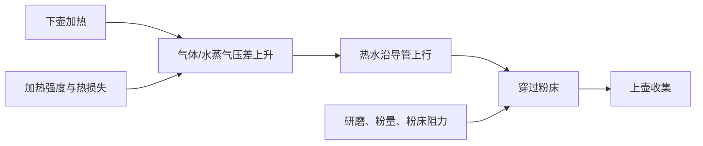
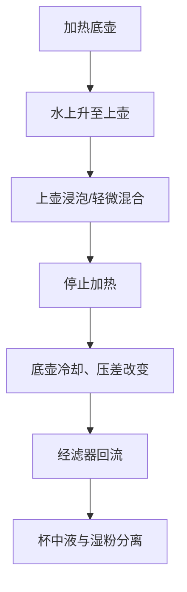

# 第 29 章 摩卡壶与虹吸壶：压力、加热与回流

摩卡壶和虹吸壶都把热量转成流动，但不是同一种压力器具。摩卡壶由下壶气体与水蒸气造成的压差把水推过粉床；
虹吸壶则在加热时把水推到上壶、停火后让液体经滤器回到下壶。两者都不能按意式的压力、粉饼与时间逻辑照抄。

## 29.1 摩卡壶：压差驱动的一次滤过

实验研究表明，摩卡壶的萃取在远低于常压沸点时就会开始，且受下壶初始空气量、加热过程和粉床渗透率影响。[^moka]
因此“必须等水完全沸腾才开始萃取”不正确；随着加热继续，驱动力与流速也会变化，并非恒定压力的一次冲煮。

摩卡壶使用压力，但研究描述的装置与典型意式所需的高压、短时、紧实粉饼不是同一工作区间。把它叫作“炉上浓咖啡”
可以帮助理解浓度，叫作“小意式”则会掩盖关键差别。

## 29.2 虹吸壶：两个阶段，两个问题

加热阶段，底壶的气体受热膨胀并把水推上；上壶形成浸泡与搅拌的阶段。离火后，底壶冷却、压力下降，液体在重力、
液体连续性与压差共同作用下通过滤器回流。所谓“真空虹吸”是对外观的简写，不应理解为上壶真的处在完全真空中；
虹吸本身也并不只靠大气压工作。[^siphon]

对虹吸壶，记录应至少包含：加热方式、上水后何时投粉、浸泡与搅拌、何时停火、回流是否顺畅。仅记录“总时长”不足以
还原两个阶段的输入。

## 29.3 调试次序

| 现象 | 先检查 | 不要急着做的事 |
|------|--------|----------------|
| 摩卡壶出液忽快忽慢 | 加热是否稳定、粉床是否堵塞、密封与导管是否清洁 | 用力压粉或把研磨一次改很多格 |
| 摩卡壶末段出现喷溅/声音变化 | 视为阶段切换信号，记录并比较杯感 | 把所有末段表现归因于“豆子不新鲜” |
| 虹吸回流很慢 | 滤器装配、粉量、研磨、滤器清洁 | 只靠延长加热补救 |
| 虹吸杯感不稳定 | 投粉、搅拌、停火时点能否复现 | 同时换粉水比、研磨与火力 |

涉及压力、密封与热源的器具，优先遵循制造商的使用与维护说明；安全阀、密封件或玻璃器皿异常不是“配方问题”。

## 29.4 常见说法辨析

| 说法 | 判定 | 说明 |
|------|------|------|
| “摩卡壶就是低配意式” | ❌ 明确错误 | 都有一次滤过与压力，但压力形成、温度轨迹和粉床条件不同。 |
| “摩卡壶要等水沸腾才开始萃取” | ❌ 明确错误 | 实验显示萃取可在较低温度开始。 |
| “虹吸靠完全真空把咖啡吸回去” | ❌ 概念错误 | 回流涉及冷却后的压差、重力与液体连续性；完全真空并非必要。 |
| “总时间相同，结果就相同” | ❌ 明确错误 | 加热、上水、浸泡和回流的阶段分配也会改变结果。 |

## 29.5 🔎 买豆与冲煮时的用处

摩卡壶和虹吸壶先选能稳定操作的尺寸与热源匹配，再谈升级。买到陌生豆时，用熟悉的基线流程记录火力/热源、研磨、
粉量和阶段时间；一旦设备或密封状态变了，先恢复机械重复性，而非直接判定豆子“适不适合”。

## 29.6 思考题

1. 为什么摩卡壶不能按意式的参数表调试？
2. 为什么虹吸壶的“浸泡时间”不能代表完整冲煮过程？
3. 【案例】虹吸壶回流变慢，列出三个优先检查项。

> 📖 **参考答案**（想清楚再看）：[Q1](../../qa/29-moka-siphon-qa.md#q1) · [Q2](../../qa/29-moka-siphon-qa.md#q2) · [Q3](../../qa/29-moka-siphon-qa.md#q3)

## 29.7 本章实操

### 🅐 无器具版

画出摩卡壶与虹吸壶的水路图，为每种器具标出“热量在哪里进入”“水何时接触粉”“液体如何离开粉”。再找一份
“摩卡壶意式配方”，标出其中把两种器具混为一谈的条件。

### 🅑 有条件版

任选其一，连续两次固定豆、粉量和研磨。摩卡壶记录首次出液与末段状态；虹吸壶记录上水、投粉、停火和回流。第三次
只改变一个阶段变量，比较结果与重复性。器具异常时停止使用并按制造商说明检查。

## 29.8 本章主要参考

| 来源 | 本章用途 |
|------|----------|
| [Navarini et al., *Applied Thermal Engineering* (2009)](https://doi.org/10.1016/j.applthermaleng.2008.05.014) | 摩卡壶气体、温度、压差与粉床渗透率的实验研究 |
| [Boatwright, Puttick & Licence, *Journal of Chemical Education* (2011)](https://doi.org/10.1021/ed2001818) | 虹吸不依赖正大气压的实验说明 |

[^moka]: Navarini 等的研究针对一台标准商用摩卡壶；它支持机制判断，不给每种型号的通用研磨、火力或时间数字。
[^siphon]: 该论文研究一般虹吸物理，不是咖啡感官实验；本章只用它澄清“完全真空/只靠大气压”的机制误解。
