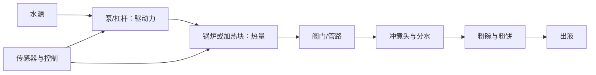

# 第 30 章 意式①：机器结构与它决定了什么

意式机不是“把 9 bar 打进咖啡”的单一部件，而是一条水路：水被加热、受泵或杠杆驱动、经冲煮头分布到粉饼，再由
粉饼阻力和阀门共同决定流量。机器能提供条件；杯中是否均匀，仍取决于研磨和粉饼制备。

## 30.1 从水路读机器

| 部件 | 它直接控制什么 | 不能保证什么 |
|------|----------------|--------------|
| 泵或杠杆 | 压差/供水方式 | 粉饼内水流均匀 |
| 锅炉、热交换器或加热块 | 水路的热输入与恢复特性 | 实际到粉饼的温度永远恒定 |
| 冲煮头、分水网 | 水进入粉碗的方式 | 粉饼本身没有裂隙 |
| 粉碗与手柄 | 粉饼的几何边界 | 研磨粒径分布一致 |
| 三通阀等泄压结构 | 萃取结束后的排压/排水路径 | 清洁或密封问题自动消失 |

工程资料对机器的共同描述是：泵提供驱动力，加热系统提供热量，冲煮头把水送往粉碗。[^machine] 但不同机型的
水路、控制逻辑与热容量不同，面板温度、压力表读数和粉饼入口处的真实条件不可直接画等号。

## 30.2 预浸泡是一个过程，不是一个神奇按钮

预浸泡可理解为在较低驱动力下让水进入粉饼，随后进入主萃取；它改变的是粉饼初始润湿与时间分配。它不能修复严重的
研磨分布、布粉或压粉问题，也不存在可跨机器照抄的固定时长。遇到一台新机器时，先确认它的预浸泡究竟是低压供水、
暂停、缓升压，还是只是程序命名，再把它作为一个可记录变量。

## 30.3 选购与调试先后

| 需求 | 优先看 | 原因 |
|------|--------|------|
| 连续出杯 | 热恢复、温度与流量的重复性 | 这是比较机器的可测工作能力 |
| 同时做奶饮 | 蒸汽与冲煮能否并行、恢复速度 | 不是“压力越高”能回答的问题 |
| 新手调试 | 能否稳定记录粉量、出液质量/时间，易否清洁 | 可重复比花哨曲线更先决 |
| 维护 | 水质要求、可获得的密封件与售后说明 | 水垢与老化会改变温度和流量 |

不要根据泵的标称最大压力判断一台机能否做出好咖啡；压力只是系统在阻力下的一个结果。先让机器按说明预热、清洁，
再用重复萃取观察输入与输出是否稳定。

## 30.4 常见说法辨析

| 说法 | 判定 | 说明 |
|------|------|------|
| “压力表到某数，萃取就一定正确” | ❌ 明确错误 | 表压、流量、温度和粉饼内部流动是不同变量。 |
| “预浸泡能解决通道” | ❌ 明确错误 | 它可能改变润湿过程，不能替代均匀制备。 |
| “锅炉越多一定越好喝” | ⚠️ 过度简化 | 多热源可能改变并行与恢复能力；好坏仍取决于具体实现与使用需求。 |
| “机器越贵，磨豆机越不重要” | ❌ 明确错误 | 研磨分布与粉饼阻力仍是意式系统的核心输入。 |

## 30.5 🔎 买豆与冲煮时的用处

买机前把预算先翻译成问题：一天几杯、是否连续做奶、能否接受预热、是否能稳定清洁和处理水质。买到新豆后，先用
固定机器状态建立一杯基线；若首杯与后续杯差异大，不要只调豆或刻度，先检查预热与恢复。

## 30.6 思考题

1. 为什么压力表不能替代对出液和粉饼的观察？
2. 为什么预浸泡应记录为过程而非一个固定秒数？
3. 【案例】同一配方首杯与第三杯差异很大，先查什么？

> 📖 **参考答案**（想清楚再看）：[Q1](../../qa/30-espresso-machine-qa.md#q1) · [Q2](../../qa/30-espresso-machine-qa.md#q2) · [Q3](../../qa/30-espresso-machine-qa.md#q3)

## 30.7 本章实操

### 🅐 无器具版

下载目标机型的说明书，画出水路并列出它实际提供的温度、压力、流量或预浸泡信息；把广告页中没有说明的条件标成
未知，而不是自行补成性能结论。

### 🅑 有条件版

机器完全按说明预热后，固定粉量、研磨和目标出液，连续做三杯。记录每杯的启动状态、出液质量、时间与口感；若差异
很大，先检查预热、清洁、水路与操作重复性，再进入下一章的粉饼制备。

## 30.8 本章主要参考

| 来源 | 本章用途 |
|------|----------|
| [ASME：Espresso machine engineering](https://www.asme.org/topics-resources/content/how-espresso-machines-work-the-engineering-inside) | 泵、锅炉、冲煮头和手柄的工程功能概览 |
| [第 25 章：床层力学与通道效应](../04-extraction/25-bed-mechanics-channeling.md) | 粉饼均匀性不能由机器压力替代 |

[^machine]: ASME 的说明用于部件功能与系统关系，不是对任何品牌、热系统或压力程序的性能排名。
