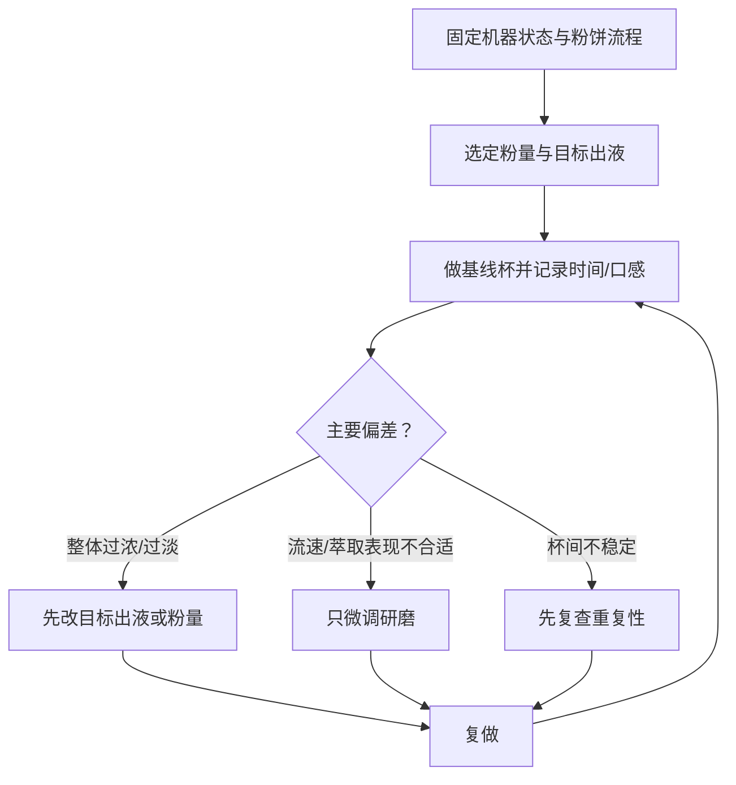

# 第 32 章 意式③：配方与调试

意式配方不是“粉量—时间—比例”三个孤立数字，而是给定豆子、磨豆机、粉碗和机器状态下的一组输入与输出。调试的
目的不是命中网传标准，而是在可重复条件中找到你认可的杯中表现，并知道每次改动在测试什么。

## 32.1 先把配方写完整

| 字段 | 记录什么 | 它回答的问题 |
|------|----------|--------------|
| 输入 | 豆、烘焙日期、粉量、研磨、粉碗 | 粉饼起点是否相同？ |
| 机器 | 预热、温度/程序、预浸泡、用水 | 水路条件是否相同？ |
| 输出 | 杯中出液质量、时间、感官 | 这杯实际发生了什么？ |
| 比例 | 出液质量 ÷ 粉量 | 杯中浓度目标如何比较？ |

时间是流动结果，不是独立开关；比例首先改变浓淡，而研磨、粉饼和机器条件一起改变流量与萃取。固定比例或固定时间
都不能保证相同口感。感官研究也显示，不同属性在浓度—萃取率平面的偏好区域并不重合。[^chart]

## 32.2 一个可检验的调试顺序

1. 固定机器预热、粉碗、粉量、制备流程与一个目标出液。
2. 连做两杯基线；若结果差异大，先处理重复性，暂不“调刻度”。
3. 若稳定但流速/杯感不合适，只小幅调整研磨，再复做。
4. 若主要问题是整体浓淡，先在其他条件固定时调整粉量或目标出液。
5. 每一轮写下假设，例如“只把研磨调细，测试流速变化是否能改善杯感”。

| 现象 | 先排除 | 最小下一步 |
|------|--------|------------|
| 连续杯时间大幅漂移 | 称量、制备、预热与清洁 | 原样复做并记录 |
| 稳定但明显太浓/太淡 | 是否把强度误认成酸苦 | 单改目标出液或粉量 |
| 稳定但流速/口感都不理想 | 粉饼流程是否已稳定 | 单改研磨 |
| 同时酸、苦、杂乱 | 不均匀流动的可能 | 先回到第 31 章做重复性检查 |

## 32.3 常见说法辨析

| 说法 | 判定 | 说明 |
|------|------|------|
| “某个比例就是所有豆的标准答案” | ❌ 明确错误 | 比例是浓淡坐标，不替代对豆、研磨和设备的标定。 |
| “时间偏离固定秒数就失败” | ❌ 明确错误 | 时间须与出液、流速、机器和感官一起解释。 |
| “一次只动一个变量” | ✅ 有用的方法 | 它让结果可归因，前提是其他输入真被固定。 |
| “高萃取率必然更难喝” | ❌ 过度简化 | 不同感官属性的关系不同，不能用单轴判定。 |

## 32.4 🔎 买豆与冲煮时的用处

换豆时先保留粉碗、机器状态和粉饼流程，做一杯完整基线。豆袋的烘焙度或“适合意式”只能提供起点，不能替代你的
配方记录。把每支豆的可接受窗口写成条件卡，下一次就不必从网络时间表重新猜起。

## 32.5 思考题

1. 为什么时间不是意式配方的独立目标？
2. 连续两杯的出液质量相同但口感不同，先检查什么？
3. 【案例】一杯稳定但太淡，你为什么不应先调细研磨？

> 📖 **参考答案**（想清楚再看）：[Q1](../../qa/32-espresso-dial-in-qa.md#q1) · [Q2](../../qa/32-espresso-dial-in-qa.md#q2) · [Q3](../../qa/32-espresso-dial-in-qa.md#q3)

## 32.6 本章实操

### 🅐 无器具版

任选一张“意式参数卡”，圈出它漏掉的机器、粉碗、研磨和制备信息。把它重写为一条可检验的假设，而不是一条适用于
所有人的命令。

### 🅑 有条件版

为一支豆写条件卡，连续做两杯相同基线。第三杯只调研磨；第四杯回到基线、只调目标出液。用重量、时间和感官比较
两种改动，保留可重复的一条路线。

## 32.7 本章主要参考

| 来源 | 本章用途 |
|------|----------|
| [Guinard et al., *Journal of Food Science* (2023)](https://doi.org/10.1111/1750-3841.16586) | 感官属性并不存在单一的浓度—萃取率最佳点 |
| [第 22 章：浓度与萃取率](../04-extraction/22-tds-pe-golden-cup.md) | TDS、萃取率与冲煮比的坐标关系 |
| [第 31 章：粉饼制备](31-puck-preparation.md) | 先确认重复性再调配方 |

[^chart]: 本书编号 [GC5]；本书仅核对到官方详细转述，未直接读到期刊全文，因此不将其感官图外推为意式的固定参数表。
