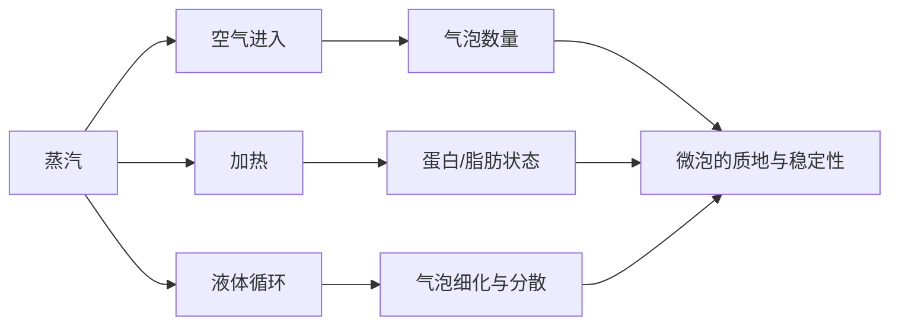

# 第 33 章 奶与奶泡：蛋白质、脂肪与打发的物理

奶泡不是“把空气打进去”就完成：蒸汽同时引入空气、加热和搅动液体；蛋白质在气液界面帮助稳定气泡，脂肪、蛋白含量、
均质/热处理和温度会共同改变泡沫形成与稳定性。[^review] 因此，不同牛奶和植物饮品需要各自建立流程。

## 33.1 目标是细泡与均一液体

| 变量 | 会改变什么 | 不应简化成 |
|------|------------|------------|
| 蛋白与脂肪组成 | 界面膜、气泡稳定、口感 | “某脂肪比例必胜” |
| 加工方式 | 蛋白状态与脂肪分散 | “鲜奶一定优于 UHT” |
| 温度 | 流动性、泡沫与风味 | 所有奶都用同一终点温度 |
| 蒸汽与动作 | 进气量、循环、气泡尺寸 | 只靠“拉几秒”复现 |

蒸汽打发的直接研究显示，牛奶类型、加工方式、乳清蛋白含量与打发温度都会改变泡沫稳定性、黏度和气泡尺寸。[^steam]
温度计能让终点可记录；比用手感猜测更适合学习期。

## 33.2 一个可重复的分段流程

1. 使用洁净奶缸与新鲜、冷藏保存的饮品；先按包装与所在地食品安全要求处理。
2. 短暂排汽，避免冷凝水先进入奶里；蒸汽棒保持洁净。
3. **进气段**只引入目标所需的空气；过度进气会产生粗大泡。
4. **整合段**让液体形成稳定循环，细化并分散气泡，同时记录终温。
5. 立刻轻晃并倒出；不要用重摔把细泡重新破坏。

没有适用于每台机器和每种奶的固定秒数。学习时固定奶种、初始量、奶缸、蒸汽档位与目标温度，一次只改变进气或终温。

## 33.3 植物饮品不是“换个名字的牛奶”

植物饮品的蛋白来源、脂肪、糖、稳定剂和配方差异很大。针对咖啡用途的综述指出，其发泡表现取决于配方和加工，不能
从“燕麦/豆/坚果”这一原料名预测。[^plant] 选购时看包装是否明确适用于热饮/打发，并为每个品牌单独建立条件卡。

## 33.4 常见说法辨析

| 说法 | 判定 | 说明 |
|------|------|------|
| “脂肪越高，奶泡一定越好” | ❌ 明确错误 | 脂肪可不利于泡沫；蛋白、加工与温度也参与。 |
| “大泡靠多打几秒就能变微泡” | ⚠️ 不可靠 | 进气过量先造成结构问题；后续循环未必能完全修复。 |
| “所有植物奶按牛奶流程打” | ❌ 明确错误 | 配方和界面性质不同，应单独标定。 |
| “终温越高越甜” | ❌ 证据不足 | 温度会改变泡沫与风味，过热可能带来蛋白变性和焦煮感。 |

## 33.5 🔎 买豆与冲煮时的用处

奶饮的口感由浓缩咖啡与奶泡共同决定。先固定一支奶、一种杯量和一个打发终温，再调意式浓度；否则你会把奶泡波动误判成
咖啡配方问题。购买植物饮品时，优先把“能否在你的机器里稳定打发”当作可验证条件，而非相信类别标签。

## 33.6 思考题

1. 为什么奶泡不能只用脂肪含量解释？
2. 为什么学习打奶时值得记录终温？
3. 【案例】同一流程换了一盒植物饮品后泡沫变粗，下一步怎么做？

> 📖 **参考答案**（想清楚再看）：[Q1](../../qa/33-milk-foam-qa.md#q1) · [Q2](../../qa/33-milk-foam-qa.md#q2) · [Q3](../../qa/33-milk-foam-qa.md#q3)

## 33.7 本章实操

### 🅐 无器具版

比较两款饮品包装的蛋白、脂肪和“适合咖啡/打发”说明，列出哪些是标签事实、哪些仍需通过实际打发验证。

### 🅑 有条件版

固定奶种、初始量、奶缸和蒸汽档位，做两次相同打发并记录终温、泡沫细腻度和倒入后的稳定性；第三次只改变进气时长
或终温之一。每次使用后立即清洁蒸汽棒。

## 33.8 本章主要参考

| 来源 | 本章用途 |
|------|----------|
| [Huppertz, *International Journal of Dairy Technology* (2010)](https://doi.org/10.1111/j.1471-0307.2010.00629.x) | 牛奶组成、加工与发泡性质的综述 |
| [Klimanova et al., *International Journal of Hospitality Management* (2022)](https://doi.org/10.1016/j.ijhm.2022.103376) | 蒸汽打发下奶种、温度和蛋白对微泡的影响 |
| [植物饮品咖啡发泡综述](https://doi.org/10.3390/beverages11010024) | 植物饮品配方与咖啡适配的边界 |

[^review]: Huppertz（2010）为综述，说明脂肪、蛋白、加工和温度都会影响泡沫；不提供任何品牌的表现排名。
[^steam]: Klimanova 等（2022）的蒸汽打发研究测试的是特定加工乳与条件，方向性不能替代每台机器的实测。
[^plant]: 植物饮品综述强调配方差异；本章不把“barista”标签当作独立科学指标。
