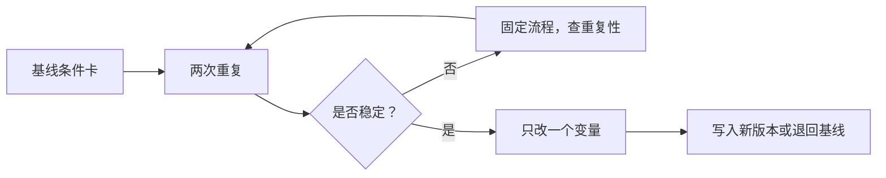

# 🛠 项目 P4：写出自己的一本配方手册

目标不是收集“万能配方”，而是为三支豆、两种器具留下别人可执行、你自己可复查的条件卡。每张卡都必须同时写输入、
过程与输出；缺少其中任何一项，就不能判断下一次的差异来自豆子还是流程。

## P4.1 交付物

| 交付物 | 最低要求 |
|--------|----------|
| 六张条件卡 | 3 支豆 × 2 种器具；没有两种器具时，改为同一器具的两种明确目标 |
| 每卡两次重复 | 不只保留“偶然成功”的单杯 |
| 一页变更记录 | 每次只动一个变量，并写明假设与结果 |
| 一页交接说明 | 别人复现时最先固定什么、允许调什么 |

## P4.2 条件卡模板

| 字段 | 内容 |
|------|------|
| 豆与日期 | 品种/处理/烘焙日（已知则写） |
| 器具 | 滤杯/粉碗、滤纸/粉碗规格、磨豆机 |
| 输入 | 粉量、水量或目标出液、温度、研磨、用水 |
| 过程 | 注水计划，或意式预热/制备/预浸泡 |
| 输出 | 总时间、杯中质量（可测则写）、感官描述 |
| 可接受窗口 | 哪些变化仍可接受，什么现象要重调 |
| 版本 | 日期、改动的唯一变量、结论 |

## P4.3 交接测试

把任一卡交给另一位冲煮者，要求他只按卡操作一次，然后回答：哪些字段足够清楚？哪个动作没有办法复现？如果对方必须
猜测研磨、注水、机器状态或判断标准，这张卡还不是配方，而是提示。

## P4.4 常见失败

| 失败 | 原因 | 修正 |
|------|------|------|
| 只写“1:2、30 秒” | 漏掉豆、粉量、研磨、机器和输出 | 补完整条件卡 |
| 一杯成功便定稿 | 没有重复性证据 | 至少复做一次 |
| 一轮改三个变量 | 无法归因 | 每轮只保留一个变量 |
| 只写“好喝” | 别人无法理解目标 | 写浓淡、酸甜苦、质地与余韵 |

## P4.5 🅐 无器具版

从本书第 26–33 章任选两种器具，为三支虚拟豆袋信息各填一张空白条件卡。标出所有无法从信息中得出的字段，并写明
第一次实测时如何建立基线。

## P4.6 🅑 有条件版

选择三支实际咖啡与两种器具。每张卡连续复做两次；只要任何一张重复性差，就先修流程，不进入下一轮调味。完成后请
另一人执行一张卡，并用 P4.3 的问题审阅。

## P4.7 本项目依据

本项目综合第 26–33 章：滤杯/滤纸改变水力条件（第 26 章），注水与粉饼制备须可重复（第 27、31 章），比例与时间
应同感官共同记录（第 32 章）。它是一套记录与实验设计任务，不主张任何固定参数。
