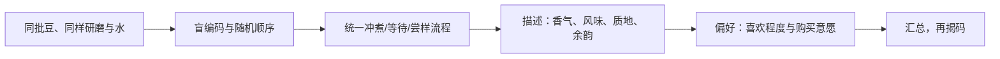

# 第 34 章 杯测：标准化的意义与流程

杯测不是为了制造唯一正确答案，而是让多人、多个样品或同一支豆的不同批次在尽可能相同条件下比较。标准化消掉的是
器具、比例、温度、时间和呈样顺序等干扰；它不能消掉人的阈值、偏好与期待。

## 34.1 先分开“描述”与“喜欢”

SCA 的 Coffee Value Assessment（CVA）不再依赖单一总分，而是把物理、描述、偏好与外部信息分为互补评估。[^cva]
这给家庭杯测的核心启发是：先写“尝到了什么、强度如何”，再写“我是否喜欢”，避免标签、价格或产地直接塑造感受。

## 34.2 家庭可复现流程

| 阶段 | 固定什么 | 记录什么 |
|------|----------|----------|
| 准备 | 样品量、研磨、杯具与水 | 样品编码、日期、操作者 |
| 冲煮 | 每杯粉水比、水温与投水方式 | 实际偏差与开始时间 |
| 观察 | 统一闻香、破渣/去浮沫、品尝时点 | 香气、风味、酸感、质地、余韵 |
| 判读 | 先盲填，后讨论与揭码 | 描述与偏好分列 |

严格的专业协议有其完整文件、设备与训练要求；家庭练习不应冒充合规认证。若要做对比，**所有样品同条件**比复刻某一
精确秒数更重要。使用本书的杯测记录表即可建立最小可用版本。

## 34.3 为什么破渣、捞沫与统一品尝仍有用

这些动作的共同目标是让不同杯在相近的液面、温度和接触状态下被比较。它们不是神秘仪式，也不能保证萃取完全相同；
若某杯的粉水比、研磨或冲煮起点不同，再整齐的动作也无法补救。

## 34.4 常见说法辨析

| 说法 | 判定 | 说明 |
|------|------|------|
| “杯测能告诉我绝对好坏” | ❌ 明确错误 | 它提高比较的可沟通性，仍应区分描述与偏好。 |
| “有一张总分表就客观” | ❌ 明确错误 | 量表不能替代盲法、训练与重复。 |
| “家庭杯测没法练” | ❌ 明确错误 | 可做简化版，但必须写清条件与局限。 |
| “先看豆袋再评更有效率” | ⚠️ 会引入偏差 | 外部信息应在记录后揭示。 |

## 34.5 🔎 买豆与冲煮时的用处

想比较两包豆，不要隔天、换器具、又带着标签分别喝。用同一水、相近杯具和盲编码一次完成；即使结论只是“我更喜欢 A”，
也比把差异归因给产区营销词更可靠。

## 34.6 思考题

1. 为什么杯测要把描述和偏好拆开？
2. 家庭对比最优先固定的是什么？
3. 【案例】两位杯测者结论不同，为什么不代表其中一人一定错？

> 📖 **参考答案**（想清楚再看）：[Q1](../../qa/34-cupping-qa.md#q1) · [Q2](../../qa/34-cupping-qa.md#q2) · [Q3](../../qa/34-cupping-qa.md#q3)

## 34.7 本章实操

### 🅐 无器具版

阅读本书杯测记录表，将“描述项”与“偏好项”分别标色；为任一线上评测指出哪些结论需要盲法或重复才能成立。

### 🅑 有条件版

准备两杯盲编码样品，固定水、粉量、研磨与杯具。先各自静默填写描述与偏好，最后揭码讨论。不要把本练习结果写成
任何认证分数。

## 34.8 本章主要参考

| 来源 | 本章用途 |
|------|----------|
| [SCA Coffee Value Assessment](https://sca.coffee/value-assessment) | CVA 的四类互补评估与官方资源入口 |
| [SCA：描述性评估说明](https://sca.coffee/sca-news/cva-in-action-descriptive-la6j8) | 描述与偏好分开的新框架 |

[^cva]: CVA 标准和表格由 SCA 管理；本章仅解释其公开框架，不复制协议原文、量表或受版权保护的版式。
