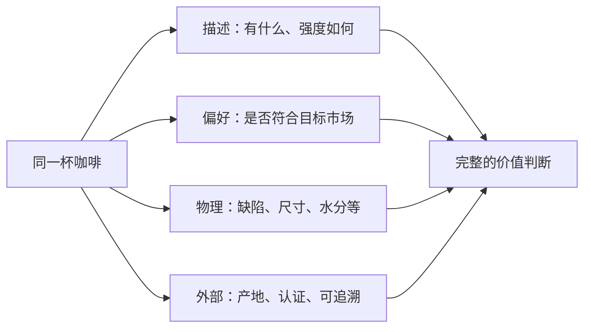

# 第 35 章 评分体系：百分制与 Coffee Value Assessment

分数看起来精确，实际上是特定样品、特定协议、特定评审与特定用途下的压缩信息。它能帮助同一系统内比较，不能替代
描述、偏好、批次信息或购买理由。

## 35.1 一张总分省略了什么

传统百分制杯测把多个感官维度汇总为总分，优点是交易沟通快；代价是同一分数可能来自很不相同的风味、缺陷与偏好。
因此看到“87 分”时，至少要追问：哪一批样品、谁评、何时评、按哪一版协议、是否盲测、分数表达的究竟是描述还是
质量印象。

## 35.2 CVA 不等于“换了一张新分数表”

SCA 的 CVA 将评估分为四类：物理、描述、偏好与外部属性。描述性评估记录可感知属性及其强度；偏好性评估记录
评审对质量的印象；外部属性则处理杯外的信息。[^cva] 这套分工的要点不是让每杯多填几张表，而是避免在描述香气时被
价格、产区或自己喜不喜欢所污染。

| 问题 | 应使用的评估 | 不应替代它的东西 |
|------|--------------|------------------|
| 杯中有什么？ | 描述性记录 | 一个总分 |
| 是否符合某人的目标？ | 偏好/印象记录 | 假装它是客观事实 |
| 生豆物理状态如何？ | 物理评估 | 杯中“好喝” |
| 认证与可追溯有何价值？ | 外部属性记录 | 香气强度 |

## 35.3 如何读菜单或生豆报价单上的分数

将分数视为一条待核验声明，而不是风味承诺。

| 标签写法 | 你能知道什么 | 还不知道什么 |
|----------|--------------|----------------|
| “87 分” | 有人给过量化评价 | 批次、协议、评审和日期可能均未知 |
| “Q Grader 评分” | 声称评审具有某类资质 | 不等于你会喜欢，也不等于本批复现 |
| “杯测高分” | 可能有比较流程 | 维度、样本量与盲法仍需追问 |

对消费者而言，最有用的是把分数与可复现的风味描述、烘焙日期和冲煮条件一起读；对采购而言，还需匹配目标市场与
合同所指定的协议。

## 35.4 常见说法辨析

| 说法 | 判定 | 说明 |
|------|------|------|
| “分高就一定适合我” | ❌ 明确错误 | 分数不等同个人偏好或你的冲煮结果。 |
| “CVA 废除了描述和偏好” | ❌ 明确错误 | CVA 恰恰将两者拆开记录。 |
| “没有数字就无法沟通品质” | ❌ 明确错误 | 标准化描述、盲测与重复同样能产生有用信息。 |
| “不同体系的分数可以直接换算” | ❌ 证据不足 | 量表、协议与用途不同，不能假设一一对应。 |

## 35.5 🔎 买豆与冲煮时的用处

买豆时把分数当作筛选线索，而非购买理由的终点：优先索要批次、评审日期、处理法、烘焙日期和风味描述。冲煮时不因
“高分豆”偏离你的基线流程；先让它在可复现条件里说话。

## 35.6 思考题

1. 为什么同分数的两支豆可能不适合相同消费者？
2. 描述性与偏好性评估为什么要分开填写？
3. 【案例】商家宣称“95 分 CVA”，你如何审读？

> 📖 **参考答案**（想清楚再看）：[Q1](../../qa/35-scoring-cva-qa.md#q1) · [Q2](../../qa/35-scoring-cva-qa.md#q2) · [Q3](../../qa/35-scoring-cva-qa.md#q3)

## 35.7 本章实操

### 🅐 无器具版

找三条含分数的豆袋或商品页，逐项标出已知的样品、日期、体系与评审信息。将其中一条营销语改写为不超出证据的描述。

### 🅑 有条件版

为同一杯样品先写描述卡，再另写喜欢/不喜欢及理由；全程不看豆袋。揭码后比较标签是否改变了你的第二份记录，并保留
两份而不把它们强行合成总分。

## 35.8 本章主要参考

| 来源 | 本章用途 |
|------|----------|
| [SCA Coffee Value Assessment](https://sca.coffee/value-assessment) | CVA 的四类评估与官方资源入口 |
| [SCA：CVA 描述性评估](https://sca.coffee/sca-news/cva-in-action-descriptive-la6j8) | 描述与偏好分开的公开说明 |
| [SCA：CVA 演进说明](https://sca.coffee/sca-news/25/issue-18/valuing-coffee-evolving-the-scas-cupping-protocol-into-a-coffee-value-assessment-system-fj7d9) | 从历史单一杯测表到价值评估框架的背景 |

[^cva]: SCA 公开页将 CVA 列为 Physical、Descriptive、Affective、Extrinsic 四类；本章不复制其受版权保护的表格、项目或量表。
