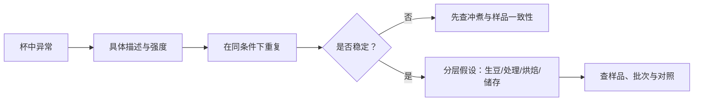

# 第 37 章 瑕疵风味：从“不好喝”到“是哪一种不好喝”

瑕疵风味的学习不是给咖啡判死刑，而是把模糊的“不好喝”拆成可描述、可复查、可追踪的线索。杯中线索可以指向生豆、
处理、烘焙或冲煮，但很少能仅凭一口就锁定唯一原因。

## 37.1 先描述，再追溯

| 感官线索 | 可优先检查的层 | 不能直接推出 |
|----------|------------------|--------------|
| 生马铃薯/生豌豆 | 生豆瑕疵与处理 | “一定由虫害造成” |
| 焦、灰、烟或烤感异常 | 烘焙过程 | “豆子天生不好” |
| 纸、木、陈旧感 | 储存、氧化、烘焙或样品暴露 | 单凭一杯确定仓储时长 |
| 酸苦并存、杂乱 | 萃取不均或原料/烘焙问题 | 必然是通道或必然是缺陷豆 |

## 37.2 一个可验证的例子：马铃薯味缺陷

PTD 与 IPMP 等甲氧基吡嗪有关，但研究发现甲氧基吡嗪可在优质样品中检出，关键是浓度而非“有/无”。虫害损伤也不是
充分条件；受损组织、微生物及其他候选机制共同构成尚未完全封闭的因果链。[^ptd] 因此，闻到生马铃薯并不等于可以
断言某一虫、某一农场或某一加工步骤就是唯一责任人。

## 37.3 烘焙缺陷与上游缺陷要分层

烘焙研究已找到若干缺陷类别的化学标记和感官可分性；这支持“烘焙缺陷不是纯主观”的说法。[^roast] 但标记物是用于
识别或关联的线索，不是“某一个分子 = 某一种缺陷”的充分等式。未熟豆等上游问题也可能在烘焙后显得像烘焙问题，
所以诊断必须保留样品、批次与对照。

## 37.4 常见说法辨析

| 说法 | 判定 | 说明 |
|------|------|------|
| “坏味一定是冲煮错” | ❌ 明确错误 | 原料、处理、储存与烘焙都可能进入杯中。 |
| “闻到 PTD 就能证明虫害” | ❌ 明确错误 | 虫害不是充分条件，机制链尚有其他环节。 |
| “有化学标记就不必做感官” | ❌ 明确错误 | 化学与感官回答不同问题，应互相校验。 |
| “一次尝到异常即可判整批有缺陷” | ⚠️ 不充分 | 需重复、盲法与更多样品确认。 |

## 37.5 🔎 买豆与冲煮时的用处

若一支豆反复出现稳定的异常描述，保留豆袋、烘焙日期、冲煮卡与少量样品，再联系烘焙商会比只说“难喝”更有用。若
异常只出现一次，先复做并检查磨豆、用水与器具清洁，避免把流程波动误报为批次缺陷。

## 37.6 思考题

1. 为什么 PTD 不能被简化为“虫害味”？
2. “标记物”为什么不等于“一锤定音的成因”？
3. 【案例】两次手冲都有纸板感，如何做下一步排查？

> 📖 **参考答案**（想清楚再看）：[Q1](../../qa/37-defect-flavors-qa.md#q1) · [Q2](../../qa/37-defect-flavors-qa.md#q2) · [Q3](../../qa/37-defect-flavors-qa.md#q3)

## 37.7 本章实操

### 🅐 无器具版

将“难喝”改写为至少两个具体观察（例如纸板感、灰感、发酵感），并为每项列出生豆、烘焙、储存、冲煮四个候选层，
禁止只写一个原因。

### 🅑 有条件版

对同一异常样品做两次同条件冲煮，并与一支基准豆盲对照。记录异常是否稳定、在哪个温度段出现；只在重复后才联络
烘焙商或继续追溯批次。

## 37.8 本章主要参考

| 来源 | 本章用途 |
|------|----------|
| [第 13 章：生豆分级与瑕疵](../02-upstream/13-green-grading.md) | PTD、IPMP 与虫害/微生物证据链 |
| [第 20 章：烘焙缺陷](../03-roasting/20-roast-defects.md) | 烘焙缺陷的化学标记与感官边界 |

[^ptd]: 本书编号 [GR6][GR9]；PTD 机制仍存在候选环节，正文不用单一因果解释。
[^roast]: 第 20 章登记的研究支持标记与感官可区分性；并非跨所有豆、机器与烘焙条件的万能判定表。
