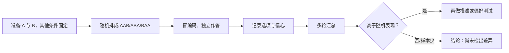

# 第 38 章 感官训练：阈值、三角测试与自我校准

感官训练不是把自己练成永远正确的人，而是知道自己在何种条件下能稳定分辨、能否说清差异，以及何时应承认“不确定”。
练习要有答案、有记录、有间隔，才会产生可追踪的进步。

## 38.1 三种不同能力

| 能力 | 问题 | 合适练习 |
|------|------|----------|
| 检出 | “这里有差异吗？” | 三角测试、简单阈值系列 |
| 识别 | “这是什么类别？” | 参照物与基本味识别 |
| 描述 | “它像什么、强度如何？” | 词典/参照物的分层记录 |

不要把三者混为一谈：能分出不同不代表能命名；能命名也不代表在盲法下能稳定分出。

## 38.2 三角测试回答什么

三角测试给三杯编码样品，其中两杯相同、一杯不同，受试者必须选出不同者。ISO 4120:2021 将其定义为强制选择的差异/
相似性检验；它只能判断是否存在可感知差异，不能给出差异大小、方向或负责的属性。[^triangle]

“未检出”不等于两样品相同：可能差异很小、样本不足、疲劳、温度变化或你的流程噪声掩盖了差异。

## 38.3 四周最小训练计划

| 周次 | 任务 | 成功标准 |
|------|------|----------|
| 1 | 基本味或两个安全参照物的识别 | 记录正确/错误，不追求一次全中 |
| 2 | 同一咖啡的两杯重复描述 | 找出自己最稳定的 2–3 个词 |
| 3 | 低次数三角测试 | 只报答对数与条件，不夸大结论 |
| 4 | 重做第 1 或第 3 周 | 比较记录，检查是否真有提升 |

每次短而专注，安排休息与清水；感觉疲劳、感冒、强烈香水或辛辣食物影响时，直接标记为“本次不可比”。一项专业咖啡
品评训练研究也将三角测试、基本味识别、排序与阈值任务作为周期性练习的一部分。[^training]

## 38.4 常见说法辨析

| 说法 | 判定 | 说明 |
|------|------|------|
| “三角测试答对一次就证明我能分辨” | ❌ 明确错误 | 单次可能是随机命中，需多轮与记录。 |
| “没检出差异就证明样品相同” | ❌ 明确错误 | 检验不显著不是同一性的证明。 |
| “阈值越低就一定更会评价咖啡” | ⚠️ 过度简化 | 阈值只是能力的一部分，还需要描述、校准与重复。 |
| “训练只能上专业课” | ❌ 明确错误 | 家庭可练，但必须把条件、答案与局限写清。 |

## 38.5 🔎 买豆与冲煮时的用处

想验证换水、换滤纸或换研磨是否真的有差异时，先做盲三角测试，再讨论哪杯更喜欢。这样能避免在预期驱动下为每一次
改动编出故事，也能避免把一次猜对当成设备升级的证据。

## 38.6 思考题

1. 三角测试为何不能说明差异的方向？
2. 为什么“未检出差异”不等于“完全相同”？
3. 【案例】你在 3 轮里答对 2 轮，应该如何报告？

> 📖 **参考答案**（想清楚再看）：[Q1](../../qa/38-sensory-training-qa.md#q1) · [Q2](../../qa/38-sensory-training-qa.md#q2) · [Q3](../../qa/38-sensory-training-qa.md#q3)

## 38.7 本章实操

### 🅐 无器具版

设计一张四周感官训练日志，至少包含日期、样品/参照物、盲法与否、答案、信心、疲劳状态和下一次要复核的问题。

### 🅑 有条件版

与伙伴准备两种明确不同的咖啡或同一咖啡的两种受控处理，随机做至少数轮三角测试。每轮独立作答后再揭码；结果只报告
答对数、总轮数和条件，随后另做描述练习，切勿从三角题直接宣布“更好”。

## 38.8 本章主要参考

| 来源 | 本章用途 |
|------|----------|
| [ISO 4120:2021](https://www.iso.org/standard/76666.html) | 三角测试的用途、强制选择与能力边界 |
| [Steen et al., *Journal of Sensory Studies* (2023)](https://doi.org/10.1111/joss.12819) | 专业咖啡品评训练中使用三角、阈值与识别任务的实例 |

[^triangle]: ISO 4120:2021 的公开摘要已核对；本章不复制标准的统计表、详细程序或受版权保护内容。
[^training]: Steen 等研究的是特定受试者与培训工具；它证明这些练习可组成训练计划，不证明四周必然达到某种专业水平。
