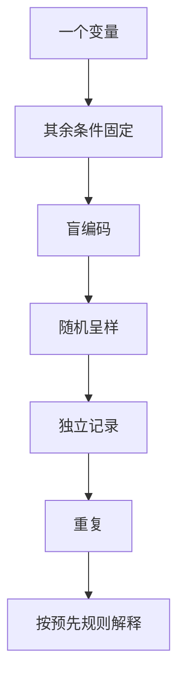

# 第 39 章 怎么做一场可信的家庭对比实验

家庭实验的目标不是发表论文，而是让你自己的决策少受期待效应与偶然波动影响。最小可信设计是：一次只测试一个问题、盲编码、随机顺序、重复，并在尝之前写下什么结果算支持或不支持假设。

## 39.1 从一个可回答的问题开始

| 太宽的问题 | 可实验的问题 |
|------------|--------------|
| “这个滤杯更好吗？” | “同一豆、同一粉水比下，我能否盲分出两种滤杯？” |
| “这水更甜吗？” | “在固定冲煮条件下，参与者是否偏好水 A 或 B？” |
| “这支豆适合意式吗？” | “同一豆在两个明确配方中，哪个在我定义的浓淡目标下更可接受？” |

先写假设和判定标准，再做样品。否则尝完后总能为任何结果补一个解释。

## 39.2 四个最低控制

| 控制 | 用处 | 常见遗漏 |
|------|------|----------|
| 单变量 | 能归因 | 同时换豆、滤纸与水温 |
| 盲编码 | 降低标签期待 | 自己端杯又知道身份 |
| 随机顺序 | 降低顺序/温度偏差 | 永远先喝 A 后喝 B |
| 重复 | 区分偶然与稳定 | 只保留最好喝的一杯 |

三角测试适合问“能否分出”，偏好排序适合问“更喜欢哪个”，描述卡适合问“差异像什么”。它们回答的不是同一问题，不应互相替代。[^triangle]

## 39.3 一份可执行实验卡

| 字段 | 例子 |
|------|------|
| 问题与假设 | “换滤纸能否被盲分？” |
| 自变量 | 仅滤纸 |
| 固定项 | 豆、研磨、粉量、水、滤杯、注水 |
| 编码与随机 | 由伙伴编码；记录每轮排列 |
| 测试 | 三角题 + 独立描述卡 |
| 轮次与停止条件 | 预先写定；疲劳时暂停并标记 |
| 结果 | 答对数、描述、偏好与局限 |

小样本得到的是“在这些条件和这些人中”的信息。不要从自己和一位朋友的两轮测试推出所有消费者都会偏好某个器具。

## 39.4 常见说法辨析

| 说法 | 判定 | 说明 |
|------|------|------|
| “只要盲测就科学” | ❌ 明确错误 | 仍需随机、控制与重复。 |
| “朋友都说 A 好喝就足够” | ⚠️ 证据弱 | 可作为偏好记录，未必排除顺序与讨论影响。 |
| “没显著差异就是产品一样” | ❌ 明确错误 | 可能是样本/能力/流程不足以检出。 |
| “结果不符合预期就重做直到符合” | ❌ 明确错误 | 这会制造选择性报告；应保留全部轮次。 |

## 39.5 🔎 买豆与冲煮时的用处

新器具、新水或新配方值得先用小实验验证，再决定是否长期购买或改变日常流程。记录失败和未检出同样有价值：它说明在你的条件下，升级可能没有可感知的回报。

## 39.6 思考题

1. 为什么盲法还需要随机顺序？
2. 为什么三角测试和偏好题应分开？
3. 【案例】三角题没有稳定答对，但大家都说 B 更喜欢，怎样记录？

> 📖 **参考答案**（想清楚再看）：[Q1](../../qa/39-home-experiment-qa.md#q1) · [Q2](../../qa/39-home-experiment-qa.md#q2) · [Q3](../../qa/39-home-experiment-qa.md#q3)

## 39.7 本章实操

### 🅐 无器具版

为“换水是否可感知”写一张实验卡，明确自变量、固定项、盲编码方式、成功/失败如何记录，并找出一个可能的混杂变量。

### 🅑 有条件版

邀请一名负责编码的伙伴，完成至少数轮两条件三角测试；每轮先独立选答，再填写描述与偏好。汇总所有轮次，包括答错的；将结论限制为这次实验的条件与参与者。

## 39.8 本章主要参考

| 来源 | 本章用途 |
|------|----------|
| [ISO 4120:2021](https://www.iso.org/standard/76666.html) | 三角测试的适用问题与边界 |
| [第 38 章：感官训练](38-sensory-training.md) | 三角题、随机命中与训练记录 |

[^triangle]: ISO 4120:2021 说明三角测试不判断差异方向、大小或属性；偏好与描述需另行设计，不能从“能分出”自动推到“更好”。
