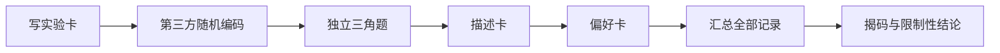

# 🛠 项目 P5：组织一次三角测试 + 杯测

本项目的交付物不是“谁喝出了答案”，而是一份别人可以审阅的实验记录：问题、样品、随机化、每轮答案、描述、偏好和局限都在。完成后你应能区分“能否分出”“差异像什么”“更喜欢哪个”三个问题。

## P5.1 交付物

| 项目 | 最低内容 |
|------|----------|
| 实验卡 | 一个问题、唯一自变量、固定项、预先判定规则 |
| 编码表 | A/B 身份与每轮排列，由非品评者保管至结束 |
| 三角答案表 | 每位参与者每轮的选择、信心、是否疲劳 |
| 杯测卡 | 描述与偏好分列，揭码前独立填写 |
| 结论页 | 答对数、描述共识/分歧、偏好、局限与下一步 |

## P5.2 执行步骤

1. 写出问题，例如“固定其余条件后，两种水能否被盲分？”；不要使用“哪个更好”这种混合问题。
2. 固定豆、研磨、比例、温度、杯具与品尝时点，仅改变一个变量。
3. 由一位不参与品尝者随机安排 AAB、ABA 或 BAA，并用无意义编码呈样。
4. 每位参与者先独立完成三角题，再写描述与偏好；全程不得讨论。
5. 汇总所有轮次后才揭码。保留答错、跳过和疲劳中止的记录。

## P5.3 结论模板

> 在【日期、样品、固定条件】下，参与者完成【N】轮三角题，答对【k】轮；这【不构成/构成】在本次设计下进一步研究差异的理由。描述记录中【列出一致/分歧】，偏好记录【列出】。本项目不能推出【不该外推的范围】；下一步将【增加轮次/改进控制/换一个问题】。

不要用家庭小样本宣称“显著”或“所有人更喜欢”；若需要正式推断，按相应标准、统计方案和足够样本执行。

## P5.4 🅐 无器具版

以“换滤纸能否被盲分”为题，填写全部空白实验卡、三种随机排列和结论模板。找出至少三项若由自己一人执行会破坏盲法的地方。

## P5.5 🅑 有条件版

至少邀请一名编码者和一名品评者，完成几轮三角题与独立杯测卡。总结时保留所有原始答案和编码表；仅在此之后揭码。若疲劳或流程异常，标记而不是删除。

## P5.6 本项目依据

三角测试只检验可感知差异，描述与偏好另行记录（第 38、39 章）；杯测将描述与偏好分开（第 34、35 章）。项目不复制 ISO 或 SCA 的受保护表格，也不授予任何认证。
