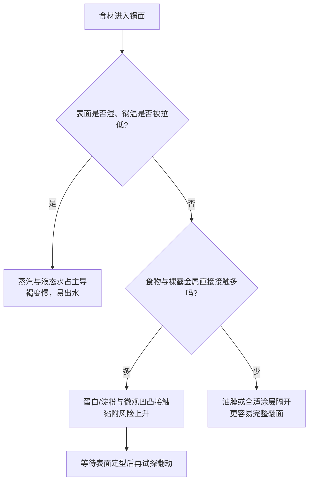

# 第 24 章 煎：接触传热与“粘锅”的物理

煎的优势是食材表面直接接触高温锅面；代价也是接触——蛋、肉等富蛋白食材容易和裸露金属黏附。粘锅不是运气：锅面状态、食材表面水分、油膜、温度变化和翻面的时机共同决定结果。

## 24.1 先分清“出水”与“黏附”

锅里有液态水时，表面温度会受水沸腾限制，难形成干爽褐变；水少以后，食物和锅的直接接触增多，若没有合适的隔离层，黏附机会也会上升。这不是“水越少越好”，而是让水、热和油的角色匹配目标。

英国皇家化学学会的教学材料指出，蛋、奶酪、肉等富蛋白食物特别容易黏金属；即便看似光滑的锅，在微观尺度仍有凹凸。油和不粘涂层的共同逻辑不是“让锅神奇地不热”，而是减少食物与金属的直接接触。[出处登记](../../standards.md)

| 现象 | 首先检查 | 不要直接归因于 |
|---|---|---|
| 刚下锅就撕裂 | 表面水分、油膜、锅面清洁度、食材是否过早翻动 | “锅天生不行” |
| 出很多水、上不了色 | 下锅量、食材表面水、锅的蓄热与火力 | 只怪油不够 |
| 有褐色锅底残留 | 是否需要做酱汁、是否焦苦 | 一律是失败 |

## 24.2 三种锅面，三种取舍

| 锅面 | 更适合的任务 | 主要取舍 |
|---|---|---|
| 不粘涂层 | 蛋、薄嫩食材、低到中温操作 | 需遵循器具说明，避免把涂层当高温煎封工具 |
| 不锈钢等裸露金属 | 想保留褐色残留做酱汁、需要耐用锅面 | 对预热、油膜和翻面时机更敏感 |
| 养护型铁锅/碳钢 | 高频煎炒、可逐步形成较易脱离的表面 | 养护状态与使用方式会改变结果 |

这是任务选择表，不是材料排行榜。同一道鱼，若目标是完整外观，可优先降低黏附风险；若目标是锅底褐香再加液体溶开，则少量锅底残留反而有用。

## 24.3 可迁移的判断规则

> **要完整翻面，先让食材表面完成“定型”，再用铲子轻试；阻力大时，不要硬撬，先检查水、油、锅温和等待时间。**

“热锅冷油”是常见惯例，但目前没有足以把它写成普适防粘定律的直接家庭厨房对照证据。可以把它当作一个待检验的起始方案：同一食材、同一锅、同样油量，改变一个变量再记录结果；不要把一次成功改写成因果铁律。

## 24.4 常见说法辨析

| 说法 | 判定 | 为什么流传 / 实际边界 |
|---|---|---|
| “粘锅说明锅坏了” | ❌ 明确错误 | 食材水分、下锅量、油膜和过早翻动都可造成黏附；锅面只是变量之一。 |
| “任何食材都要不停翻才不粘” | ❌ 明确错误 | 过早、频繁翻动会在表面尚未定型时撕裂食材；应先试探。 |
| “热锅冷油一定不粘” | ⚠️ 证据不足 | 它是可操作的惯例，但缺乏能覆盖锅具、食材与油量差异的直接证据。 |
| “锅底褐色残留必须立刻洗掉” | ❌ 明确错误 | 未焦苦的残留可在后续加液体时溶开，成为酱汁的一部分；焦苦才需要避免。 |

## 24.5 思考题

1. 为什么“食材很湿”和“食材粘锅”不是同一个问题？
2. 为什么完整翻面不应只靠加更多油？
3. 【案例】煎鸡胸时一放下就黏、两分钟后硬铲撕裂。请按“热—水—味—时间”给出排查顺序。
4. 【辨析】“不锈钢锅只能用来粘锅”为什么不成立？

> 📖 **参考答案**（想清楚再看）：[Q1](../../qa/24-pan-fry-sticking-qa.md#q1) · [Q2](../../qa/24-pan-fry-sticking-qa.md#q2) · [Q3](../../qa/24-pan-fry-sticking-qa.md#q3) · [Q4](../../qa/24-pan-fry-sticking-qa.md#q4)

## 24.6 本章实操

### 🅐 零成本版

查看家中两口锅的材质、涂层状态和说明书，把下面表格填完；只记录可见事实。

| 锅 | 锅面/涂层 | 常做任务 | 我不确定的限制 | 下次要观察的现象 |
|---|---|---|---|---|
| | | | | |

### 🅑 开火版

有灶台和食材时做：把同类食材分成两小份，保持锅、油量、火力相同；一份擦干表面、一份不擦干。分别记录出水、能否完整翻面和颜色。只改变“表面水分”这一项，不能据此替所有锅和食材下结论。

| 组别 | 表面处理 | 下锅后水汽/积水 | 首次轻试翻面时阻力 | 颜色与完整性 |
|---|---|---|---|---|
| A | 擦干 | | | |
| B | 未擦干 | | | |

## 24.7 🔎 下次做菜时的用处

煎东西黏住时，先别把铲子当解决方案。先问：食材表面是否太湿？锅内是否拥挤而降温？油膜是否完整？我是不是太早试图移动它？这样下一次能改一个变量，而不是盲目加火、加油或换锅。

## 24.8 本章依据

- 英国皇家化学学会（RSC）教学材料 *Why do pans stick?*：蛋白质食物与金属表面的黏附、微观粗糙度与涂层隔离机制；核对状态见[出处登记](../../standards.md)。
- 第 7 章与第 23 章：水分对表面温度与褐变的限制、功率与食材量的关系。相关定量来源见[出处登记](../../standards.md)。
