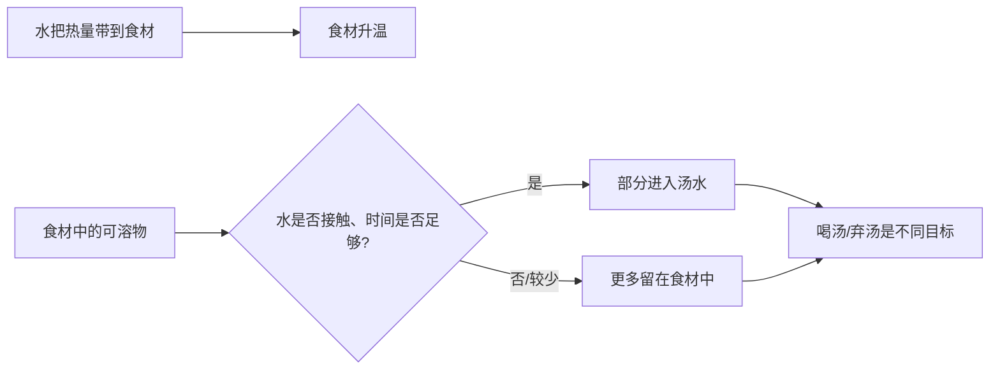

# 第 27 章 煮与汆：水里的对流与溶出

煮和汆都用水把热带进食材，但它们不能只按“水开不开”区分。更有用的是先决定目标：要让食材中的物质进汤，还是要尽量留在食材里？要快速熟化表面，还是温和地把中心推进到目标状态？

## 27.1 一锅水里有两条流动

水煮时，水溶性维生素、矿物质和其他可溶性成分可能迁移到烹饪水中；切得更小、接触面积更大、加热更久，通常会增加这种迁移。已有综述同时指出，热本身也会改变热敏成分，因此“喝掉汤”只能回收一部分浸出物，并不等于消除所有损失。[出处登记](../../standards.md)

| 目标 | 更该观察 | 典型错误 |
|---|---|---|
| 做清汤/高汤 | 汤的风味与浑浊度、食材是否愿意让味道出来 | 只看食材是否完整 |
| 水煮蔬菜后弃水 | 切块大小、时间、是否有必要弃水 | 以为汤里的迁移“消失了” |
| 汆烫后再炒/拌 | 表面是否达到目的、是否及时停止加热 | 把汆烫当成完整熟制 |
| 水煮蛋白质食材 | 中心状态与安全要求 | 只用锅里水是否翻滚判断熟度 |

## 27.2 沸腾强弱主要改变“运动”，不是把水变得更热

在同一常压下，持续沸腾的水温仍接近沸点；大滚和微沸的实际差别更多在水的运动、翻动和蒸发，而不是出现两套相差巨大的温度。对易碎食材，较温和的水流可减少机械破损；对需要快速汆烫的食材，则要让水量、投料量和恢复沸腾能力相匹配。

> **可迁移规则：先决定“我希望什么进汤、什么留在食材里”，再决定切法、水量、时间和是否弃汤。** 不要从“冷水下锅/开水下锅”反推所有食材的唯一正确答案。

## 27.3 汆是短时预处理，不是万能净化

汆烫可以加热表面、带走一部分表面可溶物或形成后续处理需要的状态；但它不能替代针对生熟分开、中心熟度和冷藏保存的食品安全步骤。不同国家对高风险食材有不同的中心时间—温度口径，需按当地现行官方指引执行。

## 27.4 常见说法辨析

| 说法 | 判定 | 为什么流传 / 实际边界 |
|---|---|---|
| “煮菜的营养都没了” | ❌ 明确错误 | 一部分可溶物会迁移或热降解，但程度取决于食材、切法、时间与是否饮用汤水。 |
| “汤里有味，说明食材没营养了” | ❌ 明确错误 | 味道、矿物质、维生素和结构物质迁移并不同步；不能用汤味替代分析。 |
| “水滚得越猛，食物熟得越快” | ⚠️ 过度简化 | 传热还受厚度、投料量和水流接触影响；猛烈翻滚也可能伤害脆弱食材。 |
| “汆一下就能保证安全” | ❌ 明确错误 | 短时表面加热不能替代需要的中心熟度与交叉污染控制。 |

## 27.5 思考题

1. 为什么“是否喝汤”是烹饪目标的一部分？
2. 为什么不能把大滚理解成比微沸“温度高很多”？
3. 【案例】你要做一锅汤和一盘汆烫后凉拌的青菜，二者对切法、水量与弃水的判断怎样不同？
4. 【辨析】“汆烫可以洗掉所有不好的东西”为什么不成立？

> 📖 **参考答案**（想清楚再看）：[Q1](../../qa/27-boiling-poaching-qa.md#q1) · [Q2](../../qa/27-boiling-poaching-qa.md#q2) · [Q3](../../qa/27-boiling-poaching-qa.md#q3) · [Q4](../../qa/27-boiling-poaching-qa.md#q4)

## 27.6 本章实操

### 🅐 零成本版

选一道汤和一道汆烫菜，分别写清“希望进汤的东西”“希望留在食材里的东西”“是否喝掉汤水”，再比较它们的切法和时间为何不同。

### 🅑 开火版

有灶台和食材时做：把同种蔬菜切成大块与小块，在相同水量、相同时间下短时煮制；分别观察汤色、食材质地与重量变化。此实验只能比较切法在这一条件下的结果。

| 组别 | 切法 | 汤水变化 | 食材质地 | 下次调整 |
|---|---|---|---|---|
| A | 大块 | | | |
| B | 小块 | | | |

## 27.7 🔎 下次做菜时的用处

下一次看到“焯一下”“煮熟”“汆水”时，先问它的目的：为了汤、为了去掉表面物、为了预熟，还是为了安全？目的不同，水量、切法、时间和是否弃水都不该照搬。

## 27.8 本章依据

- 热处理对果蔬成分综述（2024）：水煮中的浸出与热损失。
- 植物性食材烹饪综述（2026）：水煮、蒸制与浸出的比较边界。
- 英国 FSA *Cooking your food*：高风险食材的时间—温度安全思路。完整来源见[出处登记](../../standards.md)。
