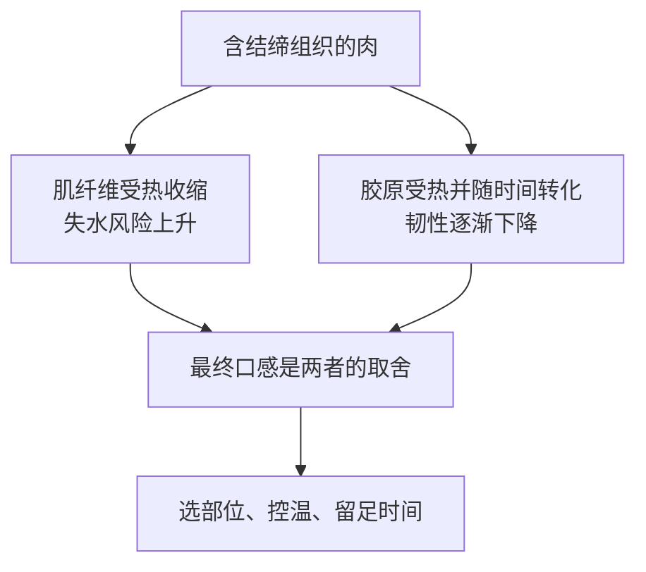

# 第 28 章 炖、焖、卤：长时间低温改造结缔组织

炖、焖、卤最反直觉的地方是：同一块肉里有两种相反的变化。肌纤维受热会收缩、失水；结缔组织中的胶原则需要热和时间才逐渐软化。适合久炖的不是“任何肉”，而是结缔组织问题足够明显、值得用时间交换质地的部位。

## 28.1 两条曲线同时在走

已有综述显示，胶原的热变化与肌纤维失水并不同步；动物年龄、肌肉部位和交联程度都会改变所需条件。因此“炖多久”不能脱离肉块尺寸、部位、锅具和实际温度给出一个通用答案。[出处登记](../../standards.md)

| 现象 | 优先怀疑 | 不能直接推出 |
|---|---|---|
| 肉还嚼不动 | 胶原尚未充分转化、部位本就结缔组织多 | 只要猛火再煮就会好 |
| 肉变柴 | 肌纤维失水、温度/时间组合不合适 | “炖肉永远不会柴” |
| 汤变浓 | 胶原相关物质、脂肪乳化、淀粉或蒸发均可能参与 | 单靠汤浓判断肉一定软 |

## 28.2 炖、焖、卤是不同的控制方式

| 方法 | 重点控制 | 适用的思考方式 |
|---|---|---|
| 炖 | 较多液体、长期传热与汤的风味 | 汤和食材共同是成品 |
| 焖 | 较少液体、盖住后靠时间推进 | 防止表面过快蒸发，观察锅内状态 |
| 卤 | 调味液与时间共同进入成品叙事 | 把咸度、香气和保温时间分开管理 |

这些名称在家庭与地区语境中会有交叠；更可靠的是问：液体多少、温度是否稳定、食材结构目标是什么、最后汤汁是否会被吃掉。

## 28.3 “大火滚”不等于更有效

在常压下，沸腾水的温度边界接近固定；把火开大通常主要增加翻滚、蒸发和机械扰动，而不是无限提高液体温度。对需要长时间处理的肉，更有价值的是维持可预测的热输入、避免烧干，并在合适节点检验纤维与结缔组织的状态。猛滚可能让易碎食材破散、让汤汁蒸发过快，却不能跳过胶原转化所需的时间。

> **可迁移规则：久炖先选对部位，再让“温度 × 时间”服务于胶原；不要用更猛烈的翻滚代替耐心。**

## 28.4 常见说法辨析

| 说法 | 判定 | 为什么流传 / 实际边界 |
|---|---|---|
| “任何肉炖久都会更嫩” | ❌ 明确错误 | 瘦肉的肌纤维会继续失水；只有结缔组织收益足以抵消代价的部位适合久炖。 |
| “大火滚能缩短一半时间” | ⚠️ 过度简化 | 常压下液体温度受沸点限制，强火更多改变蒸发与运动。 |
| “汤浓说明胶原都变成明胶了” | ❌ 明确错误 | 汤浓还可能来自脂肪、淀粉与蒸发，不能代替质地判断。 |
| “卤得越久越入味” | ⚠️ 有条件 | 调味、渗透与结构变化并非线性；过久会带来过咸、破散或失水。 |

## 28.5 思考题

1. 为什么久炖的关键不是“把肉煮熟”？
2. 为什么硬部位和里脊不应使用同一套时间策略？
3. 【案例】牛腩炖很久仍有韧劲，同时汤已明显变咸。下一步如何排查而不是继续加火？
4. 【辨析】“小火是因为温度更低，所以一定更嫩”为什么不完整？

> 📖 **参考答案**（想清楚再看）：[Q1](../../qa/28-braise-stew-qa.md#q1) · [Q2](../../qa/28-braise-stew-qa.md#q2) · [Q3](../../qa/28-braise-stew-qa.md#q3) · [Q4](../../qa/28-braise-stew-qa.md#q4)

## 28.6 本章实操

### 🅐 零成本版

找一份炖/焖/卤菜谱，给每一步标注它主要服务“胶原时间”“防失水/防烧干”“调味浓缩”还是“尚不确定”，然后找出一个必须检查而不能只靠计时的节点。

### 🅑 开火版

有灶台和食材时做：同一锅中选大小接近的两块适合久炖食材，在两个时间点各取一块，记录是否能轻易分开、纤维是否干柴、汤汁是否变咸。此实验只建立你自己的锅和食材的时间基准。

| 时间点 | 食材能否轻易分开 | 纤维口感 | 汤汁浓度/咸度 | 下次调整 |
|---|---|---|---|---|
| 早段 | | | | |
| 晚段 | | | | |

## 28.7 🔎 下次做菜时的用处

炖肉不理想时，先判断失败属于“胶原还没走完时间”还是“肌纤维已失水”。前者需要继续在稳定条件下推进，后者需要检讨部位、切块、温度和调味浓缩，而不是一律继续煮。

## 28.8 本章依据

- 低温慢煮与肉品质量综述（2023）：胶原、肌纤维、温度与时间的不同变化。
- 肌肉结构与肉/鱼品质综述（2016）：胶原交联、物种与部位差异。
- 第 4、5 章：蛋白质与结缔组织的基础框架。完整出处见[出处登记](../../standards.md)。
