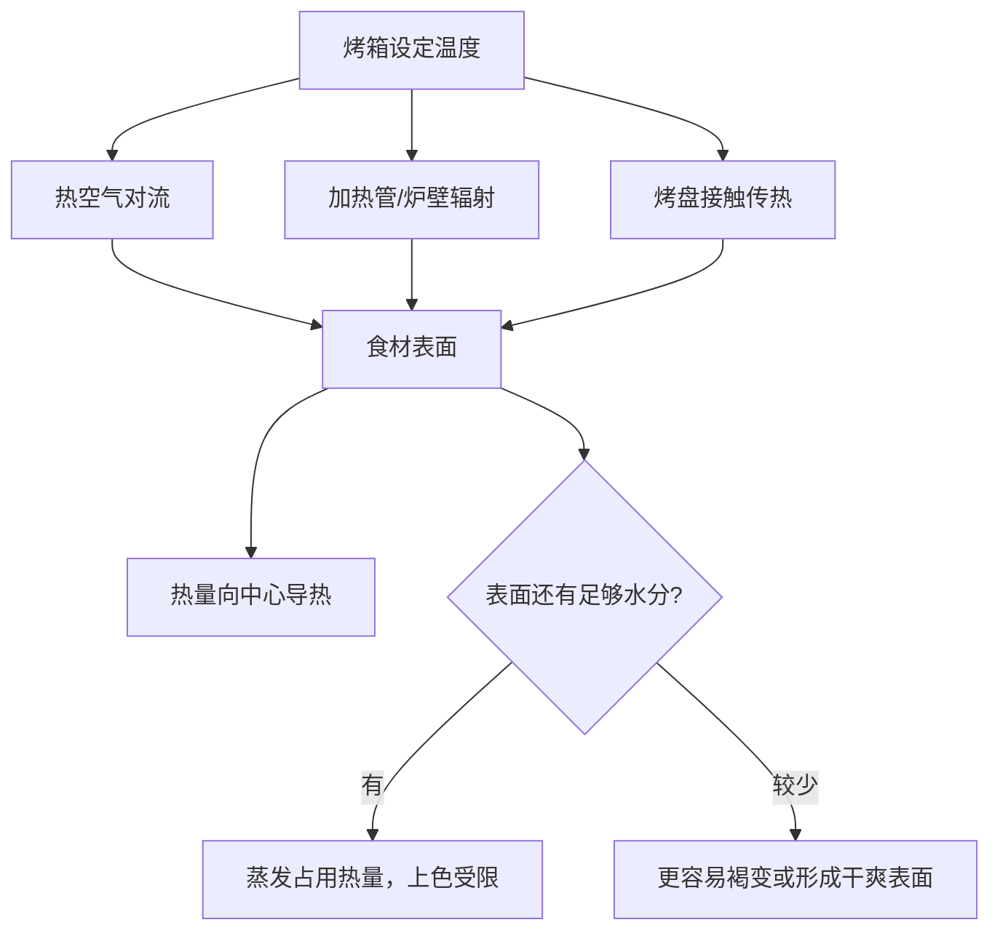

# 第 29 章 烤：辐射、热空气与干燥

烤箱不是一个“把食材均匀加热到设定温度”的盒子。它同时有热空气的对流、加热管/炉壁的辐射，以及烤盘接触传热；食材表面是否能干燥，决定热量是用于蒸发水还是用于上色。

## 29.1 烤箱里的三条热路

烤箱的设定温度是空气控制目标，不是食材中心温度，也不是每一处表面的实测温度。位置、烤盘、遮挡、风扇、食材厚度和表面水分都会让结果不同；这也是为什么同一菜谱换烤箱、换盘子或把食材堆得更密，会需要重新校准。

| 操作 | 主要改变 | 不能保证 |
|---|---|---|
| 预热 | 起始环境与烤盘热状态 | 中心必然同步熟透 |
| 换层/翻面 | 辐射与热空气接触的分布 | 所有面完全同色 |
| 摊开食材 | 蒸汽更容易离开、表面积更大 | 自动不焦 |
| 盖/包裹 | 保留水分、降低表面干燥 | 得到褐壳 |

## 29.2 上色前，先看水

在厨房时间尺度内，明显褐变需要高于水沸点的干燥表面；表面水分持续蒸发时会限制温度上升。因此“烤不黄”优先检查食材是否拥挤、表面是否太湿、是否被酱汁覆盖以及热源位置，而不是一律延长时间。

FDA 对土豆和谷物制品的提醒也说明了这条线的另一面：高温烘烤时间更长时，丙烯酰胺可能更多；切块土豆制品宜做到金黄而非深棕。本书不提供饮食建议，只复述该机构的食品制备风险管理方向。[出处登记](../../standards.md)

## 29.3 中心熟度与表面颜色是两个刻度

一块厚肉或根茎类食材可能已经表面深色、中心仍未达到目标；也可能中心已够、表面因湿而缺少颜色。前者可通过降低表面继续受热、转移位置或调整遮挡来管理；后者则应从表面水分、摊开程度和辐射接触找原因。

> **可迁移规则：烤箱里同时观察“表面干燥/颜色”和“中心状态”；两者不一致时，先判断是哪一条热路或水分路径失衡。**

## 29.4 常见说法辨析

| 说法 | 判定 | 为什么流传 / 实际边界 |
|---|---|---|
| “烤箱设 200 °C，食材就是 200 °C” | ❌ 明确错误 | 设定的是环境控制目标；食材表面和中心受水分、位置、传热路径影响。 |
| “烤不黄就一直加时间” | ❌ 明确错误 | 表面水分和热源位置可能才是瓶颈，延长会先让中心过熟。 |
| “盖住烤更嫩也更脆” | ❌ 明确错误 | 盖住有利于保水，却会降低表面干燥和褐变机会。 |
| “颜色越深风味越好” | ⚠️ 有边界 | 褐变产生风味，但过深可能带来焦苦；FDA 对部分植物性食品建议金黄而非深棕。 |

## 29.5 思考题

1. 为什么烤盘和烤箱上火管会让同一食材的不同面表现不同？
2. 为什么“预热”不能替代对中心状态的判断？
3. 【案例】烤蔬菜一盘出水发软，另一盘边缘焦黑但中心硬。各自先检查哪些变量？
4. 【辨析】“烤箱里有热风，所以不用翻面”为什么不成立？

> 📖 **参考答案**（想清楚再看）：[Q1](../../qa/29-roasting-baking-qa.md#q1) · [Q2](../../qa/29-roasting-baking-qa.md#q2) · [Q3](../../qa/29-roasting-baking-qa.md#q3) · [Q4](../../qa/29-roasting-baking-qa.md#q4)

## 29.6 本章实操

### 🅐 零成本版

选一份烤箱菜谱，把每一步标为“管理辐射”“管理热风/蒸汽”“管理接触传热”“检查中心状态”或“待验证”；特别标出菜谱中没有说明的摆放与翻面信息。

### 🅑 开火版

有烤箱和食材时做：把同种切块蔬菜分成两盘，一盘摊开、一盘拥挤摆放；其余变量相同。记录出水、颜色和质地。这个实验比较的是摆放密度，不用于推断所有烤箱的最佳温度。

| 组别 | 摆放 | 表面水分 | 颜色 | 中心质地 |
|---|---|---|---|---|
| A | 摊开 | | | |
| B | 拥挤 | | | |

## 29.7 🔎 下次做菜时的用处

烤箱菜失败时，不要只问“温度设多少”。先区分是表面水分没走、辐射不均、烤盘接触不同，还是中心还没到状态；下一次只改变其中一项，才能建立自己的设备参数。

## 29.8 本章依据

- 第 2 章：对流、辐射、接触传热与中心导热的框架。
- 第 7 章与 FDA *Acrylamide and Diet, Food Storage, and Food Preparation*：表面干燥、褐变与颜色边界。
- 食品起孔与结壳建模研究（2026）：热风条件与表面失水的机制。完整出处见[出处登记](../../standards.md)。
