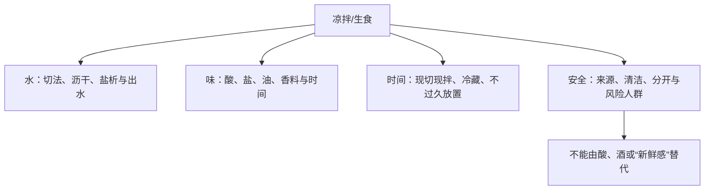

# 第 30 章 凉拌与生食：不加热时靠什么好吃、靠什么安全

不加热并不等于“不处理”。凉拌与生食把热这条线降到最低，其他三条线反而更显眼：用切法和时间改变出水，用盐/酸/油/香料建立味道，用清洁、冷藏和分开操作管理风险。风味策略与食品安全策略必须分开写。

## 30.1 生食的四条线

| 想解决的事 | 可用的动作 | 不能替代 |
|---|---|---|
| 减少蔬菜出水 | 洗后沥干、按目标控制切法与拌制时间 | 食材本身的新鲜与冷藏 |
| 建立风味 | 酸、盐、油、香草香料分层加入 | 微生物控制 |
| 管理生食农产品风险 | 流动水清洗、干净手/刀板、与生肉海鲜分开 | 加热杀菌 |
| 管理生食海鲜风险 | 选择是否食用、遵从官方高风险人群建议 | 柠檬汁、醋或冷冻的万能保证 |

## 30.2 酸改变风味，不等于把食物“煮熟”

酸能改变蛋白质状态和味觉印象，因此酸渍鱼或肉会出现类似“熟化”的外观与质地；但这不是加热过程。CDC 在旅行食品安全指引中明确把“柑橘汁、醋或其他酸性液体处理”的生海鲜列为应避免的生食情形。不能因为外观变白、变紧，就推断病原风险已被消除。

FDA 同样提醒：清洗农产品能降低而不能消除细菌；冷冻鱼可杀部分寄生虫，却不能杀死全部有害病菌。对于孕妇、儿童、老年人和免疫功能低下者，官方建议避免生或未充分烹熟的海鲜。[出处登记](../../standards.md)

## 30.3 生食的“新鲜”是信息，不是检验结果

外观、气味、颜色和购买渠道可以帮助判断品质与可追溯性，却不是微生物检测。尤其预切农产品、芽菜和生海鲜的风险需要独立考虑。FDA 指出芽菜的温暖潮湿生长条件也适合细菌繁殖，清洗不能把这个风险归零。

> **可迁移规则：生食先做风险决策，再做风味决策。** 若你无法确认来源、冷链、清洁分区或食用者的风险状况，换成充分加热的做法是减少风险的选择，不是“手艺不够”。

## 30.4 常见说法辨析

| 说法 | 判定 | 为什么流传 / 实际边界 |
|---|---|---|
| “柠檬汁能把生鱼杀菌腌熟” | ❌ 明确错误 | 酸会改变质地与味道，但不能替代加热的安全控制。 |
| “洗过的蔬菜就绝对安全” | ❌ 明确错误 | 清洗可降低、不能消除细菌；仍需避免交叉污染。 |
| “冷冻过的鱼一定可以生吃” | ❌ 明确错误 | 冷冻能处理部分寄生虫，却不能杀死所有有害病菌。 |
| “闻起来新鲜就没有食品安全风险” | ❌ 明确错误 | 感官不是病原检测；来源、处理和冷链需另行判断。 |

## 30.5 思考题

1. 为什么酸渍和加热不能互相替代？
2. 清洗生食农产品能做什么、不能做什么？
3. 【案例】同一桌人里有孕妇和儿童，如何重新设计一道原本计划做生腌海鲜的菜？
4. 【辨析】“芽菜自己种就肯定安全”为什么不成立？

> 📖 **参考答案**（想清楚再看）：[Q1](../../qa/30-cold-raw-qa.md#q1) · [Q2](../../qa/30-cold-raw-qa.md#q2) · [Q3](../../qa/30-cold-raw-qa.md#q3) · [Q4](../../qa/30-cold-raw-qa.md#q4)

## 30.6 本章实操

### 🅐 零成本版

任选一道凉拌菜，画出从购买到上桌的流程，给每一步标注“风味”“出水”“交叉污染”或“冷藏时间”风险；列出一个能改成充分加热版本的替代方案。

### 🅑 开火版

有灶台和食材时做：以同一种蔬菜做两份凉拌样品，一份切后立即拌、一份按短暂静置后再拌；记录出水、调味强度与质地。全程用清洁器具，生肉海鲜不进入该实验区。这个对照仅研究时间对出水和风味的影响，不验证食品安全。

| 组别 | 拌制时机 | 出水 | 味道强度 | 质地 |
|---|---|---|---|---|
| A | 立即 | | | |
| B | 静置后 | | | |

## 30.7 🔎 下次做菜时的用处

凉拌菜好吃靠的是水分和调味管理；是否适合生食靠的是另一张清单。把两件事分开，你就不会用“多加点醋”来代替来源、冷藏和分区卫生。

## 30.8 本章依据

- FDA *Selecting and Serving Produce Safely*：农产品清洗、冷藏与交叉污染控制。
- FDA *Selecting and Serving Fresh and Frozen Seafood Safely*：生食海鲜、冷冻与高风险人群。
- CDC *Food and Drink Considerations When Traveling*：酸性液体处理的生海鲜不等于安全。完整来源与适用范围见[出处登记](../../standards.md)。
