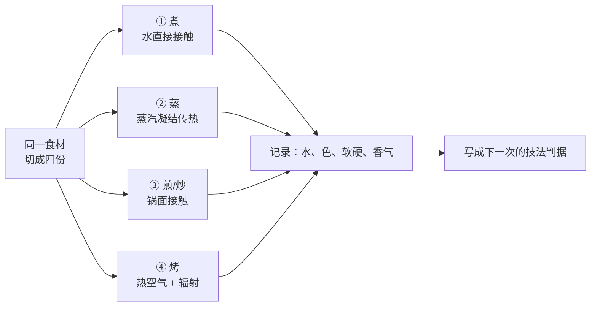

# 🛠 项目 P3：同一样食材、四种技法的对照实验

> **这是第四部分的验收。**
> 前八种技法看起来差别很大；其实每一次选择都在改同几件事：
> **热从哪里来、食材表面有多少水、时间给了什么变化。**
> 这个项目不追求做出四盘“最好吃”的菜，而是用一次可比较的实验，给自己的判断建立证据。

## P3.1 交付物与边界

做完后留下两样东西：一张四格对照表，以及一条下次能复用的选择规则。

| 交付物 | 要写下什么 | 用处 |
|--------|------------|------|
| **① 四种技法对照表** | 同一食材在水、蒸汽、锅面、干热中的表面、颜色、口感与失水差别 | 不再把“熟了”误当成同一种结果 |
| **② 我的选择规则** | 我想要某种状态时，该先选哪种技法；家中条件不够时怎样退一步 | 下次面对陌生食材时先定方向 |

**本项目用植物性食材。** 这样能把生熟安全变量降到最低，也避免生肉、鱼、蛋在四份之间交叉污染。可选土豆、南瓜、胡萝卜、茄子或西兰花梗；选**质地相近、能切成四等份**的一样即可。

> 若使用马铃薯，务必完全加热后再食用；若使用其他食材，仍应先洗手、洗净食材与器具，并把生食和熟食分开。[第 30 章](30-cold-raw.md)的边界在这里仍然有效。

## P3.2 实验不是“同时做四道菜”

你要控制的是食材与份量，故意改变的是热的路径：



四份不需要绝对相等，也不必争取同一成熟度。**差异正是资料**。唯一要避免的是：一份切成薄片、另一份切成大块，然后把尺寸造成的差异误判为技法差异。

## P3.3 🅐 零成本版：先做纸上对照

没有灶也可以完成第一版。任选一种常见蔬菜，查阅本书第 23～30 章，填下表；“预测”一栏必须在翻答案以前写。

| 技法 | 热从哪里来 | 表面水会怎样 | 我预测的颜色 / 香气 | 我预测的口感 | 适合追求什么 |
|------|------------|--------------|---------------------|---------------|--------------|
| 煮 | 水的对流 | | | | |
| 蒸 | 蒸汽凝结 | | | | |
| 煎 / 炒 | 锅面接触 | | | | |
| 烤 | 热空气与辐射 | | | | |

然后做这三个选择题，并各写一句理由：

1. 只想要“尽快变软、颜色不重要”，我先选 ______；
2. 想要表面香和颜色，我先选 ______；
3. 食材本身水很多、家里灶火又弱，我最警惕 ______。

答案没有固定词。关键是把理由写成**机制**，例如“水在场时表面温度受限”“锅面接触要求表面先变干”“烤箱同时在脱水”。写不出来的地方，回到对应章节，而不是凭菜谱记忆补一个答案。

## P3.4 🅑 开火版：四份最小对照

### 准备

| 项目 | 做法 |
|------|------|
| 食材 | 选一种蔬菜，切成**相近形状与厚度**的四份；每份少量即可 |
| 调味 | 先不放或只放同样一点盐；香料、糖、酱汁会遮住热与水的差异 |
| 器具 | 锅、带盖锅或蒸屉、烤箱（没有烤箱见下方替代） |
| 记录 | 做前称重是加分项；没有秤就记录体积、颜色、锅中留下多少水 |

依次做四份。不要执着于分钟数；以下每一步都以**状态**为停点：

| 份 | 方法 | 停点 | 你要观察的变量 |
|----|------|------|----------------|
| A | **煮**：放入接近沸腾的水中 | 筷子能插入、中心不硬 | 水是否变色或浑；食材是否吸水、散开 |
| B | **蒸**：水沸后放入蒸汽中 | 同样能插入、中心不硬 | 表面是否湿亮；盘中冷凝水；香气是否更集中 |
| C | **煎 / 炒**：擦干表面，预热锅后少量油下锅 | 表面出现局部颜色、内部熟 | 声音是否由水汽主导；何时开始上色；是否粘锅 |
| D | **烤**：平铺于烤盘，使用你设备的常用高温档 | 边缘干缩、有颜色、中心熟 | 体积缩小、边缘干湿差、颜色与香气 |

没有烤箱时，D 不要假装成“烤”：改为**干锅慢煎**，并在记录里明确写“锅面接触，不是热空气与辐射”。这样仍可比较“更干、更易上色”的路径，但不能把结论外推到烤箱。

> **顺序建议**：先煮、蒸，后煎、烤；或给每份用干净器具。不要用碰过未熟食材的夹子再夹熟食。若中途发现食材大小不一，就在表中写出来——它是本次实验的限制，不是需要掩盖的失误。

## P3.5 对照记录（交付物①）

每份刚出锅时先看、闻、摸；放到可入口温度再尝。不要只写“好吃 / 不好吃”。

| 项目 | A 煮 | B 蒸 | C 煎 / 炒 | D 烤 / 干锅替代 |
|------|------|------|----------|----------------|
| 切块大小 / 份量 | | | | |
| 加热停止时的状态 | | | | |
| 表面是湿、干还是有壳 | | | | |
| 颜色 | | | | |
| 香气 | | | | |
| 口感：脆 / 软 / 粉 / 韧 | | | | |
| 留下的水或油 | | | | |
| 我最意外的一点 | | | | |

完成后，做一次“只改一个解释”的复盘：

| 我观察到的差异 | 我认为最主要的原因 | 对应哪一章 | 我还不能排除的变量 |
|----------------|--------------------|------------|--------------------|
| | | | |
| | | | |
| | | | |

例如，煮的那份更淡不必立刻得出“煮一定没味”的结论；它也可能是切得更小、煮得更久，或水量更多。**把可疑变量写出来，就是实验成功的一部分。**

## P3.6 把观察变成规则（交付物②）

填完下列句子，规则才算完成：

```text
【我的技法选择卡】  日期：____  食材：____

我想要“湿润、均匀、颜色不是重点”时，优先考虑：________。
我想要“表面颜色 / 香气”时，先保证：________，再选择：________。
我家设备的主要限制是：________；我用的绕法是：________。
这次最容易混淆的变量是：________；下次我只改变：________。
```

最后做一个迁移练习：把食材换成**另一种**蔬菜，先不下锅，只预测四份中哪一份会最容易出水、哪一份最难上色，并写出理由。下一次做菜时再验证它。

## P3.7 自检清单

| 做到了 | 说明 |
|--------|------|
| 四份来自同一种食材、尺寸大致相近 | 你没有把“大小”误当成“技法” |
| 记录了湿 / 干、色、香、口感，不只写喜好 | 你在记录状态，不是在收集结论 |
| 至少指出一个不能排除的变量 | 你知道一次家庭实验的边界 |
| 能把一个偏好写成“状态 → 技法”的规则 | 你已经能从菜谱迁移到选择 |

## P3.8 本项目依据

本项目不新设食谱参数。它把第四部分已有的判断放进同一张对照表：

| 项目中用到的判断 | 对应章节 |
|------------------|----------|
| 炒与煎依赖锅面接触、表面干燥与足够热输入 | 第 23、24 章 |
| 炸的外壳来自失水；油是另一种高温传热介质 | 第 25 章 |
| 蒸汽凝结传热，蒸的温和也有局限 | 第 26 章 |
| 煮 / 汆存在对流和可溶物溶出 | 第 27 章 |
| 炖焖用时间换结缔组织变化 | 第 28 章 |
| 烤箱同时涉及热空气、辐射与干燥 | 第 29 章 |
| 生食、交叉污染与高风险食材的边界 | 第 30 章 |

出处与适用范围见[参考书目与出处登记](../../standards.md)。

---

**第四部分到此结束。**

你现在不只知道八种技法分别怎么做，还能用同一组变量比较它们。下一部分会把这个判断带回真实厨房：当锅、灶、时间和菜的数量同时有限，怎样排出一个不会互相打架的计划。
