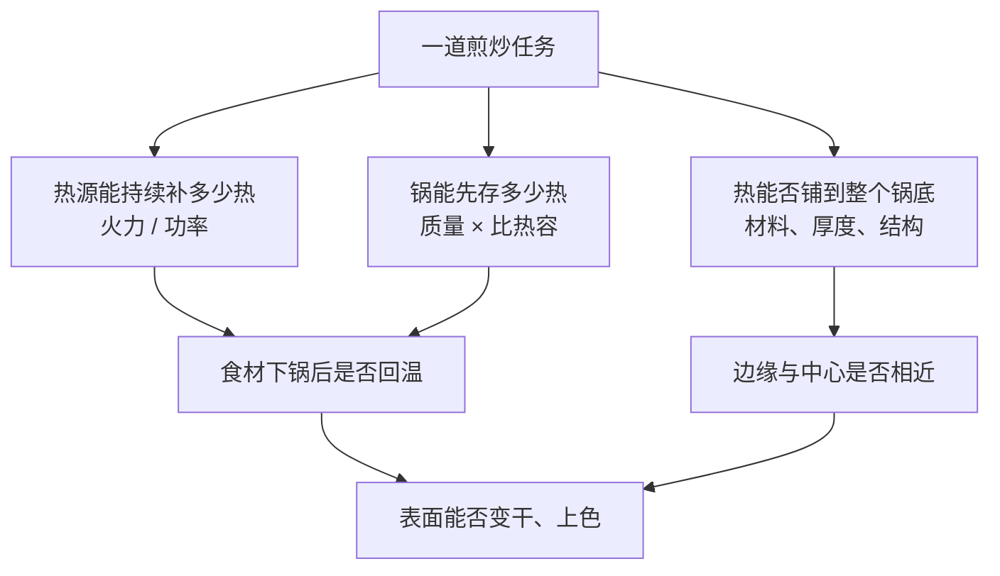

# 第 31 章 火力与锅具：导热、蓄热、不粘涂层的取舍

“这口锅不行”常常是真的，但还差半句话：**它不适合这一次的热任务。** 同一档火、同一份食材，换锅后锅底面积、锅的质量、材料传热、表面状态都会变；因此“炒几分钟”不能原样搬运。

## 31.1 先把“火大”拆成三件事

- **火力（持续供热）**：决定食材一进锅、带走热量以后，系统能回温多快。第 23 章的核心不是“开最大火”，而是让供热与下锅量相配。
- **蓄热（热容量）**：锅越重不必然越好；但在其他条件相近时，更多质量和适当的比热容能让锅在短时间内不那么容易被冷食材拉低温度。
- **传热与均匀性**：导热快不等于锅永远更热，而是热更容易从受火处移动到别处。锅底厚度、夹层、底部是否完全接触热源，同样会改写结果。

美国 NIST 的材料数据可确认：铝合金、铁/钢、不锈钢的导热性质确有差异；但这不是一张“材质排名表”。锅的厚度、直径、结构和炉头接触面积都会参与。NIST 一项以不同锅具做的燃烧测试甚至显示，锅底面积与炉头接触面积会改变升温表现，不能把结果只归给材料。[出处登记](../../standards.md)

## 31.2 选任务，不选“最好的锅”

| 你的主要任务 | 更要紧的变量 | 可优先考虑 | 主要代价 |
|--------------|--------------|------------|----------|
| 薄蛋、嫩鱼，要完整脱离 | 表面隔离与温和控制 | 状态完好的不粘锅 | 不把它当作长期空烧或极端高温工具；以制造商说明为准 |
| 少量肉、豆腐，要表面颜色 | 下锅前热量、锅面接触、表面干燥 | 能稳定预热的厚底裸露金属锅 | 更需要处理水分、油膜与翻面时机 |
| 一锅炖煮 | 容量、盖合、受热稳定 | 容量合适、易控制的锅 | 追求“锅气”的指标不重要 |
| 一次量大、食材刚从冷藏取出 | 持续供热与分批策略 | 大锅或分批，而非只换材质 | 大锅若超过炉头覆盖范围，边缘仍可能弱火 |

“铸铁一定蓄热好、不锈钢一定受热不匀、涂层锅一定不能炒菜”都把多个变量压成了一句口号。比如厚重的锅通常更不怕短时降温，却可能升温慢；薄锅升温快，却也可能在冷食材入锅时掉温更快。**先写目标，再选变量**，比先站队材质可靠。

## 31.3 不粘涂层：它解决什么，又不解决什么

不粘表面的核心收益是降低食物与锅面的直接黏附，这对蛋和薄嫩食材特别有用（第 24 章）。它并不自动解决：

| 遇到的现象 | 涂层能否直接解决 | 应先检查 |
|------------|------------------|----------|
| 食材出水、没有颜色 | 否 | 下锅量、表面水、持续供热 |
| 中心未熟、边缘焦 | 否 | 切块厚度、火力、翻面与时间 |
| 一翻就碎 | 部分能降低黏附 | 食材是否先定型、铲子时机 |
| 油冒烟 | 否 | 立即降低热输入；油和锅是否已过热 |

关于安全，别用网上的单一温度当作所有锅具的规则。已有迁移研究在特定测试条件（250 °C、30 分钟）下未见超过其评估限值的总迁移，也不等于所有品牌、磨损状态和空烧情形都一样。最可靠的家庭动作是：**查看该锅的使用说明，避免长时间空锅干烧、明显过热或用不适配工具损伤表面；表面严重损坏时按制造商建议处置。**

## 31.4 换锅后，哪些参数必须重设

把菜谱的“中火两分钟”翻译为下面这套复位流程：

1. **先空锅预热，但不离开。** 观察锅面而不是机械计时；油一出现持续冒烟，说明这个热输入已经不适合当前油和任务。
2. **只下一小份食材作探针。** 听声音、看是否迅速积水、看一面是否能定型。
3. **若声音转为咕噜、锅内积水多**：优先减量分批，或先擦干食材；不要只把火拧大。
4. **若局部焦、别处苍白**：移动位置、降低火力或选更适合热源覆盖范围的锅；不要用“更久”掩盖不均匀。
5. **把成功条件记成状态。** 例如“第一面轻推能移动、边缘出现颜色”，而不是“每面 90 秒”。

## 31.5 常见说法辨析

| 说法 | 判定 | 边界 |
|------|------|------|
| “锅越重，火就越大” | ❌ 明确错误 | 重量影响短时温降，却不创造热源功率。 |
| “导热快的锅一定更适合煎” | ❌ 明确错误 | 还取决于厚度、结构、热源覆盖、锅面与食材状态。 |
| “不粘锅不需要预热和控制火” | ❌ 明确错误 | 它降低黏附，不会消除出水、过热和熟度不均。 |
| “换锅后仍照原菜谱分钟数做” | ⚠️ 高风险 | 分钟隐含了原锅、原炉、原份量；换了任一项都应回到状态判据。 |

## 31.6 思考题

1. 为什么“锅很重”不能推出“这口锅火力大”？
2. 一口锅中心总是焦、边缘却不上色，为什么不应先简单延长时间？
3. 【案例】同一份青菜从不粘锅换到薄不锈钢锅，立刻大量出水。请按“持续供热—蓄热—表面水—下锅量”排序排查。
4. 【辨析】“不粘锅解决了粘锅，所以煎鱼必然不会碎”为什么不成立？

> 📖 **参考答案**（想清楚再看）：[Q1](../../qa/31-heat-pans-qa.md#q1) · [Q2](../../qa/31-heat-pans-qa.md#q2) · [Q3](../../qa/31-heat-pans-qa.md#q3) · [Q4](../../qa/31-heat-pans-qa.md#q4)

## 31.7 本章实操

### 🅐 零成本版

检查家中两口锅和炉头，填事实，不猜性能：

| 锅 | 直径 / 锅底是否平 | 材质与涂层状态 | 炉头能覆盖哪里 | 我通常在哪种任务失手 |
|---|---|---|---|---|
| | | | | |
| | | | | |

为其中一口锅写一句任务边界：`我用它做____，避免用它做____，因为____。`

### 🅑 开火版

用同一种耐炒的蔬菜做两小份对照；保持切法、油量与调味一致，只改变**下锅量**（一份少量、一份拥挤）。记录第一分钟的水汽、声音、颜色和锅温恢复的迹象。它只能说明这口锅、这台灶、这份食材下的现象，不是材质总排名。

| 组别 | 下锅量 | 首分钟声音 / 积水 | 第一次出现颜色 | 成品口感 | 下次只改什么 |
|------|--------|------------------|----------------|----------|--------------|
| A | 少量 | | | | |
| B | 拥挤 | | | | |

## 31.8 🔎 下次做菜时的用处

换锅后的第一锅，把它当作校准，不当作考试。先用少量食材读出这套“锅 + 灶 + 份量”的响应，再决定是否分批、是否降火、是否改技法。你要调的不是一个神秘的“锅气”，而是持续供热、存热、传热和表面状态。

## 31.9 本章依据

- NIST 材料与锅具测试资料：不同金属的热物性存在差异；锅具表现同时受质量、几何形状和接触面积影响。见[出处登记](../../standards.md)。
- Bradley 等关于不粘锅涂层迁移的研究：只用于说明特定测试条件与研究边界，不把它改写为所有锅具的安全承诺。见[出处登记](../../standards.md)。
- 第 23、24 章：家庭灶功率约束、表面水分、油膜与接触传热的判断。
