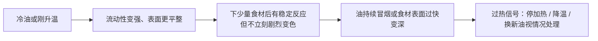

# 第 32 章 油温怎么判断：现象、温度与“几成热”

“五成热”“油纹出现”“筷子冒泡”是厨房里的沟通捷径，不是跨锅、跨油、跨火都相同的温度计。它们的真正价值是提醒你：**油已经进入某个行为阶段，下一步应观察食材会发生什么。**

## 32.1 先分三种问题

| 你真正想知道的 | 可靠的回答方式 | 不该拿什么代替 |
|----------------|----------------|----------------|
| 油是否已经明显过热 | 油是否持续冒烟、气味是否刺激；立刻降热或停火 | “再等一下就会更香” |
| 食材下锅后会发生什么 | 看声音、气泡、颜色形成速度和表面状态 | 锅里油单独时的一个口令 |
| 中心是否达到安全熟度 | 合适的食品温度计与当地官方指引 | 外皮颜色、油温或“炸了几分钟” |

最后一行尤其重要。美国 USDA 明确提醒，视觉上的“熟了”可能导致过熟变干，也可能导致未熟；温度计测的是食物中心，而不是锅里油。[出处登记](../../standards.md) 这本书不会把“油温到了”写成肉、鱼、蛋已经安全的保证。

## 32.2 油的三个观察阶段

不报“几成”，改用可复核的现象：

| 阶段 | 可以看什么 | 适合做什么 | 不能推出什么 |
|------|------------|------------|--------------|
| 刚升温 | 油更易流动、锅面更易铺开 | 温和炒香、试探预热 | 一个精确温度 |
| 有效加热 | 少量食材下锅后有稳定声音与气泡，颜色不是瞬间暴冲 | 煎、炒、浅炸中根据食材继续调节 | 每种油、每种锅都同样 |
| 过热 | 持续冒烟、刺鼻气味、食材刚下锅就快速变深 | 暂停、离火或调低；不要硬把食材放进去 | “烟越大火越旺，越适合炸” |

烟点是“开始持续冒烟”的现象性指标；它会受油的游离脂肪酸、炼制程度和使用历史影响，且目视判断本身有局限（第 23 章）。所以烟不是“高温成功”的标志，而是**当前油—锅—火组合需要回退**的信号。

## 32.3 为什么“滴水、插筷子”不够可靠

这些办法最多能提示“有热反应”，却混入太多变量：筷子的含水量与粗糙度、食材表面水、油量、锅底厚度、火力和观察者对“泡多泡少”的理解都会不同。把它们当作**练习观察的起点**可以；把它们翻译成固定温度或安全结论不可以。

| 常见说法 | 这次真正测到的 | 它漏掉的变量 |
|----------|----------------|--------------|
| “木筷周围冒泡就是五成热” | 木筷表面水分受热汽化 | 木材湿度、油深、锅温分布、火力 |
| “滴水跳舞就能下肉” | 水与热油接触后的剧烈反应 | 溅油风险、局部温度、食材中心熟度 |
| “油没冒烟就可以无限加热” | 还没观察到持续烟 | 油的老化、食材何时会焦、不同油的差异 |

**不建议往热油里滴水做测试。** 它没有提供比“少量食材试探”更好的决策信息，却增加飞溅风险。

## 32.4 最小校准法：让食材当“任务探针”

实际做菜时，油温从来不是目的；目标是让食材获得合适的表面反应而不焦。用少量同类食材试探：

1. 先在中等热输入下预热，油铺开后放入**一小块擦干的同类食材**；
2. 观察 10～20 秒：是沉寂、稳定反应，还是颜色飞快加深；
3. 沉寂且出水多，优先检查锅温、食材表面水和下锅量；
4. 颜色过快变深或油有烟，降低热输入，不要靠频繁翻动抢救；
5. 找到合适状态后再下其余食材，且别让总量突然翻倍。

这不是用食材“测温”，只是用它测试**当前任务是否匹配**。换了食材、锅或油，应重新校准。

## 32.5 常见说法辨析

| 说法 | 判定 | 为什么 |
|------|------|--------|
| “几成热是精确温度” | ❌ 明确错误 | 各书、各地区、各厨房对术语的映射不统一，且油与锅的状态在变。 |
| “油冒烟才够热” | ❌ 明确错误 | 持续冒烟是过热警讯，不是常规起跑线。 |
| “炸到金黄就说明内部安全” | ❌ 明确错误 | 表面颜色与中心安全熟度不是同一件事。 |
| “温度计能替代看状态” | ⚠️ 不完整 | 温度计能量化局部温度；食材含水、大小、下锅量和颜色仍需观察。 |

## 32.6 思考题

1. 为什么“油温”不能直接回答“食物熟了吗”？
2. 为什么不建议用滴水试油温？
3. 【案例】炸一小块食材立刻深褐、油又冒烟。按优先级你会做什么？
4. 【辨析】“只要油不冒烟，火就不可能太大”为什么不成立？

> 📖 **参考答案**（想清楚再看）：[Q1](../../qa/32-oil-temperature-qa.md#q1) · [Q2](../../qa/32-oil-temperature-qa.md#q2) · [Q3](../../qa/32-oil-temperature-qa.md#q3) · [Q4](../../qa/32-oil-temperature-qa.md#q4)

## 32.7 本章实操

### 🅐 零成本版

观看一次自己或公开视频中的煎炒过程，按下表只写画面事实：

| 时点 | 油 / 锅的可见现象 | 食材入锅后的声音和颜色 | 我推测下一步应加 / 减什么热 | 不确定之处 |
|------|-------------------|------------------------|------------------------------|------------|
| 刚下锅 | | | | |
| 约半程 | | | | |
| 出锅前 | | | | |

### 🅑 开火版

用一小份耐煎的植物性食材，分两次做：一次从较温和热输入开始，另一次故意稍强但**不让油冒烟**。保持切法、油量和份量一致，记录颜色首次出现、是否出水、有没有焦苦。不要往油中滴水，也不要用本实验判断动物性食材的安全熟度。

| 组别 | 起始热输入 | 首次明显反应 | 首次颜色 | 出水 / 焦苦 | 下次调整 |
|------|------------|--------------|----------|------------|----------|
| A | 温和 | | | | |
| B | 稍强 | | | | |

## 32.8 🔎 下次做菜时的用处

忘掉“几成”的固定答案，记住两个停损点：**持续冒烟就回退；表面颜色不能替代中心熟度。** 其余时间，让少量食材的声音、出水和上色速度告诉你，这一锅该加热、减热还是减量。

## 32.9 本章依据

- 美国 USDA FSIS「Food Thermometers」：视觉熟度并非可靠安全判据，温度计应测食物本身；见[出处登记](../../standards.md)。
- 第 23 章登记的油烟点研究：烟点是受油品质影响、且目视判断有局限的现象指标。
- 第 25 章：油炸时食材失水、形状与时间都会参与结果，不能只由油温单独决定。
