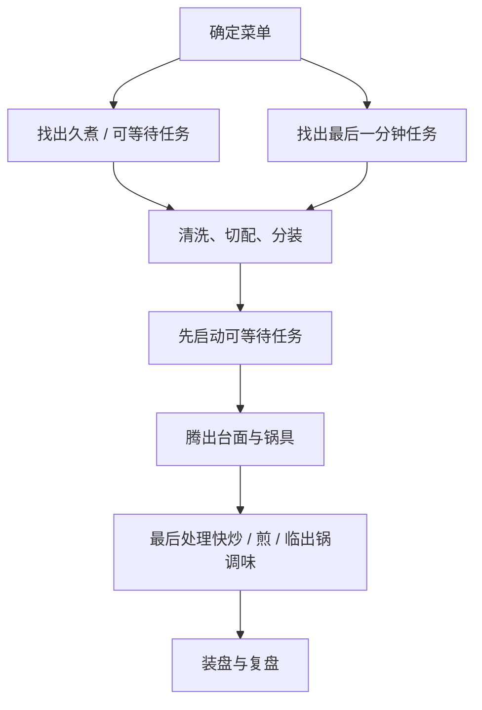

# 第 33 章 切配前置与一顿多菜的时间表

一顿饭翻车，常不是因为不会做某道菜，而是把三件互相冲突的事放进同一分钟：锅在冒烟、蒜还没切、汤需要看火。切配前置不是“把所有东西摆得好看”，而是**把不可中断的热任务从寻找、清洗、称量中解放出来**。

## 33.1 先画依赖，不先写分钟

“18:10 炒菜、18:15 出锅”假设了食材、锅、火和人都按同一节奏工作。更可靠的是写依赖：哪件事必须在另一件事之前，哪件事开始后不能离开。

| 任务类型 | 典型例子 | 排程原则 |
|----------|----------|----------|
| 可等待 | 淘米煮饭、炖煮、洗切、配酱汁 | 尽早启动；设置能回来查看的提醒 |
| 等待会变差 | 叶菜久放、切开后易氧化的食材、拌好会出水的菜 | 靠近开火或上桌再做 |
| 不能离开 | 热油下料、收汁、快速煎炒 | 之前完成切配、调料、盘子和工具准备 |
| 共享资源 | 只有一口锅、一只炉头、一块案板 | 提前决定谁先用、何时清空 |

这张表不说“什么菜必须最后炒”，而是问：**它离开火后会不会迅速失去你要的状态？它开始后我能不能去切另一道菜？**

## 33.2 切配前置的最小单位

不是所有东西都要提前一小时切好。把前置拆成四格，够用就停：

| 格子 | 开火前要完成什么 | 为什么 |
|------|-------------------|--------|
| 食材 | 洗、切、擦干；按下锅顺序分组 | 开火时不再临时找食材；也避免湿食材突然入油 |
| 调味 | 把会连续加入的调料放近，需混合的先混合 | 减少“锅已过头、手还在找瓶子” |
| 工具 | 铲、夹子、盘、锅盖、隔热物到位 | 热任务开始后不必翻橱柜 |
| 清洁与安全 | 生熟分开；擦干台面；处理生食后洗手和器具 | 把交叉污染控制放在最不忙的时段 |

“提前切配”不等于把所有食材混进一大碗。洋葱、蒜、干辣椒的入锅时机不同；肉和蔬菜也可能需要不同处理。**按下锅顺序分组**，才让前置真正减少认知负担。

## 33.3 一顿三菜的通用排法

先给每道菜贴标签，再排，而不是把菜名硬套进顺序。

| 菜 | 等待代价 | 开火后注意力 | 资源 | 标签 |
|----|----------|--------------|------|------|
| A | 低 / 中 / 高 | 低 / 中 / 高 | 锅 / 炉头 / 烤箱 | 例如：可先启动 |
| B | | | | |
| C | | | | |

排程规则：

1. **先做耗时长、可等待的**：米饭、汤、炖菜先启动；它们不是“早做完”，而是给快炒腾出窗口。
2. **再做能保温或能回锅的**：做好后盖好、保温或短暂回热的任务，放在中段。
3. **最后做等待代价最高的**：快炒青菜、煎得刚好的蛋、临出锅香气，最后占用你的注意力。
4. **留空档，不排满。** 一口锅要洗、食材会出水、电话会响；计划中预留一段没有硬任务的时间，才有弹性。

## 33.4 失败不是“手慢”，而是资源冲突

| 现场症状 | 多半是什么冲突 | 下次的工程改法 |
|----------|----------------|----------------|
| 菜焦了，蒜还没剥 | 热任务与准备任务重叠 | 开火前把蒜和调料放到锅边 |
| 第一盘凉了，最后一盘才好 | 把等待代价高的菜做得太早 | 调换顺序，或选择可保温任务先做 |
| 一锅菜出水，另一锅空着 | 锅、灶与下锅量没匹配 | 分批或改用第二个热源；第 31 章先校准锅灶 |
| 台面乱到找不到工具 | 把收纳当成最后一步 | 给每道菜一只小盘 / 一组容器，做完即归位 |

## 33.5 常见说法辨析

| 说法 | 判定 | 边界 |
|------|------|------|
| “专业厨房都提前切好，所以家里也要全部预切” | ⚠️ 不完整 | 原理是降低热任务中的中断；易变色、易出水食材可晚处理。 |
| “一顿饭必须所有菜同时出锅” | ❌ 明确错误 | 不同菜的等待代价不同；先后出锅、适当保温往往更稳定。 |
| “计划越细越不会乱” | ❌ 明确错误 | 分钟表过密会忽略锅灶差异和意外；依赖与缓冲比虚假的精确更有用。 |
| “切配前置只为效率” | ❌ 明确错误 | 它也把交叉污染、湿食材下油和找工具的风险移到低压力时段处理。 |

## 33.6 思考题

1. 为什么一张“18:10 做什么”的时间表不如依赖图可靠？
2. 哪类食材不适合过早混在一起？为什么？
3. 【案例】你只有一个炉头，要做饭、番茄炒蛋和清炒青菜。怎样按“等待代价”排出顺序？
4. 【辨析】“所有菜必须同时出锅”为什么不是更高的标准？

> 📖 **参考答案**（想清楚再看）：[Q1](../../qa/33-mise-en-place-scheduling-qa.md#q1) · [Q2](../../qa/33-mise-en-place-scheduling-qa.md#q2) · [Q3](../../qa/33-mise-en-place-scheduling-qa.md#q3) · [Q4](../../qa/33-mise-en-place-scheduling-qa.md#q4)

## 33.7 本章实操

### 🅐 零成本版

选你最常做的一顿饭，先不做菜，填一张依赖表：

| 任务 | 前置条件 | 开始后能离开吗 | 等待代价 | 共用什么资源 | 我放在第几段 |
|------|----------|----------------|----------|--------------|----------------|
| | | | | | |
| | | | | | |
| | | | | | |

至少给计划留一个空档，并写下“如果前一道多花十分钟，我优先推迟哪一道”。

### 🅑 开火版

做一次两菜或三菜饭，但只测试排程：开火前完成切配分组、调料和工具定位；做饭时记录每道菜开始与结束的状态，而非追求分钟准确。复盘只改一个瓶颈，例如“青菜最后下锅”或“酱汁提前调好”。

| 菜 | 原计划位置 | 实际位置 | 哪一步被打断 | 成品等待后的变化 | 下次只改一项 |
|----|------------|----------|--------------|------------------|--------------|
| | | | | | |
| | | | | | |

## 33.8 🔎 下次做菜时的用处

开火前先问一句：**这口锅一忙起来，我还缺什么？** 缺的是蒜、酱油、盘子、夹子，还是一条不被打断的收汁窗口？把答案提前放好，再开火。菜谱会变，依赖关系不会消失。

## 33.9 本章依据

- 本章是厨房工作流与前述热—水—时间框架的组织方法，不引入新的食品参数。
- 第 23、31、32 章：快炒的热输入限制、锅灶校准与油温的状态判断。
- 第 30 章：生熟分开、洗手和避免交叉污染的安全边界。
