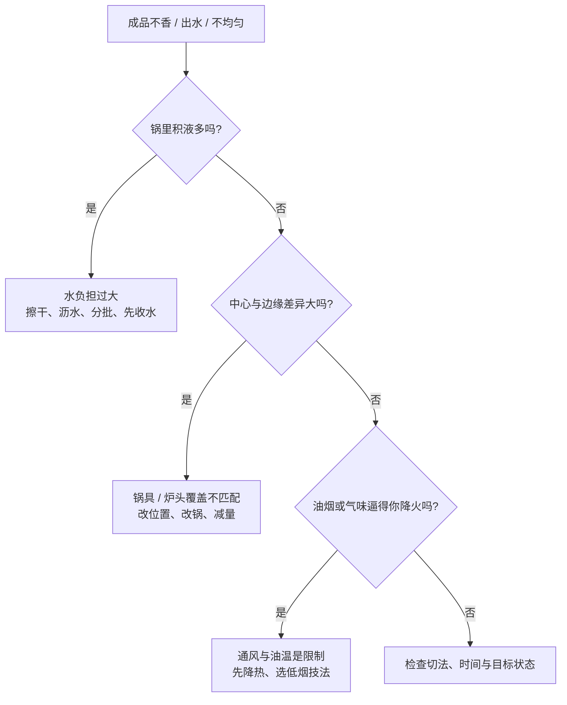

# 第 34 章 家庭灶的限制怎么绕

家庭厨房的限制不需要靠意志克服。灶的持续供热有限、锅底与炉头未必匹配、锅内水汽又会占走热量；把餐馆流程原封不动放大，结果常是“由炒变煮”。正确的目标不是复制餐馆，而是在自己的条件下选一个能稳定达成的版本。

## 34.1 先识别是哪一种限制

| 限制 | 典型信号 | 先做的绕法 | 不要误做成 |
|------|----------|------------|--------------|
| 持续功率不够 | 食材一多就积水、声音从滋啦变咕噜 | 分批；减少表面水；把要上色的步骤前置 | 一次塞更多、只把火拧到最大 |
| 锅太小或热源覆盖不合适 | 中心焦、边缘苍白；翻不动 | 减量、换更适合的锅或改成分次完成 | 用更久来弥补不均 |
| 水汽排不出去 | 盖盖后湿软、打开后冷凝水多 | 给蒸汽路径；分阶段开盖 / 收汁；选蒸煮而非假装干炒 | 把盖子当成“更大火” |
| 油烟与气味 | 刺激、持续冒烟、不得不中断 | 先降温、停止继续加料；改用蒸、煮、炖等匹配目标的技法 | 以“忍住烟”换上色 |

## 34.2 三套绕法：减负、分段、换目标

### 绕法一：减负——让热量有机会做它该做的事

第 7 章的核心关系是：表面还有自由水时，热量会被蒸发占用，温度难以进入明显褐变的窗口。家用灶与餐馆灶的功率量级不同，因此最普适的补偿不是换神奇调料，而是：

- 食材洗后沥干、需要上色的表面擦干；
- 不把份量突然翻倍；
- 把需要褐变的食材分批处理，先盛出，再合并；
- 湿调料和加水步骤放在上色之后，除非这道菜本来就要煮。

这不是承诺“分批一定更香”。它是把同一份热量分给更少的水与食材，给系统保留上色机会。具体改善幅度会随锅、灶、食材和份量改变，本书没有家庭尺度的定量百分比。[出处登记](../../standards.md)

### 绕法二：分段——别让一口锅同时完成互相冲突的任务

同一锅可以先完成一项状态，再完成下一项：

| 目标 | 可分成的阶段 | 为什么这样拆 |
|------|--------------|--------------|
| 肉既要颜色又要熟透 | 少量分批上色 → 合并加液体完成中心熟化 | 上色要较干表面；加液体后温度受水限制 |
| 蔬菜既要熟又不想大量出水 | 先处理最湿 / 最耐火的部分 → 最后短时处理叶菜 | 不同部位的水分、厚度和熟化速度不同 |
| 一锅量太大 | 先完成可等待部分 → 最后处理等待代价高的部分 | 把注意力留给不能离开的热任务 |

分段不是更多步骤本身，而是承认“褐变、煮透、收汁、临出锅香气”经常需要不同的热—水条件。

### 绕法三：换目标——不能爆炒时，不必假装在爆炒

如果抽烟、空间、炉头或锅具不支持高热干炒，就把目标改写得诚实一些：

| 原来想复制的结果 | 条件不支持时的替代目标 | 相应技法 |
|------------------|--------------------------|----------|
| 大量食材同时强褐变 | 一部分上色 + 整体熟透 | 分批煎后合并，或先烤后合并 |
| 快炒的干爽口感 | 湿润、均匀、温和的质地 | 蒸、汆、焖，再用调味补香 |
| 高温炸出的外壳 | 较干、较有颜色的表面 | 烤箱或空气流动的干热；仍需按设备说明操作 |

换目标不是失败。读者真正要学会的是：**我缺的是热、空间、排湿，还是时间？** 找到缺口，才知道该分批、分段还是换技法。

## 34.3 “盖盖子”不是免费火力

盖盖能减少热和水汽离开系统，常有利于焖熟；也会让锅内湿度上升、把干炒和上色的窗口关得更久。正确问题不是“要不要盖”，而是：

1. 这一段目标是让中心熟，还是让表面干？
2. 锅内已经有多少液体？
3. 后面是否还留有开盖收水、调整味道的窗口？

> **可迁移规则**：想要表面颜色，优先减少水负担和下锅量；想要均匀熟透，允许水与盖子参与。不要要求同一分钟同时实现两端。

## 34.4 常见说法辨析

| 说法 | 判定 | 边界 |
|------|------|------|
| “家庭灶炒不好，是手艺不够” | ❌ 明确错误 | 持续功率、锅具与份量是物理约束；手艺的作用是识别并绕开约束。 |
| “只要开最大火就能解决出水” | ❌ 明确错误 | 食材水分与下锅量超过系统处理能力时，最大火也可能不够。 |
| “分批一定更好吃” | ⚠️ 不完整 | 它通常有利于降低瞬时水负担，却增加操作时间与批次差异；需按目标验证。 |
| “盖盖能让所有菜更快更香” | ❌ 明确错误 | 它有利于保热和焖熟，也会增加湿度并延后褐变。 |

## 34.5 思考题

1. 为什么“火开最大”不必然让一锅菜更容易上色？
2. “分批”和“分段”分别在解决什么问题？
3. 【案例】一口小锅、一个炉头、四人份炒肉片：每次都大量出水。请给出“目标 → 主要限制 → 顺序 → 验证”的方案。
4. 【辨析】“盖盖子相当于加大火力”为什么不成立？

> 📖 **参考答案**（想清楚再看）：[Q1](../../qa/34-home-kitchen-limits-qa.md#q1) · [Q2](../../qa/34-home-kitchen-limits-qa.md#q2) · [Q3](../../qa/34-home-kitchen-limits-qa.md#q3) · [Q4](../../qa/34-home-kitchen-limits-qa.md#q4)

## 34.6 本章实操

### 🅐 零成本版

为家中最常失败的一道菜填一张限制诊断表：

| 我看到的现象 | 最可能的限制 | 我能减掉的负担 | 我可拆开的阶段 | 我用什么现象验证 |
|--------------|--------------|----------------|----------------|------------------|
| | | | | |

只选择一个最小改动，例如“这次只分两批”，不要同时换锅、换油、换切法和换调味。

### 🅑 开火版

有灶台和食材时做：用同一种耐炒蔬菜或肉片做两小份。A 组一次下完，B 组分两批；保持切法、调味与锅相同。记录的是水汽、声音、颜色和等待成本，不把单次结果外推成普遍规律。

| 组别 | 下锅策略 | 积水 / 水汽 | 首次出现颜色 | 操作成本 | 我愿意保留的取舍 |
|------|----------|-------------|--------------|----------|------------------|
| A | 一次下完 | | | | |
| B | 分两批 | | | | |

## 34.7 🔎 下次做菜时的用处

当你发现“怎么加火都不香”，先不要怪锅或怪自己。先把问题改写成一句可操作的话：**这锅此刻是水太多、量太大、受热不匀，还是我想在同一分钟完成互相冲突的目标？** 答案会直接给出下一步。

## 34.8 本章依据

- 第 7 章与第 23 章：功率、食材出水与褐变窗口的关系；家用与餐馆灶的量级来自已登记的 *Chemical Reviews* 综述，见[出处登记](../../standards.md)。
- 第 29 章：烤箱的热空气、辐射与干燥；第 31～33 章：锅灶校准、油温状态和任务排程。
- “家庭分批下料可改善多少”的定量幅度尚未核到；本章只给机制方向与可验证的对照方法。
