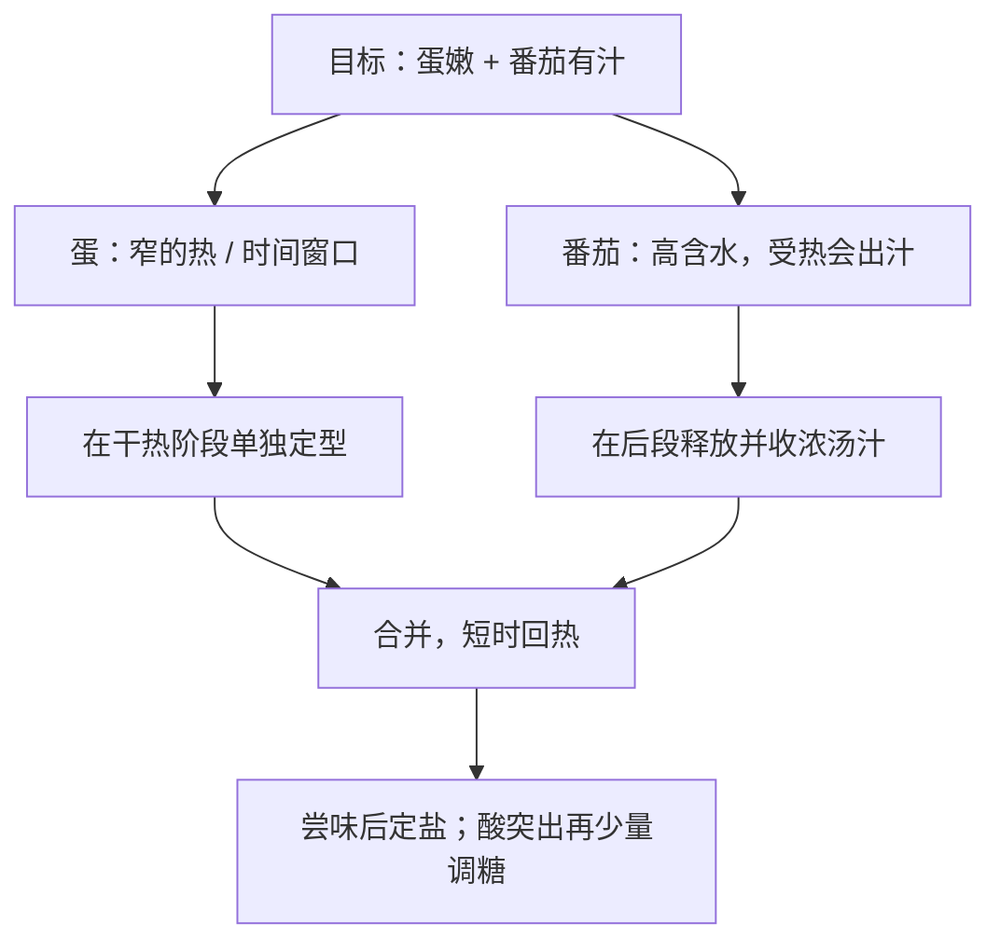

# 第 35 章 番茄炒蛋：四条线的最小完整案例

这不是一份“两个鸡蛋配几个番茄”的标准菜谱。它要解决的是：当蛋要嫩、番茄要出汁、又想有香气时，**同一口锅里哪些目标必须分开完成，哪些可在最后合并。**

## 35.1 先定义成品，不先争顺序

同叫番茄炒蛋，至少有两种合理目标：

| 目标 | 蛋 | 番茄 | 顺序倾向 |
|------|----|------|----------|
| 大块、嫩滑，带一点煎香 | 先在较干、较热的锅中快速定型 | 出汁但仍保留块状 | 先蛋，盛出，再处理番茄，最后合并 |
| 软嫩、与番茄汁融在一起 | 在汁中凝成小块 | 更软、更像浇头 | 先番茄出汁，再倒蛋液 |

第二种不是“做错了第一种”；它是另一种终点。先选成品，才谈顺序。

生番茄含水量约为 94.5 g/100 g、全蛋约 76.2 g/100 g（USDA 数据）。番茄入锅后的主要限制不是“它不够熟”，而是它释放的水会占用热量，使锅内更接近湿热环境；因此蛋若和它同时久煮，更容易从“嫩块”走向碎、老、出水。[出处登记](../../standards.md)

## 35.2 把一盘菜拆成四条线

| 阶段 | 热 | 水 | 味 | 时间 |
|------|----|----|----|------|
| 打蛋、切番茄 | 暂不加热 | 切面决定出汁速度 | 蛋液中少量盐用于内部均匀；不等于最后定味 | 预处理时间 |
| 先做蛋 | 较高热输入、短时定型 | 尽量不让番茄汁介入 | 油带来润滑与香气载体 | 看到大半凝固就离火，余温会继续作用 |
| 处理番茄 | 中等热输入 | 释放汁水，再按目标收浓 | 酸、甜、鲜进入汤汁 | 别把“出汁”与“熬成泥”混为一谈 |
| 合并与出锅 | 只需短时回热 | 汁挂住蛋，不必全部蒸干 | 尝后补盐；酸突出才少量加糖再尝 | 合并越久，蛋越容易错过窗口 |

这张表给出的可迁移规则是：

> **把“怕久、想要干热表面”的食材单独完成；把“会出水、负责汤汁”的食材放在后段。**

它同样适用于肉片配西葫芦、虾仁配青菜：不是记住“先炒谁”，而是识别谁怕水、谁怕久。

## 35.3 处理方案，而不是固定配方

按以下状态推进；份量、锅和火力改变时，优先改状态判断，不照搬分钟数。

| 步骤 | 要做什么 | 进入下一步的判据 | 对应原理 |
|------|----------|------------------|----------|
| 1 | 番茄切成相近块，蛋液打散 | 食材、调味、盘子已在手边 | 第 33 章：前置降低热任务中断 |
| 2 | 先做蛋，必要时分两次 | 大部分凝固、仍有润泽感，能成大块移动 | 第 21、31 章：蛋的窄窗口、锅灶校准 |
| 3 | 盛出蛋，处理番茄 | 番茄有汁；若要块状，尚未完全散掉 | 第 3、20 章：水分释放与质地 |
| 4 | 尝汁，再决定盐与是否要一点糖 | 不是按勺数，而是酸、咸、鲜是否平衡 | 第 12、15 章：混合味与纠偏 |
| 5 | 蛋回锅，短时合并后离火 | 汁能裹住蛋；蛋没有继续明显收紧 | 第 4、21 章：余温与避免久煮 |

### 两个常见分歧，其实各有目标

| 分歧 | 选择 A | 选择 B | 不变的底线 |
|------|--------|--------|------------|
| 先蛋还是先番茄 | 要大块煎香蛋 | 要蛋与汁融在一起 | 别把不想要的质地叫“失败” |
| 糖要不要放 | 酸突出时少量、尝后再调 | 番茄成熟甜、已有平衡时不放 | 糖不是固定配方；它会同时改甜与酸的感受 |
| 盐何时放 | 蛋液里少量，帮助内部均匀 | 最后尝后补，作为定味 | “早放 / 晚放”在解决不同任务 |

## 35.4 常见说法辨析

| 说法 | 判定 | 边界 |
|------|------|------|
| “必须先炒蛋才正宗” | ❌ 明确错误 | 先后顺序服务不同的成品目标，不是道德判断。 |
| “蛋液里早放盐一定会老” | ⚠️ 证据不足 | 盐会影响蛋白体系，但本书未核到可迁移到家庭蛋液的直接定量对照；不写成定律。 |
| “加糖只是为了变甜” | ❌ 不完整 | 糖也会改变对酸的感受；具体结果取决于番茄酸度与已有调味。 |
| “番茄出汁就是火力不够” | ❌ 明确错误 | 番茄本身高含水，出汁是目标的一部分；问题是它在错误阶段淹没了蛋的干热窗口。 |

## 35.5 思考题

1. 为什么番茄炒蛋的顺序首先是“成品目标”问题？
2. 为什么“番茄出汁”既是需要的过程，又会限制褐变？
3. 【案例】你只有小火、薄锅，想做大块嫩蛋和带汁番茄。请按“目标 → 限制 → 顺序 → 验证”写方案。
4. 【辨析】“蛋液里早放盐一定会老”应怎样标注证据强度？

> 📖 **参考答案**（想清楚再看）：[Q1](../../qa/35-tomato-eggs-qa.md#q1) · [Q2](../../qa/35-tomato-eggs-qa.md#q2) · [Q3](../../qa/35-tomato-eggs-qa.md#q3) · [Q4](../../qa/35-tomato-eggs-qa.md#q4)

## 35.6 本章实操

### 🅐 零成本版

在[一道菜的处理方案表](../../forms/dish-plan.md)中，分别为“大块嫩蛋版”和“融入汤汁版”填写目标、主约束和顺序。只比较它们的逻辑，不评判哪一种高级。

| 版本 | 我想要的蛋 | 我想要的汁 | 谁先做 | 我用什么状态判断出锅 |
|------|------------|------------|----------|----------------------|
| A | | | | |
| B | | | | |

### 🅑 开火版

有灶台和食材时做：将蛋液和番茄分成两小份。A 组先做蛋再合并，B 组先让番茄出汁再倒蛋液；保持总量、锅、调味大致相同。比较的是成品目标是否不同，不是给任一版本判输赢。鸡蛋应按当地现行食品安全指引充分加热。

| 组别 | 顺序 | 蛋的形态 | 汁的状态 | 我更喜欢的目标 | 下次只改什么 |
|------|------|----------|----------|----------------|--------------|
| A | 先蛋 | | | | |
| B | 先番茄 | | | | |

## 35.7 🔎 下次做菜时的用处

番茄炒蛋不必背成七步。下次只需先说出一句目标：我要“蛋大块、番茄带汁”，还是“蛋和汁融在一起”？这句会自动决定大部分顺序；其余用尝味和状态收尾。

## 35.8 本章依据

- USDA FoodData Central：番茄与全蛋的生食材含水量，见[出处登记](../../standards.md)。
- 第 3、4、12、15、21、31、33 章：水分与表面温度、蛋白变性窗口、酸甜交互与纠偏、锅灶和调度。
- 家庭蛋液中“加盐时机 × 嫩度”的直接定量对照尚未核到；本章不提供固定盐量或分钟数。
