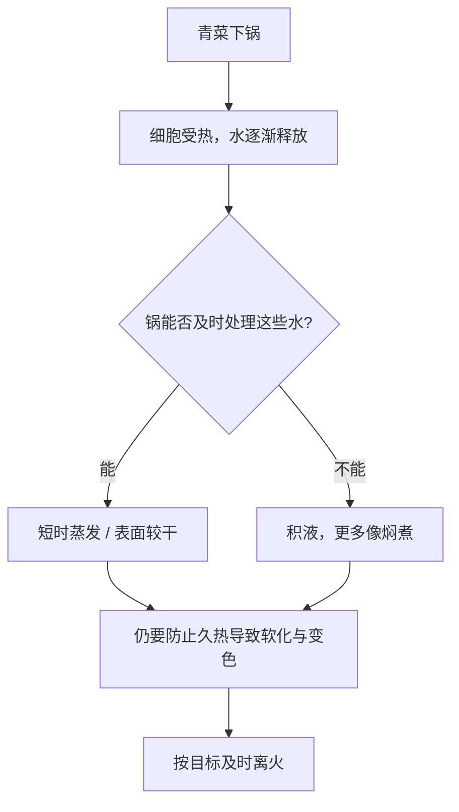

# 第 36 章 清炒青菜：水、火与叶绿素

“青菜出水、发黄、发苦”不是同一个失败。出水主要是细胞里的水被释放；发黄主要涉及叶绿素在加热后的变化；苦则可能来自食材、焦化、调味失衡或过量碱性处理。把它们混成一句“火不够”，通常会越救越乱。

## 36.1 先决定你要保留哪一种状态

加热后的青菜不可能保留生菜那种由完整细胞膨压带来的“生脆”；能争取的是细胞壁和中间层尚未完全软化的**挺括感**。目标不同，操作也不同：

| 目标 | 可接受的水 | 最需要避免的事 | 主要策略 |
|------|------------|----------------|----------|
| 干爽、略带颜色 | 很少 | 一次下太多、表面很湿 | 擦干、分批、短时、高效排水 |
| 嫩软、带一点汁 | 有少量 | 把它炒到软烂 | 中等热输入，尽早停下 |
| 颜色鲜绿 | 允许短时加热 | 在热里久等 | 缩短总受热时间，出锅即上桌 |

## 36.2 三种现象，三条排查线

| 现象 | 首先问什么 | 主要机制 | 优先动作 |
|------|------------|----------|----------|
| 出水 | 一次量是否太大、菜表面是否湿、是否过早加盐 | 细胞膜受热后水释放；外加盐也会改变渗透 | 沥干、减量分批、按目标后置盐 |
| 发黄 / 橄榄色 | 是否在热中停太久、是否做好后仍闷在锅里 | 叶绿素在加热和酸性环境中发生脱镁变化 | 缩短热暴露，出锅，不靠“更大火”硬顶 |
| 苦或焦苦 | 是食材本味，还是蒜、叶缘、锅底焦化 | 焦化与苦味物，或原料本身差异 | 先尝未加调味的菜；检查焦点，不要先加糖遮盖 |

蔬菜中的水本来就在细胞内。加热会使细胞膜失去完整性，水进入锅中；液态水在场时，热量大量用于升温和蒸发，锅内难保持干热表面。**出水并不等于没做熟，真正要判断的是：你想让水留作汁，还是想在它积累前把它处理掉。**

## 36.3 清炒的一条处理方案

| 步骤 | 状态判据 | 为什么 |
|------|----------|--------|
| 洗后沥干，必要时擦干 | 叶面没有明显挂水 | 减少额外蒸发负担，不等于阻止食材自身出水 |
| 按叶梗与叶片分组 | 较厚部位与薄叶不混成一把 | 两者熟化速度不同；先后下锅可缩短薄叶受热时间 |
| 先用小份校准锅灶 | 声音稳定、未立刻积水 | 第 31、34 章：先验证供热与下锅量匹配 |
| 厚部位先、叶片后 | 叶片刚塌而仍有颜色 | 让不同部位在更接近的状态结束 |
| 尝后定味、及时出锅 | 咸淡正确、锅中没有继续焖煮 | 盐的“定味”与让食材出水是不同任务 |

“盐一定最后放”也不是定律。对于想让某些菜更快出汁的目标，早盐是可选工具；对于想做干爽清炒，早盐的渗透方向通常与目标冲突。但“盐的时机对家庭炒青菜出水量能差多少”尚缺直接对照，本书只把它写成机制方向与可验证假设。

## 36.4 颜色不是“火力锁住的”

叶绿素失去中心镁离子后，会由鲜绿趋向橄榄褐。大火快炒有时看起来更绿，最可靠的解释不是“大火锁色”，而是**总受热时间更短**；同样地，菜做好后仍盖在热锅里，也会继续沿这条时间线变化。

| 常见处理 | 它真正可能改变什么 | 本章判断 |
|----------|----------------------|----------|
| 缩短加热和等待 | 减少累积热暴露 | ✅ 有机制支持 |
| 加小苏打“保绿” | 提高 pH，但也会加速果胶相关软化并改变味道 | ⚠️ 不作为家庭通用建议 |
| 焯水加盐 / 加油“锁绿” | 可能改变表面和溶出，但缺乏直接支持 | ⚠️ 证据不足；加盐还有水分与可溶物损失代价 |
| 盖盖一定发黄 | 湿热与酸积聚的推理存在，但家庭直接对照未核到 | ⚠️ 机制推理，不写成定律 |

> **可迁移规则**：想要青菜更绿、更挺，不是找一个“神奇添加物”；是让不同厚度的部位在各自刚到目标时离开热源，并避免在锅内无目的地等待。

## 36.5 常见说法辨析

| 说法 | 判定 | 原因 |
|------|------|------|
| “青菜出水就是火力不够” | ❌ 明确错误 | 青菜本身含水很高，受热释放水不可避免；火力只是决定水能否及时处理的变量之一。 |
| “大火能锁住绿色” | ⚠️ 表述错误 | 更短的总加热时间可减慢颜色变化，不是火把颜色锁住。 |
| “盐晚放一定不出水” | ❌ 明确错误 | 食材自身受热也会出水；晚盐只能减少一个可能的渗透变量。 |
| “苦了加糖就能救” | ⚠️ 高风险 | 糖可能掩盖一部分感受，却不能消除焦化或原料苦味；先诊断来源。 |

## 36.6 思考题

1. 为什么“出水”和“发黄”不能用同一招解决？
2. 为什么较厚的菜梗与薄叶适合分开下锅？
3. 【案例】一盘小白菜总是水多、颜色暗、梗却还硬。请按“目标 → 变量 → 顺序 → 验证”提出方案。
4. 【辨析】“焯水加盐保绿”应如何处理证据强度？

> 📖 **参考答案**（想清楚再看）：[Q1](../../qa/36-stir-fried-greens-qa.md#q1) · [Q2](../../qa/36-stir-fried-greens-qa.md#q2) · [Q3](../../qa/36-stir-fried-greens-qa.md#q3) · [Q4](../../qa/36-stir-fried-greens-qa.md#q4)

## 36.7 本章实操

### 🅐 零成本版

拿一把青菜，先按“厚梗 / 薄叶”“叶面干 / 湿”“要干爽 / 要带汁”做三项标记，再写一份不含分钟数的下锅顺序。

| 食材部位 | 厚薄 / 含水观察 | 我的成品目标 | 下锅顺序 | 离火判据 |
|----------|-----------------|--------------|----------|----------|
| | | | | |

### 🅑 开火版

有灶台和食材时做：将同一把耐炒青菜分两份，保持锅、油、总量接近。A 组叶梗叶片同时下；B 组厚部位先、薄叶后。记录出水、梗的软硬、叶片颜色和等待成本；一次实验只说明这把菜和你的设备。

| 组别 | 下锅策略 | 积水 | 梗的状态 | 叶的状态 | 下次只改什么 |
|------|----------|------|----------|----------|--------------|
| A | 同时下 | | | | |
| B | 分段下 | | | | |

## 36.8 🔎 下次做菜时的用处

看到水多，先看量、水和顺序；看到颜色暗，先看热暴露时间；尝到苦，再找是焦化还是食材本味。把抱怨拆开，下一锅才能只改一个真正的变量。

## 36.9 本章依据

- 第 20 章：蔬菜细胞、膨压、果胶软化、叶绿素变化及其适用边界；相关一手与综述来源见[出处登记](../../standards.md)。
- 第 3、7、23、31、34 章：水分对表面温度的限制、家用灶功率与分批策略。
- “盐时机”“盖盖”对家庭炒青菜的直接定量对照未核到；正文均按机制方向或证据不足处理。
