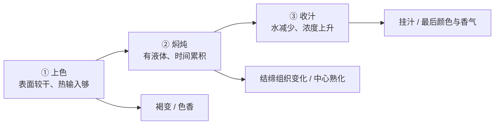

# 第 37 章 红烧肉：糖色、胶原与收汁

红烧肉把同一块肉放进三种互相冲突的环境：开始需要较干的表面来上色，中段需要有水和时间来软化结缔组织，最后又要把水赶走，让味道和光泽回到表面。它不该被记成“炖多少分钟”，而应被理解成三个目的明确的阶段。

## 37.1 三段不是仪式，是条件切换

| 阶段 | 主要目标 | 水在做什么 | 最容易误判 |
|------|----------|------------|------------|
| 上色 | 形成颜色与香气 | 要少，避免表面温度受水限制 | 把“变色”当成“褐变” |
| 焖炖 | 让硬的结缔组织获得足够时间变化 | 液体把体系维持在湿热路径 | 以为火越猛、肉越快软 |
| 收汁 | 浓缩、挂住、恢复末段香气 | 水减少，温度限制逐步放开 | 只盯着“煮干”，结果焦苦 |

肉的瘦部分受热会收缩、失水；带结缔组织的部分则需要时间才会往较易咀嚼的方向变化。这两条过程同时发生，所以“久炖一定更嫩”不是普适规律：部位、切块、温度和时间共同决定结果。对红烧类，接受一部分瘦肉失水，是为了换取皮、筋、结缔组织带来的软化与胶质口感；若换成很瘦的里脊，同一方案就不合适。

## 37.2 每一步都标注它在解决什么

| 处理 | 解决的目标 | 四条线 | 可替换 / 可省的边界 |
|------|------------|----------|----------------------|
| 切块、擦干、分批 | 让锅能给表面足够热 | 水 + 热 | 切得更小会缩短中心传热距离，也会改变外层比例；不是单纯“更快” |
| 煎 / 煸到有颜色 | 建立褐变香与颜色 | 热 + 水 | 不是“锁住肉汁”；量太大时应分批 |
| 加液体后焖炖 | 给中心熟化与结缔组织变化时间 | 热 + 时间 + 水 | 液体一加入，明显褐变窗口关闭；此时目标不再是上色 |
| 调味并尝味 | 让盐、甜、鲜与香匹配浓缩后的体系 | 味 | 早期的咸淡会随蒸发改变，最后仍要尝后再定味 |
| 收汁 | 浓缩、增黏挂汁、恢复末段表面反应 | 水 + 味 + 热 | 不能离开锅；停在汁能裹住肉，而非锅底发黑 |

### 糖色与“糖上色”不是唯一道路

糖在高热、低水的条件下会形成颜色与风味物；酱油等复合调料也会贡献颜色、盐与鲜味。是否做糖色是风格选择，不是红烧肉成立的前提。对新手更重要的是识别风险：**从颜色好看走到焦苦的窗口很窄**；如果当前目标是稳定完成一锅肉，可先让肉表面上色、用已有调料调色，而不要把“炒糖”当必做考试。

## 37.3 为什么“小火咕嘟”通常比大滚更可控

液态水存在时，锅内温度主要受沸腾限制；把火调大未必显著提高肉中心温度，却会让蒸发、翻滚和局部受热更难控制。这里不需要迷信“绝不能大滚”：本书没有核到家庭锅中大滚与微沸的直接温差和机械损伤对照。能稳妥地说的是：

- 中段的任务是**时间累积与稳定湿热**，不是继续上色；
- 只要保持能持续熟化的状态，较温和的沸腾更易控制液量与等待；
- 若肉还硬，先判断是否是结缔组织尚未给够时间、切块太大或部位本就不适合，而不是立刻把火加到最大。

> **可迁移规则**：一锅菜从“上色”切换到“加液体焖”，就要同时切换成功判据：前者看干、色、香；后者看软化进度与液量；最后才看挂汁。

## 37.4 黄酒、调料与末段纠偏

一项红烧肉风味组学研究在其特定体系中发现，加入黄酒与部分异味挥发物变化、脂质氧化路径和花果香物质有关。它支持“黄酒可能同时贡献香气并影响异味路径”的方向，但只是一道菜、一种酒的研究；它不是“酒中和某种胺”这条广泛说法的证据。

| 现象 | 先判断 | 可尝试的单一调整 |
|------|----------|--------------------|
| 汁太淡 | 是液体尚多，还是盐 / 鲜不足 | 先决定是否继续收；再尝后小步补味 |
| 汁太咸 | 是收过头浓缩，还是早期盐已过量 | 加回合适液体稀释并重新平衡；不要继续收 |
| 肉仍有韧感 | 是瘦肉失水，还是结缔组织尚未软化 | 看部位和切块；只延长湿热阶段并记录结果 |
| 末段焦苦 | 是糖、锅底残留还是汁已太少 | 立即停止强热；下次把收汁判据提前 |

## 37.5 常见说法辨析

| 说法 | 判定 | 边界 |
|------|------|------|
| “先煎能锁住肉汁” | ❌ 明确错误 | 煎的收益是表面色香；肉失水主要受内部受热收缩影响。 |
| “炖得越久一定越嫩” | ⚠️ 不完整 | 结缔组织部位需要时间，但瘦肉会持续失水；部位与温度决定取舍。 |
| “大火滚比小火更快炖烂” | ⚠️ 证据不足 | 家庭直接对照未核到；中段应优先追求稳定、可控的湿热与液量。 |
| “加黄酒就是去腥” | ⚠️ 过度简化 | 有特定红烧肉研究支持多路径影响，不能外推为所有异味的单一化学解释。 |

## 37.6 思考题

1. 为什么红烧肉的三个阶段不能用同一套火力判据？
2. 为什么收汁不仅是“把水煮干”？
3. 【案例】肉已软、汁仍稀、但尝起来已偏咸。请按目标—限制—顺序给出补救方案。
4. 【辨析】“炖得越久一定越嫩”为什么应标为不完整？

> 📖 **参考答案**（想清楚再看）：[Q1](../../qa/37-red-braised-pork-qa.md#q1) · [Q2](../../qa/37-red-braised-pork-qa.md#q2) · [Q3](../../qa/37-red-braised-pork-qa.md#q3) · [Q4](../../qa/37-red-braised-pork-qa.md#q4)

## 37.7 本章实操

### 🅐 零成本版

任选一份红烧类菜谱，把每一步标为“上色 / 湿热 / 收汁 / 定味”，并在每一段旁边写一个状态停点。找出其中所有“炖 X 分钟”而没有状态判据的步骤。

| 原步骤 | 所属阶段 | 它真正要解决什么 | 我的状态停点 | 若失败先查什么 |
|--------|----------|------------------|--------------|----------------|
| | | | | |

### 🅑 开火版

有灶台和食材时做：选择小份、适合长时湿热的带皮或带结缔组织部位。只测试一个变量，例如将上色阶段分批与不分批比较，或记录收汁前后的汁浓度和肉表面状态；不要同时改变肉块大小、调味和火力。处理生肉与成品应使用分开的器具，熟度与保存遵循当地现行食品安全指引。

| 阶段 | 我看到的状态 | 我做的决定 | 成品结果 | 下次只改什么 |
|------|--------------|------------|----------|--------------|
| 上色 | | | | |
| 焖炖 | | | | |
| 收汁 | | | | |

## 37.8 🔎 下次做菜时的用处

红烧肉“颜色不够、肉不软、汁不挂”时，不要同时加糖、加水、加火。先指出它卡在哪一段：上色段、湿热段，还是收汁段。阶段对了，才知道该减水、给时间，还是停止加热。

## 37.9 本章依据

- 第 3、5、7、23、28 章：水对温度与收汁的作用、胶原与时间、褐变与功率、炖焖的边界。
- *Foods* 2023 肉品低温慢煮综述（PMC10453940）及红烧肉黄酒风味研究（PMC13129437）；适用范围与限制见[出处登记](../../standards.md)。
- 家庭“大滚 vs 微沸”的定量对照与统一炖煮时长均未核到；本章不给固定分钟数。
