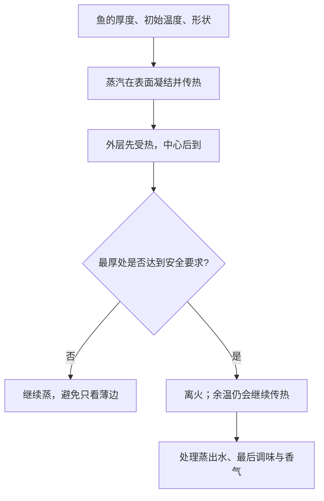

# 第 38 章 清蒸鱼：窄窗口蛋白质与去腥

清蒸鱼的难处不在“蒸汽够不够热”，而在于鱼肉从半透明、柔嫩到发紧、渗水的窗口很窄；同一盘鱼的厚处和薄处又不在同一时间到达状态。做法因此应围绕**厚度、余温、表面水和安全熟度**安排，而不是背“每斤蒸几分钟”。

## 38.1 先把三个目标分开

| 目标 | 要观察的对象 | 不能用什么替代 |
|------|--------------|----------------|
| 口感 | 鱼肉是否刚变不透明、是否仍润泽、是否容易分片 | 固定分钟数 |
| 调味与香气 | 蒸出的水、盘中调味与最后香气 | 把所有调料一开始倒上去 |
| 安全 | 鱼最厚处的中心温度与当地指引 | “看起来白了”或蒸锅水开了 |

美国 FDA 的有鳍鱼类口径是 145 °F（约 63 °C）或肉质不透明、可用叉轻易分开；加拿大卫生部给出鱼 70 °C。各国口径不同，且安全判断应优先以所在地现行官方指引与合适温度计为准。这里的“刚好嫩”是口感判断，**不覆盖安全要求**。[出处登记](../../standards.md)

## 38.2 为什么鱼比“蒸多久”更重要

加热时间受厚度影响不是线性的：热要从表面走到中心，厚度稍增，所需时间可能显著增加；鱼的形状、是否带骨、是否刚从冷藏取出、蒸汽是否稳定，都会改变结果。因此“同重量鱼蒸同样久”也不可靠——一条扁鱼与一块厚切鱼的中心距离不同。

| 变量 | 为什么改变结果 | 更可靠的应对 |
|------|----------------|----------------|
| 最厚处厚度 | 决定热到中心的距离 | 以最厚处作为熟度与安全检查点 |
| 初始温度 | 冷藏鱼需要先跨越更大温差 | 把“刚从冰箱拿出”记入计划，不硬套时间 |
| 切法 / 是否开花刀 | 改变厚度与暴露面积 | 把它看成传热设计，而非装饰 |
| 盘中积水 | 稀释调味、继续提供湿热环境 | 依目标倒掉或另作处理，再决定调味 |

蒸汽的优势是温和、均匀地把热送到表面；局限是它不提供煎炸式干热褐变。想要的是鱼肉本身的细嫩时，不必要求蒸鱼也出现煎鱼的香壳；需要香气时，应通过最后加入的葱姜、热油或酱汁等独立步骤来设计，并注意油温与飞溅风险。

## 38.3 去腥不是把所有“腥味”归给一种物质

鱼类异味的来源、鲜度与处理方式差异很大。“姜、葱、酒一定中和腥味”不是本书能支持的单一化学定律。已核到的方向是：加热可挥发或改变部分异味物；特定红烧肉体系中黄酒同时影响脂质氧化相关异味物与香气，但这不能直接外推成所有鱼的机制。

对清蒸鱼更稳妥的工作流是：

1. **先处理表面水与血污等可见来源**，并严格生熟分开；
2. **让鱼在安全要求与目标口感间尽量少地停留**，避免长时间湿热导致发紧、渗水；
3. **蒸后再处理盘中液体和末段香气**：先尝，再决定是否需要调味；
4. 若异味明显，优先考虑原料状态与冷链是否适合食用，而不是用更多香料掩盖风险。

## 38.4 一张不含分钟数的处理方案

| 阶段 | 行动 | 进入下一步的判据 | 四条线 |
|------|------|------------------|----------|
| 前置 | 清洁、擦干、按最厚处评估；准备温度计与调味 | 鱼、盘子、工具和生熟分区就绪 | 水 + 时间 |
| 蒸制 | 稳定蒸汽加热，避免反复开盖 | 最厚处按当地安全指引达到要求 | 热 + 时间 |
| 离火 | 立即停止强热，预留余温影响 | 鱼肉仍润泽、不再无目的闷放 | 热 + 时间 |
| 调味 | 视目标处理蒸出液，最后加入香气元素 | 尝后再定咸淡与香气 | 味 + 水 |

> **可迁移规则**：薄、嫩、含水高的蛋白质食材，先按最厚处保证安全，再尽量缩短其他部位的额外受热；香气和调味可放在这个热任务之后独立完成。

## 38.5 常见说法辨析

| 说法 | 判定 | 边界 |
|------|------|------|
| “按重量计时就能蒸好所有鱼” | ❌ 明确错误 | 厚度、形状、初温和设备差异都会改写中心到达速度。 |
| “鱼肉变白就一定安全” | ⚠️ 不够可靠 | FDA 给出颜色/可分片作辅助描述，但不同国家温度口径不同；安全优先用当地指引和温度计。 |
| “蒸出水一定要倒” | ⚠️ 取决于目标 | 它可能稀释调味或带来不想要的气味，也可能仍有可利用的味道；先判断而非一律处理。 |
| “姜、酒能把不新鲜的鱼蒸好” | ❌ 明确错误 | 香料不能修复原料风险或替代加热与冷链。 |

## 38.6 思考题

1. 为什么清蒸鱼的安全判断要看最厚处，而不是最先变白的边缘？
2. 为什么“蒸制”和“最后加香”应拆成两段？
3. 【案例】一条扁鱼和一块同重量的厚切鱼，能否按同一时间蒸？请给出“目标 → 变量 → 验证”方案。
4. 【辨析】“蒸出水一定倒掉”为什么只能是条件化建议？

> 📖 **参考答案**（想清楚再看）：[Q1](../../qa/38-steamed-fish-qa.md#q1) · [Q2](../../qa/38-steamed-fish-qa.md#q2) · [Q3](../../qa/38-steamed-fish-qa.md#q3) · [Q4](../../qa/38-steamed-fish-qa.md#q4)

## 38.7 本章实操

### 🅐 零成本版

找两张不同形状的鱼菜谱图，估计各自最厚处，写出不能照搬同一时间的理由，并完成下表。

| 鱼 / 切法 | 最厚处在哪里 | 口感目标 | 安全验证方式 | 我会把什么留到蒸后 |
|-----------|--------------|----------|--------------|--------------------|
| | | | | |

### 🅑 开火版

有灶台和食材时做：选择来源可靠的鱼，使用能测中心温度的温度计，并遵循所在地现行安全指引。比较“蒸后立即处理盘中液体再调味”和“把调味一开始放入”的成品差异；保持鱼的大小、蒸制过程相同。该对照只讨论风味与稀释，不可替代安全验证。

| 组别 | 调味时机 | 盘中液体状态 | 鱼肉润泽度 | 咸淡 / 香气 | 安全验证记录 |
|------|----------|--------------|------------|-------------|--------------|
| A | 蒸后 | | | | |
| B | 蒸前 | | | | |

## 38.8 🔎 下次做菜时的用处

清蒸鱼不要先问“蒸几分钟”。先问：最厚处在哪里、我的安全判据是什么、我想让蒸出的液体留下还是移走、哪一层香气应最后给。这样时间只是记录，而不是唯一的控制器。

## 38.9 本章依据

- 美国 FDA「Safe Food Handling」与加拿大卫生部鱼类中心温度指引；国家口径不同，以当地现行发布为准，见[出处登记](../../standards.md)。
- 第 2、4、19、26、30 章：厚度与传热、窄窗口蛋白质、异味与蒸制、生熟分开与原料安全。
- 本章不给鱼的固定蒸制分钟数；其会随厚度、形状、初始温度和设备改变。
