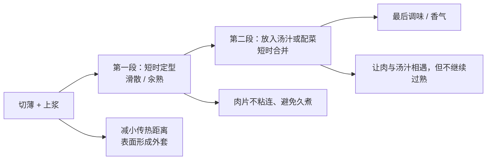

# 第 39 章 水煮肉片与滑肉：上浆与两段加热

水煮肉片和滑肉看似相反：一道在热汤里完成，一道先在油或水中快速滑散再合并。它们共享的核心不是“配料”，而是把肉片的热任务拆开：**用薄切缩短传热距离，用上浆改变表面层，用两段加热避免肉片在任何一个阶段久留。**

## 39.1 先识别两段各自做什么

| 阶段 | 目标 | 主要风险 | 判据 |
|------|------|----------|------|
| 切片 | 厚薄尽量接近 | 有的已熟、有的仍生 | 用最厚一片作为保守参照 |
| 上浆 | 表面形成可受热的含水层 | 太厚、太黏、掩盖肉味 | 薄薄裹住，而非变成厚面糊 |
| 第一段加热 | 肉片分散、表面定型 | 锅温被大量冷肉拉低，或加热太久 | 肉片分开且刚到目标状态 |
| 第二段合并 | 汤汁、配菜、味道与肉片合到一起 | 在滚汤里久煮，肉继续收缩失水 | 合并后尽快完成与离火 |

## 39.2 上浆是“外套”，不是魔法

淀粉受热糊化能形成含水凝胶；蛋清受热凝固也能参与形成表面层。机制上，这层外套可增加传热阻力并减少直接蒸发，因此有理由期待它帮助肉片更温和地受热。但本书没有核到中式家庭场景下“什么配比、减少多少失水”的直接对照；不能把它写成通用的嫩肉公式。

| 成分 / 操作 | 本书能说的 | 不能说的 |
|-------------|------------|----------|
| 淀粉 | 加热后可糊化成膜 | 某一种淀粉必然更嫩的通用排序 |
| 蛋清 | 会凝固成膜，并可能结合一部分香气 | 固定用量或“加越多越滑”的结论 |
| 盐 | 在某些肉制品体系中影响蛋白溶出和保水 | 直接换算到家庭肉片的比例 |
| 薄切 | 缩短热到中心的距离 | 逆纹、厚度对嫩度的精确改善幅度 |

> **可迁移规则**：上浆只是在热到达肉片前加一道可控表面层；它救不了已经在锅里久煮、超过目标熟度的肉。

## 39.3 水煮与滑肉的共同框架

| 做法 | 第一段的介质 | 第二段的介质 | 为什么仍要分段 |
|------|----------------|----------------|------------------|
| 水煮肉片 | 热汤 / 水中短时定型，或按方案直接在汤中分散 | 调味汤汁与配菜 | 汤的味道形成与肉片熟化需要不同的注意力窗口 |
| 滑肉 | 油或水中快速滑散 | 炒菜、勾芡汁或汤中合并 | 先避免粘连与过热，再让肉接触其他食材 |

两种做法都不能从“颜色变了”直接推出安全熟度。尤其是薄片肉，外层颜色变化很快、厚片中心仍可能不足；使用温度计和所在地官方指引是更可靠的安全路径。不同国家的安全口径不同，本书不以“滑多久”提供替代数字。

## 39.4 调味、辣味与最后的油

水煮肉片的汤底、豆瓣、辣椒与最后热油分别承担不同工作：复合调味料常同时带来盐、鲜、色和香；辣椒和花椒带来的刺激不是“咸味”的替代；最后热油可改变香气释放与口感。一个关于水煮牛肉的缺项实验提示，去掉豆瓣会让鲜味和总体接受度下降，即使咸度更高；但该研究是标准化预制菜语境，不能推导出家庭配方比例。

因此实操应按顺序尝：先判断浓度与咸淡，再判断鲜味、酸度与香气，最后才决定是否需要更多刺激或油香。不要用加辣、加油去掩盖“汤太淡”“肉过熟”这样的结构性问题。

## 39.5 常见说法辨析

| 说法 | 判定 | 边界 |
|------|------|------|
| “上浆一定锁住肉汁” | ⚠️ 机制方向支持，定量未核 | 可说它形成表面外套、减缓传热与蒸发；不可承诺效果大小或固定配比。 |
| “肉片滑到变白就熟了” | ❌ 安全上不充分 | 颜色变化不是所有肉类的安全验证；应按当地指引与温度计判断。 |
| “肉片越薄越嫩” | ⚠️ 不完整 | 薄片更快达到中心状态，也更容易过头；切法是缩小窗口，不是消除窗口。 |
| “多加豆瓣就会更好吃” | ❌ 明确错误 | 复合调味料同时增加盐、鲜、色与刺激；需要按当前汤底尝味，不是线性加法。 |

## 39.6 思考题

1. 为什么水煮肉片与滑肉都适合用“两段加热”理解？
2. 为什么上浆不能补救过熟的肉片？
3. 【案例】肉片外面发白、汤已很香，但吃起来发柴。请按热—水—时间排查并给出下一次只改一项的方案。
4. 【辨析】“上浆一定锁住肉汁”的证据边界是什么？

> 📖 **参考答案**（想清楚再看）：[Q1](../../qa/39-poached-sliced-meat-qa.md#q1) · [Q2](../../qa/39-poached-sliced-meat-qa.md#q2) · [Q3](../../qa/39-poached-sliced-meat-qa.md#q3) · [Q4](../../qa/39-poached-sliced-meat-qa.md#q4)

## 39.7 本章实操

### 🅐 零成本版

找一份水煮肉片或滑肉菜谱，将每一步归入“切片 / 上浆 / 第一段定型 / 第二段合并 / 最后香气”，并把所有“煮到变色”的语句改成可验证的安全与口感双判据。

| 原步骤 | 它解决的目标 | 过头的风险 | 我改写的判据 |
|--------|--------------|------------|--------------|
| | | | |

### 🅑 开火版

有灶台和食材时做：同一块肉切成相近薄片，分两组。一组不加外套，一组做薄上浆；保持切法、总量、介质和加热流程尽量一致。记录粘连、表面、口感和是否影响汤汁；熟度按所在地现行指引验证，生熟器具分开。这个对照不能给出所有肉、所有浆料的通用结论。

| 组别 | 表面处理 | 第一段是否易分散 | 表面状态 | 口感 | 汤汁 / 配菜受影响 |
|------|----------|------------------|----------|------|-------------------|
| A | 无上浆 | | | | |
| B | 薄上浆 | | | | |

## 39.8 🔎 下次做菜时的用处

肉片发柴时，先别急着增加腌料。先问：是不是切得不均、第一段已经过久、第二段又在滚汤里等太久？上浆、切片、分段的价值，都是让你有机会在正确状态提前离火。

## 39.9 本章依据

- 第 4、6、17 章：肉片受热窗口、淀粉糊化、上浆的机制方向及其定量缺口。
- 水煮牛肉缺项实验（PMC12554931）及肉类食品安全官方来源，见[出处登记](../../standards.md)；研究适用范围不外推为家庭配方。
- 本章不给家庭上浆比例、肉片“滑熟”时间或减失水百分比。
