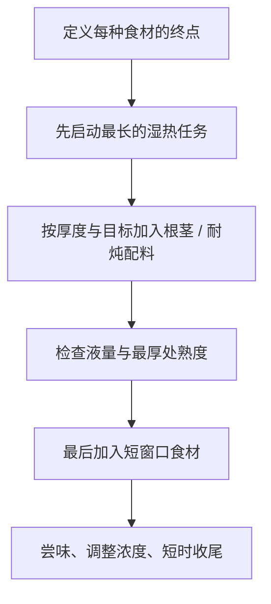

# 第 40 章 一锅炖：把所有原理压在一个锅里

“一锅炖”不是把所有食材同时丢进锅。它是一个多终点问题：肉可能需要长时间湿热，根茎要煮透但不散，叶菜只需短时，调味又会随蒸发改变浓度。下锅顺序的依据不是谁“耐煮”，而是**谁到达目标状态需要的热—水—时间路径不同。**

## 40.1 先按终点分组

| 食材组 | 想到达的状态 | 最怕什么 | 通常处于哪个阶段 |
|--------|--------------|----------|------------------|
| 带结缔组织肉 | 结缔组织有足够时间软化 | 只给短时强热 | 早下，承担长时湿热 |
| 根茎 / 淀粉类 | 中心熟、能保持或按目标软化 | 外烂内生、过度搅动 | 按切块大小在中段加入 |
| 耐炖蔬菜 | 熟、入味但不完全散 | 长时间高温导致过软 | 中后段，按目标加入 |
| 叶菜、香草、脆嫩配菜 | 刚熟、保持颜色或香气 | 在锅中久等 | 最后加入或离火后加入 |
| 末段调味 | 接近最终浓度的平衡 | 过早定味后被浓缩 | 最后尝后决定 |

## 40.2 “早下锅”并不等于“更入味”

食材在液体中久煮，确实有更多时间与汤汁交换；但对大块肉，腌料和调味渗入并不快，且久煮会同时带来结构与水分代价。把“入味”拆成三种来源更有用：

| 你尝到的“有味” | 主要来自 | 更有效的操作 |
|------------------|----------|--------------|
| 表面和汤汁够味 | 汤汁浓度、挂汁 | 末段调味与收汁 |
| 食材自身风味进入汤中 | 溶出与长时加热 | 让适合久炖的食材先走湿热阶段 |
| 大块内部有调味感 | 切块几何、预处理与足够接触 | 切小 / 划刀是结构改变；别只无限延长时间 |

所以“一锅炖越久越入味”遗漏了代价：瘦肉会失水，蔬菜会软烂，汤汁会浓缩到偏咸。顺序的目标是让每种食材在自己的窗口进场，而不是让所有食材共享同一条时间线。

## 40.3 一锅中的三次检查点

| 检查点 | 问题 | 你可以调整什么 |
|--------|------|----------------|
| 开始后 | 长时食材是否已经进入稳定湿热环境 | 液量、火力、是否需要盖盖 |
| 中段 | 根茎最厚处是否仍硬、汤是否已明显浓缩 | 切块、补液、加入下一组食材的时机 |
| 末段 | 短窗口食材是否刚好、整体咸淡是否准确 | 最后调味、是否短时收汁、立刻离火 |

收汁同时浓缩味道、增加挂汁能力，也逐步解除水对温度的限制；因此它应该被视为独立阶段，而不是“多煮一会儿”。已经偏咸时继续收汁会加重问题，应先决定是否需要补液并重新尝味。

## 40.4 用“最厚处”和“最晚加入者”校准

一锅里至少有两个不同的控制点：

- **安全控制点**：涉及肉、禽、鱼、蛋时，看需要充分加热的食材最厚处，并按所在地现行官方指引与温度计验证；各国口径不同。
- **口感控制点**：看最后加入、窗口最窄的食材是否刚到目标状态；它常决定整锅何时离火。

这解释了为什么“肉熟了就关火”不总对：肉安全达标后，根茎可能仍硬；反过来，“土豆软了就关火”也不总对：叶菜可能还没加，或肉的安全要求仍未满足。要把控制点写出来。

> **可迁移规则**：一锅菜的顺序由“谁需要最长时间”决定开场，由“谁最怕久”决定收场；安全与口感各有控制点，不能互相替代。

## 40.5 常见说法辨析

| 说法 | 判定 | 边界 |
|------|------|------|
| “一锅炖就是所有食材一起下” | ❌ 明确错误 | 食材到达目标状态的时间不同；同时下锅只是在选择让一部分食材过头。 |
| “早放才入味” | ⚠️ 不完整 | 对汤汁交换有方向性意义，但大块食材渗入慢，且有久煮代价。 |
| “土豆煮烂说明整锅都好了” | ❌ 明确错误 | 不同食材的安全和口感控制点不同。 |
| “最后再调味一定更好” | ⚠️ 不完整 | 最后尝味适合定味；一些需要时间建立的味道或预处理仍可能在前段完成。 |

## 40.6 思考题

1. 为什么一锅炖的下锅顺序应按终点而非按菜名决定？
2. 为什么安全控制点与口感控制点常不是同一个？
3. 【案例】你要炖带骨肉、土豆、胡萝卜和青菜。请按“最长任务 → 中段 → 最后窗口”写顺序，并写出两个验证点。
4. 【辨析】“早放才入味”遗漏了哪些限制？

> 📖 **参考答案**（想清楚再看）：[Q1](../../qa/40-one-pot-stew-qa.md#q1) · [Q2](../../qa/40-one-pot-stew-qa.md#q2) · [Q3](../../qa/40-one-pot-stew-qa.md#q3) · [Q4](../../qa/40-one-pot-stew-qa.md#q4)

## 40.7 本章实操

### 🅐 零成本版

选择你家常做的一锅菜，将食材按下表分组。若两样食材都写“早下”，再追问它们真的需要同样长的时间吗。

| 食材 | 目标状态 | 最怕的失败 | 下锅段 | 安全 / 口感验证点 |
|------|----------|------------|--------|-------------------|
| | | | | |

### 🅑 开火版

有灶台和食材时做：做一锅包含至少三种不同窗口食材的炖菜。只改变一个排程变量，例如叶菜最后加入而其余步骤不变；记录各食材的状态与汤汁浓度。对肉、禽、鱼、蛋按所在地现行安全指引验证，剩菜及时冷藏。

| 阶段 | 加入的食材 | 我观察到的状态 | 此时液量 / 咸淡 | 下次只改什么 |
|------|------------|------------------|----------------|--------------|
| 早段 | | | | |
| 中段 | | | | |
| 末段 | | | | |

## 40.8 🔎 下次做菜时的用处

打开冰箱准备“一锅炖”时，先别问配方。先给每样食材写一个终点：软而不散、刚熟、需要长时湿热、最后才要香气。顺序自然会浮现出来。

## 40.9 本章依据

- 第 3、5、6、20、28、33、37 章：水与收汁、结缔组织、淀粉与根茎、蔬菜软化、炖焖与排程。
- 肉、禽、鱼、蛋的安全验证遵循所在地现行官方指引；多国口径与边界见[出处登记](../../standards.md)。
- 本章不给任何一锅菜的统一下锅分钟数；切块、食材结构、锅具与目标都会改变顺序。
