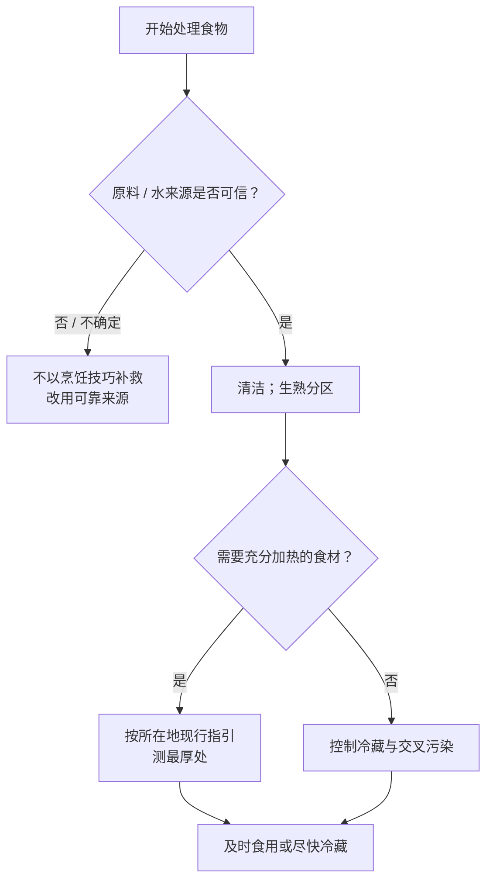

# 第 42 章 食品安全：温度红线、时间规则与交叉污染

食品安全不是“闻起来没坏就行”，也不是背一张万能温度表。它是一套**把风险留在可控范围内**的工作流：原料和水可信、生熟分开、把该加热的部分加热到位、别让易腐食物在不安全温度停太久。

WHO 将它概括为五件事：保持清洁、生熟分开、烧熟煮透、保持安全温度、使用安全的水和原材料。它们彼此不能替代：把肉煮熟，不能补救碰过生肉的即食沙拉；冰箱够冷，也不能补救一块没有加热到中心的禽肉。

## 42.1 先分清：口感判断和安全判断不是同一把尺

本书前面大量讨论“嫩”“脆”“上色”“收汁”。这些是**品质**的判断；安全还要问“最厚处是否达到所在地官方要求的条件”。美国 CDC 明确指出，除海鲜外，颜色和质地不能可靠判断是否熟透，温度计才可靠。

温度计测的是食物，不是锅底或蒸汽。探针靠近骨头、锅壁，或只插到表面，都可能读错。把它插到最厚、最可能慢热的位置；对于形状不规则的食物，多点确认更稳妥。

## 42.2 数字为什么会不同

下表只展示已核到的美国与加拿大官方口径，**不是跨地区的统一处方**。同一种食材的具体要求会因食品形态、是否绞碎、是否整只、监管口径而不同；应以所在地当前官方发布为准。

| 情境 | 美国 FDA 口径（已登记） | 加拿大卫生部口径（已登记） | 该怎么用 |
|------|-------------------------|----------------------------|----------|
| 整块牛 / 猪 / 羊 / 小牛 | 145 °F（约 63 °C）+ 静置 3 分钟 | 牛羊小牛按熟度分 63 / 71 / 77 °C；猪整块 71 °C | 不把一国数字当“全球唯一正确值” |
| 绞肉 | 160 °F（约 71 °C） | 牛羊小牛绞肉 71 °C；猪绞肉 71 °C | “表面熟了”不等于中心符合要求 |
| 禽类 | 165 °F（约 74 °C） | 分割禽 74 °C；整只禽 82 °C | 依当地口径测最厚处 |
| 鱼 | 145 °F（约 63 °C）或不透明、叉可分开 | 70 °C | 视觉描述可辅助，温度要求仍看本地指引 |
| 剩菜再加热 | 165 °F（约 74 °C） | 74 °C | 剩菜也不是“热一热就算” |

这些数字的作用是**安全验证**，不能拿来直接定义理想口感；例如鱼刚好嫩与符合当地安全要求，是两个需要同时满足的目标。

## 42.3 时间和温度：冷藏不是暂停键

美国 FDA 与 CDC 的通用口径是：易腐食品在烹调或购买后应在 **2 小时内**冷藏；环境高于 90 °F（约 32 °C）时缩短为 **1 小时**；冰箱保持在 40 °F（约 4 °C）以下。CDC 将约 4~60 °C 称为细菌迅速繁殖的危险温度带。各地具体建议可不同，所以在当地生活时，仍优先查当地卫生部门的现行指引。

这带来三个比“隔夜能不能吃”更有用的问题：

| 该问什么 | 不够好的问法 | 更可靠的行动 |
|----------|--------------|--------------|
| 它在室温多久了？ | “闻着还行吗？” | 记录是否已超过适用的时间边界；不确定就不要赌 |
| 冰箱是否真够冷？ | “放进冰箱就行” | 确认设备能维持当地建议的冷藏温度，不把热食长时间堆在外面等凉 |
| 要不要再吃？ | “反复热透能救回来吗？” | 把冷却、冷藏、再加热看作连续流程，不用后一环抵消前一环 |

熟食为了散热可以分成较浅的小份、避免把一大锅长时间留在台面；但本章不据此给通用“放凉几分钟”的配方，因为容器、份量、环境和冰箱负荷都会改变过程。

## 42.4 交叉污染：看不见的路径要提前截断

交叉污染常不是因为“没洗干净”，而是因为流程没有分区：碰过生肉的手、刀、砧板、夹子、腌料，又碰了即食食物或熟食。

| 高风险路径 | 在家里的简单截断方式 |
|------------|------------------------|
| 生肉 / 海鲜 → 即食蔬果 | 先处理可直接吃的食物，或使用清洁过的另一把刀、另一块砧板 |
| 生食工具 → 熟食 | 盛熟食前换干净夹子、盘子、筷子；不拿用过的工具“试一口” |
| 腌过生肉的料汁 → 成品 | 下肉前先分出要作酱汁的一份；否则按官方建议先煮沸，不能直接刷回熟肉 |
| 手 → 多个表面 | 处理生食后洗手至少 20 秒，再碰调料罐、冰箱把手或熟食 |

果蔬也不是例外。FDA 的建议是以流动水清洗；这能降低、但不能消除细菌。不要用肥皂、洗涤剂或商业果蔬清洗剂替代流动水；预切、包装的易腐农产品应冷藏，并与生肉海鲜分开。

## 42.5 常见说法辨析

| 说法 | 判断 | 原因与替代动作 |
|------|------|----------------|
| “肉不红就熟了” | ❌ 不可靠 | 除海鲜外，颜色和质地不是可靠安全指标；用合适温度计并按本地指引。 |
| “腌肉放台面入味更快” | ❌ 不建议 | FDA 指引要求腌制在冰箱中进行；速度不是绕过温度控制的理由。 |
| “剩菜只要滚烫就能抵消之前久放” | ❌ 不成立 | 冷却、冷藏与复热是连续控制，不让食物长时间处于危险温度带。 |
| “加醋 / 加盐就能安全密封保存” | ❌ 不能自行推出 | 工业罐藏的 pH、水活度法规分类不是家庭腌渍配方证明；家庭保藏按本地专门指引。 |
| “高风险人群和其他人完全一样” | ⚠️ 风险并不相同 | 孕妇、儿童、老年人、免疫功能低下者对生或半生海鲜、生乳等风险更高，应采用更审慎的官方建议。 |

## 42.6 思考题

1. 为什么“鱼肉刚刚嫩”不能单独作为安全判据？
2. 一盘熟鸡肉先被夹到生肉盘里，又放回锅中加热。问题只在“加热够不够”吗？
3. “冷藏”在安全流程中解决什么，不能解决什么？
4. 为什么本章把美国与加拿大的中心温度并列，而不选一个当唯一答案？

## 42.7 本章实操

### 🅐 零成本版：画出你家的一次生熟路径

选一道含肉、蛋或鱼的常做菜，不开火，画出从冰箱到上桌的路径。圈出所有“生的东西碰到什么”的节点。

| 节点 | 接触了什么 | 生 / 熟 / 即食 | 可能把风险带到哪里 | 我准备怎样截断 |
|------|------------|----------------|--------------------|----------------|
| 取食材 | | | | |
| 切配 | | | | |
| 加热 | | | | |
| 装盘 | | | | |
| 收纳剩菜 | | | | |

最后只挑一个最容易漏掉的节点，给自己写一句可执行规则，例如“熟菜出锅后只用干净夹子”。

### 🅑 开火版：一次温度计与冷藏流程演练

选一份来源可靠、需要充分加热的食材，准备合适的探针温度计：

1. 开始前查阅所在地现行官方指引，写下食材类型与目标条件；
2. 加热后在最厚处测量，避免探针接触锅壁或骨头；
3. 记录“达到条件时的外观 / 时间 / 厚度”，但不把它们取代温度判断；
4. 若有剩余，分装并尽快按当地指南冷藏；下次复热时再次按适用指引验证。

| 食材与本地指引 | 最厚处 / 测量方式 | 达到条件时的现象 | 剩菜怎么处理 | 我下次要改的一个流程 |
|----------------|------------------|------------------|--------------|------------------------|
| | | | | |

## 42.8 🔎 下次做菜时的用处

下次看到“要不要多煮两分钟”“剩菜能不能吃”“这把夹子还能不能用”，先不要凭经验争论。按这个顺序走：**来源可信吗 → 生熟路径断开了吗 → 该测的中心测了吗 → 时间和冷藏有没有断档**。四个问题中任何一个没有把握，安全优先于菜的口感。

## 42.9 本章依据

- WHO「Five keys to safer food」：五项食品安全原则；该页面不提供温度数字。
- 美国 FDA「Safe Food Handling」：中心温度、冷藏与时间边界；美国 CDC：危险温度带与“除海鲜外不可凭颜色/质地判断”。
- 加拿大卫生部「Safe internal cooking temperatures」：与美国不同的中心温度口径。
- 美国 FDA「Handling Food Safely While Eating Outdoors」：冷藏腌制、腌料处理、洗手与冷热保持。
- 美国 FDA「Selecting and Serving Produce Safely」及海鲜安全页：果蔬清洗、生熟分开与高风险人群。

所有原始链接、适用范围和已知限制见[参考书目与出处登记](../../standards.md)。
