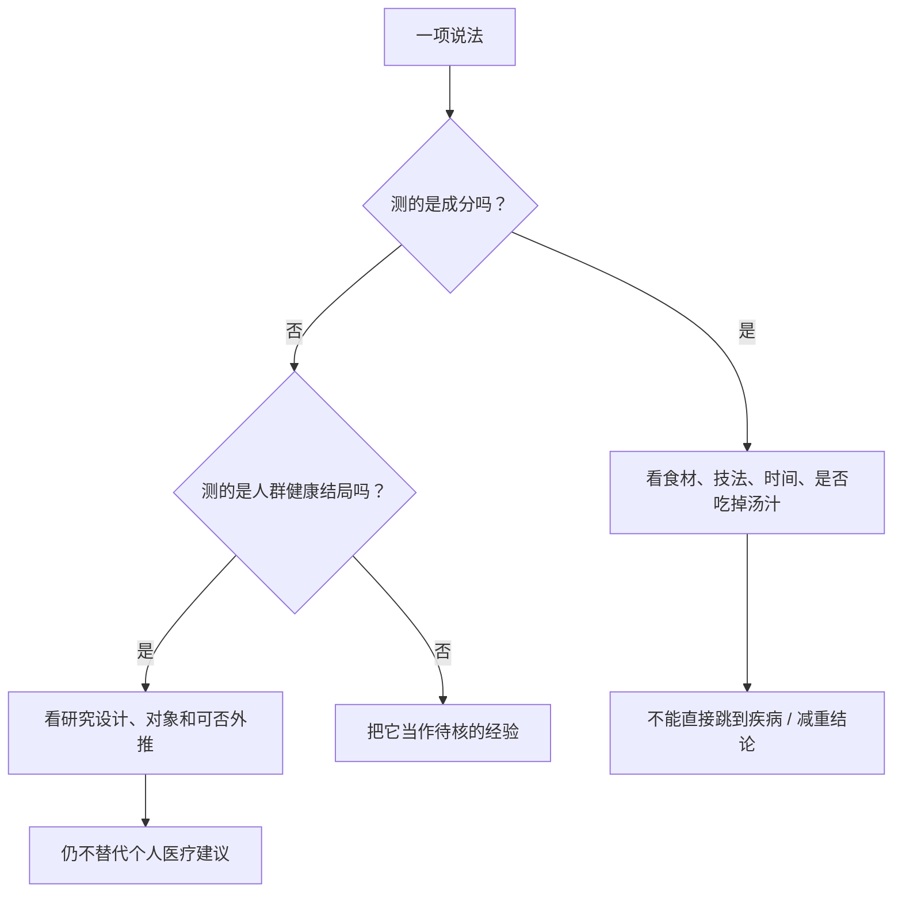

# 第 44 章 营养与烹饪：只讲证据等级

“水煮会损失营养”“微波会破坏营养”“冷饭更健康”都把不同层级的问题混在了一起。烹饪确实会改变某些成分；但一项食材、一个条件下的成分变化，不能直接推出某个人该怎样吃，更不能替代医疗或个体化营养建议。

## 44.1 先问：证据到底测到了什么

| 层级 | 能回答什么 | 不能直接回答什么 |
|------|------------|------------------|
| 成分实验 | 某食材在某条件下，某成分如何变化 | 一顿饭对某个人的长期健康效果 |
| 感官 / 出品率实验 | 口感、浸出、重量和可接受度 | “最健康的唯一做法” |
| 人群研究或官方建议 | 在特定人群、特定口径下的关联或建议 | 诊断、治疗或替代当地指南 |

## 44.2 已有数据能支持什么

一篇 2024 年综述汇集了果蔬热处理研究：水煮时，水溶性成分可能浸到水里，抗坏血酸也对热敏感；蒸没有液态水浸出，部分研究中保留结果不同。它支持的结论是：**技法、食材、时间与是否吃掉烹调液都会影响成分结果**，而不是“蒸永远更营养”或“水煮没有价值”。

| 观察 | 可以谨慎说 | 不该升级成 |
|------|------------|--------------|
| 水煮后某些水溶性成分下降 | 有热损失与浸出两条可能路径；是否喝汤会改变摄入路径 | “水煮蔬菜毫无营养” |
| 蒸菜在部分研究中保留不同 | 少了液态水浸出是合理机制之一 | “蒸一定优于所有技法” |
| 微波加热 | FDA 表示微波烹饪不会比传统烹饪更多地降低营养价值 | “微波天然更健康”或“微波从里到外熟” |
| 冷藏米饭抗性淀粉上升 | 低温储存样品中测到物理结构和抗性淀粉变化 | “冷饭可以治疗、减肥或适合所有人” |

数字也必须带着条件。综述中例如某些蔬菜焯水或水煮的抗坏血酸下降，来自特定品种、温度与时间；它们不是所有蔬菜、所有锅具的家庭预测器。本书因此只将其用于理解“热”和“水”是变量，不制定保健处方。

## 44.3 风险与营养不是二选一

追求少一点浸出，不能越过安全边界；为了缩短加热，不能让需充分加热的食材没有达到所在地要求。正确的问题是：在安全、可接受和家庭条件成立后，怎样减少不必要的过度加热与不必要的弃汤。

| 优先级 | 该做的判断 |
|--------|------------|
| 1 安全 | 原料、交叉污染、中心温度、冷藏流程符合所在地指引吗？ |
| 2 可食用性 | 食物熟度、质地和味道是否让人愿意吃？ |
| 3 成分取舍 | 水、热、时间是否超出实现目标所需？烹调液是否会被食用？ |

例如，汤菜里的浸出物并未必等于“丢失”；若汤会被吃掉，问题是摄入路径改变。反过来，煮菜水倒掉也不能用来判断整餐的营养价值，因为还取决于食材量、搭配和实际吃了多少。

## 44.4 常见说法辨析

| 说法 | 判断 | 更准确的说法 |
|------|------|--------------|
| “水煮一定最没营养” | ❌ 过强 | 水和热可改变部分成分；食材、时间、汤汁是否吃掉都重要。 |
| “微波会比其他烹饪更破坏营养” | ❌ 与 FDA 表述不符 | 微波并非天然更损失营养；仍须关注受热均匀与安全。 |
| “冷饭抗性淀粉高，所以人人都该吃冷饭” | ❌ 越级推论 | 已核到的是特定低温储存样品的成分 / 结构变化，不给健康或治疗建议。 |
| “只要少盐就是完整的营养方案” | ❌ 过度简化 | WHO、FDA 的钠建议是特定公共卫生口径；食物结构和个体情况也重要。 |

## 44.5 思考题

1. 为什么“某成分下降”不能自动等于“这顿饭不健康”？
2. 为什么“把煮菜水喝掉”仍不能证明一餐营养相同？
3. 当安全、口感与减少过度加热发生冲突时，优先顺序是什么？

## 44.6 本章实操

### 🅐 零成本版：给一句营养话分层

任选一句短视频或菜单上的营养宣称，填表：

| 原说法 | 它其实在谈成分、感官还是健康？ | 缺少哪些条件 / 证据 | 我能保留的谨慎结论 |
|--------|------------------------------|----------------------|--------------------|
| | | | |

### 🅑 开火版：一次“水、热、时间”记录

选一种蔬菜，以安全、可食用为前提，记录一次烹饪而不追求测出营养数字。

| 食材 / 切法 | 技法与烹调液是否食用 | 达到目标状态的停点 | 是否存在不必要延长 | 下次只想比较的一个变量 |
|------------|--------------------------|--------------------|------------------|--------------------------|
| | | | | |

这份记录能帮助你避免无意义的久煮，但不能给出个人营养处方。

## 44.7 🔎 下次做菜时的用处

下次听到“某技法毁营养”时，先追问四件事：**测了什么成分、什么食材和条件、烹调液吃了吗、有没有从成分跳到了健康结论**。若问题涉及疾病、特殊人群或饮食治疗，应咨询合格医疗或营养专业人士。

## 44.8 本章依据

- 热处理与果蔬成分综述（2024，PMC11605278）：热、浸出、食材与技法的条件性结果。
- 美国 FDA「Microwave Ovens」：微波并非比传统烹饪更多降低营养价值；并非“从里到外”加热。
- 熟米低温储存研究（PMC9180724）：结构与抗性淀粉变化；不外推健康效果。
- WHO「Salt reduction」、美国 FDA「Sodium in Your Diet」：机构的钠相关公共卫生口径，本书不据此做个人摄入建议。

出处、条件与限制见[参考书目与出处登记](../../standards.md)。
