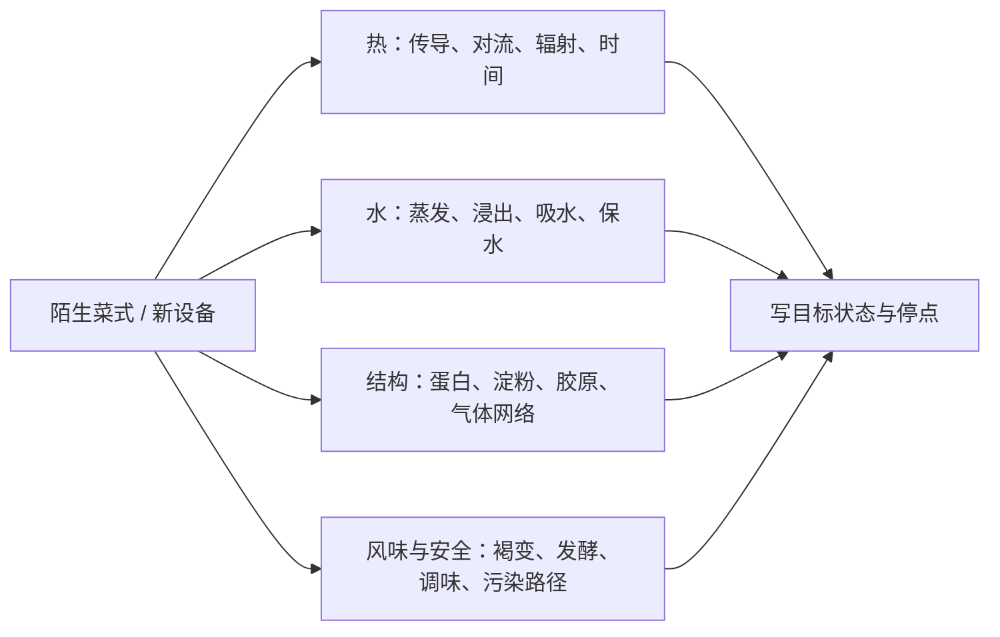

# 第 45 章 再往外走：设备清单与烘焙 / 发酵 / 西餐的地图

这本书不是厨具购物指南，也不试图把所有菜系装进一套菜谱。它提供的是更小、也更可迁移的东西：遇到新设备或新菜系时，先问热从哪里来、水往哪里走、结构何时建立、风味何时生成，以及安全条件是否被验证。

## 45.1 设备不是等级表，而是测量与控制能力

先补“看不见的变量”，再补“新的技法路径”。因此，同等预算下，能验证温度的工具通常比一个重复现有锅功能的器具更有价值；但没有任何一件设备能替代清洁、分区与判断。

| 你缺的能力 | 可优先考虑的类别 | 它解决什么 | 它不能保证什么 |
|------------|------------------|------------|----------------|
| 验证中心熟度 | 合适的探针温度计 | 测食物最厚处，避免凭颜色猜 | 不能替代当地安全口径或正确插入位置 |
| 稳定处理细小食材 | 合适尺寸的锅、盖、滤网 / 蒸具 | 管理热、水汽与操作空间 | 不能把过量食材变成高热输入 |
| 观察并记录 | 计时器、秤、笔记 | 让一次经验可复做、可比较 | 不能自动得出因果 |
| 获得干热路径 | 烤箱或能稳定提供干热的设备 | 热空气、辐射与脱水的组合 | 不等同于锅面接触或油炸 |

品牌、价格、材质排行榜和“必买清单”都高度依赖地区、预算和已有器具，本书不作推荐。购买前先写下：我想解决的是**测不到**、**控不住**，还是**缺少一种热的路径**？

## 45.2 四条线在别的厨房里仍然成立

| 场景 | 同一套问题如何落地 |
|------|--------------------|
| 烘焙 | 干热怎样进到中心？表面何时失水变壳？淀粉、蛋白和气体网络何时定型？ |
| 发酵 | 微生物、时间、温度与原料条件是否可控？最终产品的保存与安全是否有专门指引？ |
| 西式煎烤 | 锅面 / 烤箱的热路径是什么？表面能否先变干以产生褐变？中心的安全与质地如何同时验证？ |
| 压力烹饪 | 通过改变沸点与时间换来什么？食材结构、装填量与设备说明书的边界是什么？ |

“西餐”“中餐”不是物理学分类。煎牛排、烤根茎、蒸鱼和红烧肉当然使用不同传统，但都绕不开热到中心的路径、水分和结构变化。

## 45.3 发酵与保藏：最需要克制外推的领域

发酵会带来酸、香气与结构变化，但不能因为“是发酵”就推定安全。不同食品依赖的菌种、盐度、酸度、水活度、温度、时间和密封条件不同。工业罐藏法规的 pH / 水活度分类，也不是家庭腌渍配方的安全证明。

| 看到的说法 | 本书的边界 |
|------------|------------|
| “酸了就安全” | 不成立；酸感不能代替经过验证的家庭保藏流程。 |
| “发酵食品都一样” | 不成立；原料、菌种、工艺与保存条件决定风险。 |
| “我可以凭气味判断” | 不可靠；安全问题应跟随本地专门的官方指引。 |

想进入家庭发酵、罐藏、真空低温烹饪等领域时，使用所在地现行、针对该食品类别的官方资料与设备说明；不要从本书的机制章节拼出一个自创安全流程。

## 45.4 常见说法辨析

| 说法 | 判断 | 更可靠的做法 |
|------|------|--------------|
| “买贵锅就能解决火候” | ❌ | 先识别问题是热输入、份量、水分、顺序还是测量；设备只是其中一个变量。 |
| “有温度计就绝对安全” | ⚠️ | 温度计须测对位置，并配合本地食材类别指引、清洁和冷藏流程。 |
| “烘焙和炒菜完全是两套学问” | ⚠️ | 配方语言不同，但热、水、结构和风味仍可作为共同地图。 |
| “发酵就是让食物更耐放” | ❌ | 没有受控方法与适用指引，不能从“发酵”推出保存安全。 |

## 45.5 思考题

1. 为什么温度计通常比第二只相似的锅更能提升判断能力？
2. 第一次做面包时，怎样把“塌了”拆成热、水、结构三个候选问题？
3. 为什么本章不提供自制罐头或发酵配方？

## 45.6 本章实操

### 🅐 零成本版：为一个新菜式画四条线

选一项你想学的烘焙、发酵或异国菜，不做也可以。不要先找“正宗分钟数”，先填：

| 目标状态 | 热的路径 | 水的去向 | 要建立的结构 | 风味 / 安全控制点 | 我最缺的证据 |
|----------|------------|------------|--------------|-----------------|--------------|
| | | | | | |

### 🅑 开火版：只新增一种能力

选一道熟悉菜，尝试一个你已有设备能提供的新路径（例如烤箱干热、蒸汽、或用温度计验证中心），不要同时换食材、换配方和换设备。

| 原有路径 | 新路径 | 保持不变的条件 | 我观察到的热 / 水 / 结构变化 | 安全如何验证 |
|----------|--------|----------------|------------------------------|--------------|
| | | | | |

## 45.7 🔎 下次做菜时的用处

面对陌生设备或菜式，先把“我该买什么 / 照谁的分钟数”换成：**我要得到什么状态？我缺的是测量、控制，还是一种热路径？哪些安全条件需要查专门指引？** 这三问会让新工具成为证据，而不是新的迷信。

## 45.8 本章依据

本章不新增设备性能、价格或品牌比较。温度计与安全测量见第 42 章及美国 CDC / USDA 已登记资料；干热、蒸汽、锅面接触见第 23～29 章；工业罐藏法规不能外推为家庭配方见第 8、42 章；胶原与时间—温度取舍见第 5 章。具体来源和限制见[参考书目与出处登记](../../standards.md)。
