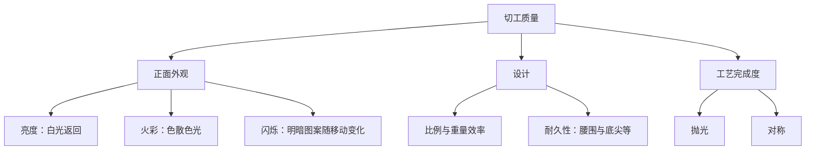

# 第 16 章 4C ④切工：比例、对称与抛光怎样把光送回眼睛

> **本章目标**：把“切工好”拆成可核验的光学表现、设计与做工，而不是背一组“万能理想比例”。
> GIA 的总切工等级只适用于 D–Z 色级的**标准圆明亮式**钻石；花式切工的阅读方式见第 17 章。

## 16.1 切工不是形状，也不只是一个证书词

“圆形、椭圆、祖母绿形”说的是轮廓（shape）；切工质量说的是刻面排列、比例和完成度怎样处理光。
GIA 对标准圆明亮式的总切工评估分成三层：

一颗钻石可以克拉更大、颜色更高，却因比例让光从亭部漏走，正面显得偏暗或“摊不开”。因此切工是把
材料潜在的亮度、火彩和闪烁兑现出来的步骤，不是附在克拉后的装饰项。

## 16.2 GIA 总切工等级到底说什么

GIA 对符合范围的标准圆明亮式给出 Excellent、Very Good、Good、Fair、Poor 五档总切工等级。
它评估七项：亮度、火彩、闪烁、重量比、耐久性、抛光、对称。前五项中任何一项明显受限，都会限制总评；
抛光与对称另有各自等级，也参与总评边界。

| 报告字段 | 它回答什么 | 不能单独推出什么 |
|----------|------------|------------------|
| Cut grade | 圆钻在该体系内的综合切工判断 | 所有花式切工的优劣 |
| Polish | 刻面表面的完成度 | 光学表现必然最好 |
| Symmetry | 轮廓、刻面形状/位置/对齐的准确性 | 一定没有光漏或“蝴蝶结” |
| Proportions diagram | 该石的台面、冠角、亭角、深度等实测关系 | 一组数字即可替代观察 |

“3EX / Triple Ex”通常指总切工、抛光、对称都为 Excellent。它是有用的筛选条件，却不是保证某颗石头
一定比另一颗更合眼缘的认证；同属 Excellent 的石头仍可有不同的明暗图案与比例组合。

## 16.3 为什么不能背“唯一理想比例”

台面大小、冠角、亭角、全深、星刻面和下腰刻面长度彼此联动。单看一个数字会遗漏组合关系：浅冠配某个
亭角、深冠配另一个亭角，可能产生不同但仍可接受的外观。GIA 也明确说明每一切工档包含多组比例与外观。

更稳妥的柜台顺序是：先确认适用范围与总评；再看比例图、腰围/底尖描述、抛光和对称；最后在多种光线下
观察正面是否明亮、图案是否均衡、闪烁是否自然。不要用网络上的单个角度阈值否定一颗已获权威实验室
总评的钻石，也不要因“EX”就拒绝看实物或视频。

## 16.4 ASET、H&A：辅助观察，不是跨实验室总标准

ASET 等反射图可以帮助观察不同角度的光线返回，H&A 图案则与圆钻的对称和刻面关系有关；两者都依赖
观察设备、拍摄条件和具体切工。它们适合作为补充证据，不能替代实验室报告，也不能直接用于花式切工
或跨品牌的机械排名。卖家只给一张渲染图、不说明设备与实物对应关系时，证据力度有限。

## 16.5 常见说法辨析

| 说法 | 判定 | 说明 |
|------|------|------|
| “切工就是钻石形状” | **明确错误** | 形状是轮廓；切工质量涉及比例、光学表现、抛光和对称。 |
| “所有钻石都有 GIA 总切工等级” | **明确错误** | GIA 的该总评适用于其定义范围内的标准圆明亮式。 |
| “3EX 一定肉眼最闪” | **不完整** | 它是强筛选条件，但同档内仍有图案、光线和个人偏好差异。 |
| “记住一组理想角度就能挑钻” | **不准确** | 比例是组合问题；脱离报告、实物与适用范围的单点阈值会误导。 |

## 16.6 🔎 柜台前的用处

1. 圆钻先读总切工，再读抛光、对称和比例图；不要把形状当作切工等级；
2. 花式切工报告没有 GIA 总切工等级时，不要把“空白”误解为差；改看形状特有的漏光、对称与比例；
3. 遇到 3EX 溢价，要求同时看报告、实物或标准化视频，确认这份溢价是否对应你的观察；
4. 腰围过薄、过厚或底尖异常都值得单独问：前者涉及磕碰风险，后者可能占重量、缩小正面尺寸；
5. 任何“理想切工”营销词，都先追问它依据的是哪个实验室、哪种形状和哪份可复核数据。

## 16.7 思考题

1. GIA 对标准圆明亮式切工的七项评估成分是什么？
2. 为什么 “3EX” 不是跨所有钻石形状的万能质量结论？
3. 为什么不能只用一个冠角或亭角数字挑钻？
4. 【案例】两颗圆钻均为 GIA Excellent：A 为 EX/EX/EX，B 为 EX/VG/EX；B 价格更低。
   应怎样判断 B 的较低抛光是否对你有实际影响？

> 📖 **参考答案**（想清楚再看）：[Q1](../../qa/16-cut-qa.md#q1) · [Q2](../../qa/16-cut-qa.md#q2) · [Q3](../../qa/16-cut-qa.md#q3) · [Q4](../../qa/16-cut-qa.md#q4)

## 16.8 本章实操

### 🅐 无器具版

找两份圆钻报告，填写[证书核对清单](../../forms/certificate-checklist.md)中与切工有关的字段：总评、
抛光、对称、比例图、腰围和底尖。先写报告能证明什么，再写仍需看实物的问题。

### 🅑 有器具版

在同一光源和角度下比较两颗圆钻的正面视频或实物，分别记录亮度、火彩、闪烁和明显漏光；不把一次
手机拍摄的曝光差异当成完整切工诊断。

## 16.9 本章主要参考

| 来源 | 本章用途 |
|------|----------|
| [GIA：Diamond Cut Grade—6 Things to Know](https://4cs.gia.edu/en-us/blog/gia-diamond-cut-grade-six-things-to-know/) | 七项评估、适用范围、五档总评与完成度边界 |
| [GIA：Understanding Diamond Cut Grades](https://4cs.gia.edu/en-us/blog/gia-diamond-grading-reports-understanding-diamond-cut-grades/) | 报告字段、标准圆钻与花式切工总评的区别 |
| [GIA *Gems & Gemology*：A Foundation for Grading Overall Cut Quality](https://www.gia.edu/gems-gemology/fall-2004-grading-cut-quality-brilliant-diamond-moses) | 切工体系的研究基础与“单一理想比例”边界 |
