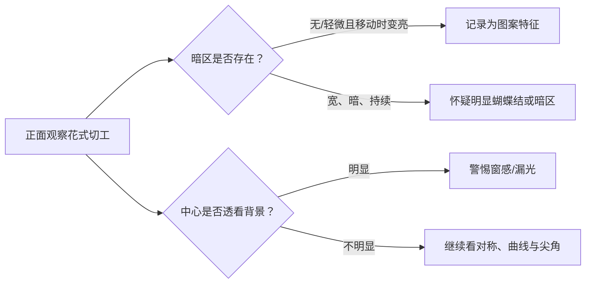

# 第 17 章 花式切工：轮廓、图案与尖角的另一套判断

圆形以外的钻石通常称花式切工（fancy shapes）。它们不应因 GIA 报告缺少圆钻式的总切工等级而被
误认为“无法判断”；恰恰相反，购买者需要把报告数据、正面轮廓、动态图案与耐久性拆开看。

## 17.1 先分形状与刻面风格

| 常见形状 | 值得优先观察 | 常见风险或偏好差异 |
|----------|--------------|--------------------|
| 椭圆、梨形、马眼 | 两侧对称、曲线、蝴蝶结、长度宽度比 | 中部暗带、尖端磕碰 |
| 公主方、雷迪恩 | 轮廓方正、尖角、正面尺寸与明暗图案 | 四角缺乏保护时易磕崩 |
| 祖母绿、阿斯切 | 台阶刻面、通透度、窗感、净度显露 | 大刻面更暴露内含物 |
| 心形 | 两个“肩”是否饱满、凹口和尖端是否居中 | 形状不清晰、两边不对称 |
| 垫形 | 轮廓、刻面图案、明暗和长宽比 | “碎冰”风格属于偏好，不是统一等级 |

形状（outline）和刻面排列（cutting style）要分开。例如椭圆可以有不同刻面图案；同样的长宽比也
不会保证同样的亮度或蝴蝶结。

## 17.2 为什么报告没有总切工等级

GIA 对花式切工报告会给抛光和对称等级，但不提供与标准圆明亮式相同的总切工等级。原因不是花式切工
不重要，而是形状、刻面排列和视觉偏好变化太多；圆钻方法不能直接移植。研究也显示，观察者普遍不喜欢
明显窗感，但对轻微蝴蝶结和“碎冰”图案的偏好存在明显的个人与地域差异。

因此不要寻找跨所有花式形状的“理想比例表”。长度宽度比只是外观偏好的起点，不是总质量分数。

## 17.3 蝴蝶结与窗感：看动态，不看一句话

蝴蝶结是细长形（如椭圆、梨形、马眼）中央可能出现的暗色对比区。它可能随钻石、观察者或光源移动而
变化；窄而不持续的暗区未必是缺陷，宽、暗、持续并削弱整体亮度时才更值得警惕。窗感（windowing）则
是正面中心显得透明、像能看到背景的区域；在 GIA 的观察研究中，明显窗感获得的评价较差。

最可靠的线上观察方式是要求同一颗石在固定、可说明的光源下旋转的视频；单张强打光图片常把暗区和
漏光藏掉。线下则在不同方向轻转石头，确认图案怎样变化。

## 17.4 尖角、镶嵌与“显大”

梨形、马眼、心形和公主方等尖角处是碰撞敏感区。尖端应由 V 形爪或合适的包镶等设计保护；这属于
镶嵌与日常佩戴的风险控制，不是证书上某一等级可以替代的判断。

花式切工常因拉长轮廓显得更大，这是视觉效果而非免费重量。比较时同时看毫米尺寸、正面轮廓与全深，
不要只比克拉数或只追求极端拉长比例。

## 17.5 常见说法辨析

| 说法 | 判定 | 说明 |
|------|------|------|
| “花式切工没总切工等级，所以随便买” | **明确错误** | 报告和实物仍可评估对称、抛光、图案、轮廓与耐久性。 |
| “所有蝴蝶结都是瑕疵” | **不准确** | 轻微或动态变化的暗区有时是图案的一部分；是否接受取决于强度和个人偏好。 |
| “长宽比达到网传数字就一定好看” | **不完整** | 长宽比不包含曲线、对称、刻面图案、窗感与蝴蝶结。 |
| “尖角钻石只要净度高就不易损” | **明确错误** | 尖角的固有碰撞风险还取决于镶嵌保护与日常使用。 |

## 17.6 🔎 柜台前的用处

1. 先确认你喜欢的轮廓，再把长宽比当作筛选而非评分；
2. 对称要看轮廓：梨形和心形沿中线两侧应协调，椭圆/马眼还要看横纵轴；
3. 要求旋转视频或多光线实物观察，专门检查窗感、宽暗蝴蝶结和不自然的曲线；
4. 对公主方、梨形、马眼、心形，确认尖角有保护性镶嵌；
5. 阶梯形（祖母绿/阿斯切）优先看净度图与实物，因为大刻面不擅长隐藏内含物。

## 17.7 思考题

1. 为什么花式切工不能直接套用圆钻的总切工体系？
2. 宽而持续的蝴蝶结与轻微、随移动变亮的暗区，购买决策应怎样不同？
3. 【案例】一颗 1 ct 梨形钻很修长、图片显大，但视频中中心长期透明发灰，尖端又没有保护设计。请写出
   至少三项需要分别核验的风险。

> 📖 **参考答案**（想清楚再看）：[Q1](../../qa/17-fancy-shapes-qa.md#q1) · [Q2](../../qa/17-fancy-shapes-qa.md#q2) · [Q3](../../qa/17-fancy-shapes-qa.md#q3)

## 17.8 本章实操

### 🅐 无器具版

找同一形状的三段旋转视频，按“轮廓对称、曲线/尖角、窗感、蝴蝶结、动态闪烁”做五栏记录；
把“我喜欢”与“明显缺陷风险”分开写。

### 🅑 有器具版

用 10 倍镜和手电观察一枚花式切工首饰的尖角、腰围和爪位。只记录可见状态；若怀疑松动、崩口或裂纹，
交由专业珠宝维修或实验室确认，勿自行掰动测试。

## 17.9 本章主要参考

| 来源 | 本章用途 |
|------|----------|
| [GIA：Buying a Quality Diamond](https://4cs.gia.edu/en-us/blog/how-to-buy-a-quality-diamond/) | 花式切工报告字段、轮廓/线对称/曲线的观察框架 |
| [GIA *G&G*：Oval, Pear and Marquise—Implications for Fancy Cut Grading](https://www.gia.edu/gems-gemology/fall-2024-fancy-shaped-diamonds) | 蝴蝶结、窗感、碎冰图案与观察者偏好边界 |
| [GIA：Fancy-shaped diamond cut grading FAQ](https://www.gia.edu/FAQ/gia-faq-analysis-grading-system-fancy-shape-diamond) | GIA 花式切工总评的现状 |
