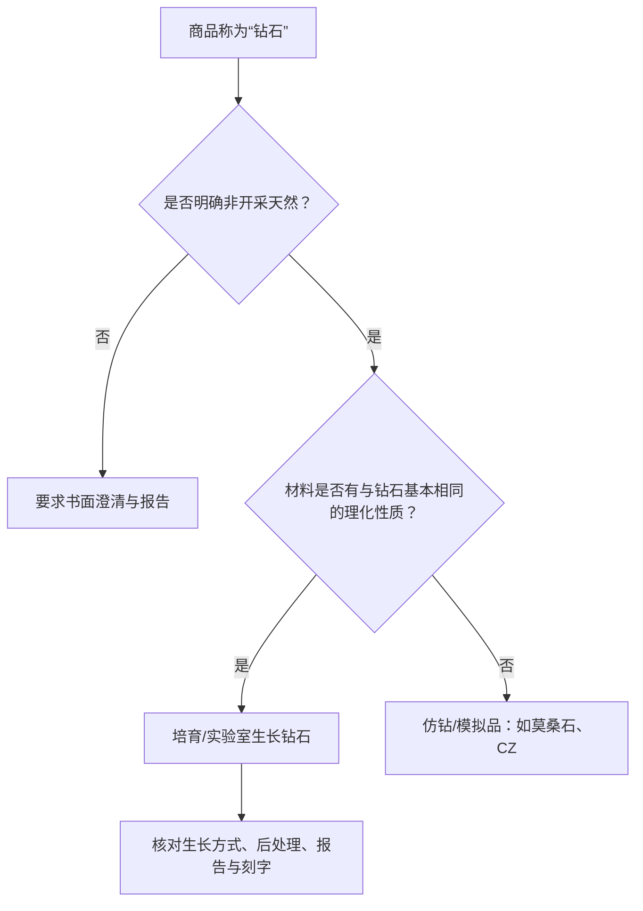

# 第 18 章 培育钻石：同种材料，不同来源与流通逻辑

培育钻石（laboratory-grown diamond）是实验室生长的钻石材料：其化学、物理和光学性质与天然钻石
基本相同，因此它不是莫桑石、立方氧化锆等“仿钻”。但来源、可追溯性、供应扩张与二手流通逻辑不同，
销售时必须清晰披露“非开采天然钻石”。

## 18.1 HPHT 与 CVD 是生长路线，不是品质等级

| 路线 | 基本原理 | 常见识别线索（实验室综合判断） | 不能推出 |
|------|----------|--------------------------------|----------|
| HPHT | 高压高温下让碳在晶种上生长 | 金属熔剂包裹体、特定生长/荧光/应变特征 | 一定比 CVD 更好或更差 |
| CVD | 气相沉积在晶种上逐层生长 | 带状应变、生长条纹、点状包裹体等 | 一定未经后处理 |

线索不是家庭鉴定口诀。GIA 明确指出并非每颗培育钻都显示所有特征，结论通常要结合多种宝石学与
仪器证据；普通筛查器的 “refer” 结果也只表示需要进一步检测，不等于已经证明是培育钻。

## 18.2 生长后处理必须单列

CVD 钻石可能接受 HPHT 等后处理以改善颜色，报告应披露是否检出相关证据。不要把“CVD”当成
“无处理”的同义词，也不要因为报告写 HPHT 就混淆“HPHT 生长”与“HPHT 后处理”——前者是形成路线，
后者是对已生长材料的改色步骤，需看报告的完整措辞。

购买时核对：报告是否明确 laboratory-grown、报告号能否官网验证、腰围刻字是否与报告一致、所述生长
方式为何、是否有后处理说明。报告核验是身份与分级信息的核验，不是对未来价格的承诺。

## 18.3 披露与仿钻的边界

FTC 的珠宝指南要求面向消费者清楚、醒目地说明 laboratory-grown / laboratory-created 等材料并非开采
钻石；反过来，也不应把莫桑石或立方氧化锆叫作“培育钻石”，因为它们不具备钻石的同类理化性质。

## 18.4 价格与决策：不要把供应故事写成保值承诺

培育钻石的价格受生产效率、产能、库存、渠道、品牌和报告/切工等因素共同影响。它和天然钻石都可能
出现零售—回收价差；任何“必然保值”“一定归零”都不是对具体产品可验证的结论。

更实用的决策顺序是：先明确你买的是佩戴效果、预算内的尺寸/4C，还是天然稀缺来源；再将同等尺寸、
颜色、净度、切工、报告和售后条件放在同一口径比较。若把未来转售放在首位，要求卖方给出书面回购条款，
而不是接受口头价格预测。

## 18.5 常见说法辨析

| 说法 | 判定 | 说明 |
|------|------|------|
| “培育钻就是莫桑石” | **明确错误** | 培育钻是钻石；莫桑石是不同材料的仿钻。 |
| “肉眼看不出，所以不需要报告” | **明确错误** | 商业价值和来源不同，披露与可追溯性仍是交易核心。 |
| “CVD 一定没有处理” | **明确错误** | 部分 CVD 材料会有生长后处理，须看报告披露。 |
| “培育钻一定不保值/天然钻一定保值” | **缺乏证据的绝对化说法** | 流通价格取决于具体产品、渠道、供需和回购条件，不能承诺。 |

## 18.6 🔎 柜台前的用处

1. 先要求在商品标题、订单和证书上明确写“培育/实验室生长”或“天然”；
2. 核验报告号、腰围刻字、4C、生长方式和后处理披露是否互相一致；
3. 不用肉眼、热导仪或单一紫外反应替代来源鉴定；
4. 与莫桑石/CZ 比较时，先承认它们是不同材料，再比预算、外观、耐久性和售后；
5. 不把任一来源的钻石当作收益产品；若关心转售，先拿到书面条款。

## 18.7 思考题

1. 为什么培育钻和莫桑石不能归为同一类“人造钻石”？
2. 为什么 HPHT 既可能指生长方式，也可能指生长后处理？
3. 【案例】卖家称“一颗无奶咖的 CVD 天然钻，肉眼根本看不出，不用证书”。其中至少有哪些术语或
   推理需要纠正？你会要求哪些书面信息？

> 📖 **参考答案**（想清楚再看）：[Q1](../../qa/18-lab-grown-qa.md#q1) · [Q2](../../qa/18-lab-grown-qa.md#q2) · [Q3](../../qa/18-lab-grown-qa.md#q3)

## 18.8 本章实操

### 🅐 无器具版

任选三条商品页，检查其是否在标题附近清楚披露天然、培育或仿钻；把“材料身份、报告、处理、售后”
分别抄入[证书核对清单](../../forms/certificate-checklist.md)。

### 🅑 有器具版

查看一份可在线验证的培育钻报告，核对报告号、腰围刻字、4C、生长路线和后处理说明。若实物与报告
不符或价值较高，停止交易并交由权威实验室复检。

## 18.9 本章主要参考

| 来源 | 本章用途 |
|------|----------|
| [GIA：HPHT and CVD Diamond Growth Processes](https://www.gia.edu/hpht-and-cvd-diamond-growth-processes) | HPHT/CVD 的生长路线、鉴定线索与单一特征局限 |
| [GIA：Laboratory-Grown Diamond Report](https://www.gia.edu/introducing-lgdr-by-gia) | 报告中的生长方式、后处理与腰围刻字披露 |
| [GIA *G&G*：Laboratory-Grown Diamonds Update (2024)](https://www.gia.edu/gems-gemology/summer-2024-gia-update-on-laboratory-grown-diamonds) | 筛查器与实验室综合鉴定的边界 |
| [FTC：Jewelry Guides](https://www.ftc.gov/business-guidance/resources/loupe-advertising-diamond-gemstones-pearls) | 对培育、仿制材料的清晰披露原则 |
