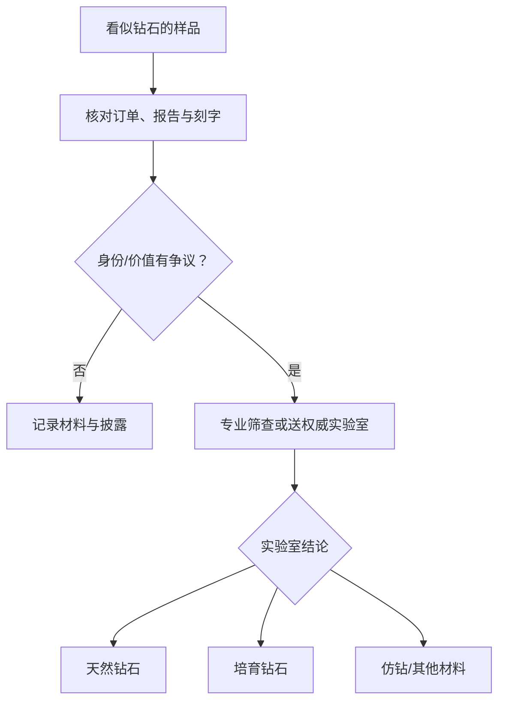

# 第 19 章 仿钻：莫桑石、立方氧化锆与“检测笔”的边界

仿钻（simulant）是外观模仿钻石、但材料本身不是钻石的宝石。常见的莫桑石（synthetic moissanite，
碳化硅）与立方氧化锆（CZ）和培育钻石不同：培育钻仍是钻石，仿钻不是。

## 19.1 三类材料先分开

| 类别 | 代表 | 与天然钻石的关系 | 交易重点 |
|------|------|------------------|----------|
| 天然钻石 | mined diamond | 天然形成的钻石 | 身份、4C、处理与报告 |
| 培育钻石 | CVD / HPHT | 实验室生长的钻石 | 清晰披露、报告、处理 |
| 仿钻 | 莫桑石、CZ | 外观相似但材料不同 | 材料名称与耐久/保养边界 |

“人造”不是一个足够的交易描述：它既可能指实验室生长钻石，也可能指合成莫桑石或 CZ。必须问材料的
准确名称，而不是接受“人工钻”“实验室钻”等模糊用词。

## 19.2 可作线索的观察，不是家庭鉴定结论

莫桑石通常具有很强的色散，较大尺寸时可能出现更强烈的彩色闪光；它是双折射材料，在适当方向和
放大观察下，刻面棱线可能出现重影。CZ 的整体外观和耐久性特征又不同。这些是训练有素的鉴定人员会
结合的线索，不是“看到彩光就肯定莫桑石”的规则。

钻石、培育钻石和莫桑石均可能让某些热导测试笔给出“钻石”类结果。GIA 的研究明确指出，传统热导
探针本身不足以分离莫桑石和钻石；报纸测试、哈气测试、划玻璃等网络方法受光线、污渍、切工、镶嵌和
主观判断影响，不能用作购买结论。

## 19.3 从筛查到结论的正确路径

筛查工具可帮助决定“是否需要进一步检测”，但工具的适用尺寸、颜色范围、镶嵌状态与可能误报都需要
先确认。高价值石头、来源披露不清或报告/刻字不一致时，停止交易或使用权威实验室复检，而不是反复
用家用工具测试。

## 19.4 常见说法辨析

| 说法 | 判定 | 说明 |
|------|------|------|
| “莫桑石过热导笔，所以就是钻石” | **明确错误** | 热导测试不能单独排除莫桑石。 |
| “培育钻是仿钻” | **明确错误** | 培育钻是钻石；仿钻是不同材料。 |
| “火彩越强一定越好” | **不完整** | 是审美偏好与材料/切工共同作用，不能替代身份判断。 |
| “报纸/哈气测试能验真” | **缺乏可靠性** | 条件变量太多，不能作购买或鉴定结论。 |

## 19.5 🔎 柜台前的用处

1. 要求订单和标签直接写“天然钻石、培育钻石、莫桑石或 CZ”，不接受模糊词；
2. 热导笔“通过”只能说明要继续核验，不能证明天然来源；
3. 购买高价值主石时，把证书在线查询、腰围刻字与实物对应作为最低动作；
4. 发现刻字、报告或材料披露矛盾时，保留凭证、暂停交易、走实验室复检；
5. 把莫桑石和 CZ 当作独立材料选择：按外观、预算、耐久性和个人偏好购买，不把它们伪装成钻石。

## 19.6 思考题

1. 为什么“人造钻”不是能直接写进订单的材料名称？
2. 为什么热导笔出现“钻石”结果仍不能证明天然钻石？
3. 【案例】商家用热导笔测试一枚戒指后说“通过，绝对天然”，却不能提供报告或刻字照片。你会如何
   评价这条证据链？下一步怎么做？

> 📖 **参考答案**（想清楚再看）：[Q1](../../qa/19-simulants-qa.md#q1) · [Q2](../../qa/19-simulants-qa.md#q2) · [Q3](../../qa/19-simulants-qa.md#q3)

## 19.7 本章实操

### 🅐 无器具版

在三家商品页中找材料披露，把每款按“天然钻石 / 培育钻石 / 仿钻 / 说不清”分类；对“说不清”的
条目写出需要补的文件，而非猜材料。

### 🅑 有器具版

若已有 10 倍镜，可在不拆卸首饰的前提下观察刻面棱线是否疑似重影，并记录观察条件。它只能是送检前
的线索；不可据此向他人宣称鉴定结论，也不可自行划擦测试。

## 19.8 本章主要参考

| 来源 | 本章用途 |
|------|----------|
| [GIA：How to Tell if a Diamond Is Real](https://4cs.gia.edu/en-us/blog/how-to-tell-if-diamond-is-real/) | 网络测试的局限、培育钻与仿钻的边界 |
| [GIA *G&G*：Synthetic Moissanite](https://www.gia.edu/gems-gemology/winter-1997-synthetic-moissanite-nassau) | 莫桑石的双折射、热导笔局限和综合鉴定原则 |
| [GIA：Imitation Diamonds](https://www.gia.edu/gem-imitation) | 莫桑石与 CZ 的材料定位、外观与耐久性说明 |
