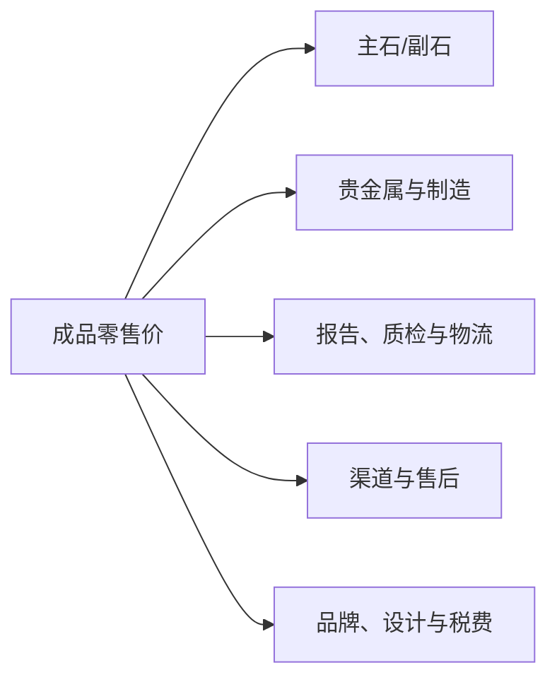

# 第 20 章 钻石定价与流通：报价单不是成交价，更不是回收承诺

钻石价格不是由 4C 自动计算出的唯一答案。4C、形状、荧光、报告、库存状态、渠道、品牌、镶嵌、售后与
交易条件共同决定一笔交易；天然与培育钻石的流通结构也应分开比较。

## 20.1 先区分四种“价”

| 价格语境 | 它通常包含 | 不能拿来替代 |
|----------|------------|--------------|
| 行业基准/报价表 | 特定质量条件下的参考或要价 | 实际成交价 |
| 批发/裸石成交 | 具体库存、付款、退货与谈判条件 | 零售成品价 |
| 零售首饰价 | 裸石、金属、工费、品牌、门店和售后 | 回收报价 |
| 回收/寄售价 | 二手流动性、检测、整备与渠道风险 | 原始零售价 |

Rapaport Price List 是行业常用的参考工具，但其自身说明是特定条件下的高现金要价基准，并非实际交易
记录。即使专业人士也需按形状、克拉、颜色、净度、切工、荧光、证书和实时库存调整；消费者不应把
“Rap 多少折”当成某颗钻石天然合理价或回收保证。

## 20.2 用分层模型读一张零售价签

这张图不是估价公式，而是提醒：同样 4C 的两颗裸石可以因来源与服务不同而有差价；同样主石的戒指也
会因金重、工艺、镶嵌、品牌和售后不同而不可直接比价。要比较，先拆成“同一颗石头的裸石条件”和
“同等工艺/服务的成品条件”。

## 20.3 三个常被忽略的变量

1. **报告与可核验性**：报告不等于估价，却会影响身份和 4C 信息的可比较程度；
2. **切工与形状**：圆钻与花式切工不宜只按克拉、颜色、净度横比；
3. **交易条款**：付款方式、退换期、复检、改圈、维修与回购书面条款，都是交易价值的一部分。

任何“证书价”“国际价”“保值价”都要问清出处、适用对象、日期与是否包含成品/服务。没有可核验的
条款，就只把它当营销描述。

## 20.4 回收与“保值”的诚实边界

零售购买包含制造、门店、服务和税费，回收方接手的则是需要再次鉴定、整备、流通的二手商品，两者
报价不同是正常的交易结构。品牌、稀缺来源或特殊设计可能有不同的二级市场，但不能由销售人员口头
概括为“必然保值”。若回购是决定性条件，要求书面写明对象、标准、时点、折算方式、手续费和例外。

## 20.5 常见说法辨析

| 说法 | 判定 | 说明 |
|------|------|------|
| “Rap 价就是成交价” | **明确错误** | 它是参考/要价基准，不是所有实际成交记录。 |
| “同 4C 的钻石应该同价” | **不完整** | 还受切工、形状、荧光、报告、库存与条款影响。 |
| “证书就是估价证明” | **明确错误** | 分级报告确认特征，不承诺市场价值。 |
| “可回收就等于保值” | **不准确** | 回收规则、时间、流动性和费用都需要书面核验。 |

## 20.6 🔎 柜台前的用处

1. 让卖方将裸石报价、戒托/工费、证书、税费和服务分开列；
2. 同时拿到报告号、实物视频和完整交易条款，才开始横向比价；
3. 听到“按 Rap 折扣”时，确认基准日期、形状/质量范围、是否天然钻石、是否含服务；
4. 购买前先看退换与复检规则，回购承诺一律要求书面；
5. 把钻石首先当消费品/佩戴品；不要以本章作为投资或收益建议。

## 20.7 思考题

1. 为什么 Rapaport 报价表不能直接等同于消费者的成交价？
2. 为什么“同 4C”仍不能作为成品戒指的充分比价条件？
3. 【案例】卖家称“这颗天然钻按国际报价打六折，证书价 10 万，原价回收”。请列出至少四项需要
   书面核验的信息。

> 📖 **参考答案**（想清楚再看）：[Q1](../../qa/20-pricing-qa.md#q1) · [Q2](../../qa/20-pricing-qa.md#q2) · [Q3](../../qa/20-pricing-qa.md#q3)

## 20.8 本章实操

### 🅐 无器具版

找两件看似相近的成品戒指，按主石、金属/工艺、报告、服务和交易条款五栏拆价。无法获得的信息写
“待核验”，不要用总价差反推任何一项的真实价值。

### 🅑 有器具版

拿一份真实报价和证书，核对报告在线查询、主石参数、戒托金重/材质、税费、退换和复检条款是否一致；
不要用家用称或照片代替实验室对主石的身份确认。

## 20.9 本章主要参考

| 来源 | 本章用途 |
|------|----------|
| [Rapaport：Price List Guide](https://help.rapaport.com/en/articles/2982406-rapaport-price-lists-your-guide-to-diamond-pricing-tools) | 参考价的适用范围、更新性与非成交价边界 |
| [GIA：Report vs Appraisal](https://4cs.gia.edu/en-us/blog/what-is-the-difference-between-a-diamond-grading-report-and-an-appraisal/) | 分级报告与估价的差别 |
