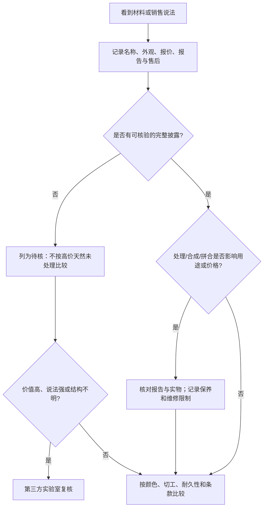

# 第 29 章 彩宝的坑：把“看见线索”与“得到结论”分开

处理、合成和拼合不是三个可以凭一眼分开的标签。消费者最有效的工作不是在柜台上宣布鉴定结论，
而是用可观察线索决定：继续比较、要求书面披露，还是送实验室。

## 29.1 先画出正确的决策路径

这张图的关键是：**线索只是升级核验的理由，不是最终鉴定**。即使报告存在，也要先确认报告编号、
重量、尺寸、照片/特征能否对应眼前这颗石。

## 29.2 五类常见状态，分别问什么

| 状态 | 它改变了什么 | 消费者应问 | 不可越过的边界 |
|------|--------------|------------|----------------|
| 加热 | 颜色、透明度或内含物表现 | 报告怎样写、是否有检测限制 | 不把“未检出”扩成绝对历史 |
| 扩散 | 外来元素进入晶格、改变颜色 | 具体扩散处理和维修限制 | 不以肉眼颜色判定 |
| 充填/浸油 | 裂隙可见度与耐久性 | 填充物、程度、清洁/改款限制 | 不超声、蒸汽、溶剂或化学试验 |
| 染色/覆膜 | 颜色在孔隙、裂隙或表层改变 | 染色/镀层是否披露、耐久性 | 不以摩擦或溶剂“验色” |
| 合成/拼合/仿品 | 来源或结构不同 | 定名、实验室生长、拼合层和材料 | 不用“像天然”替代证据 |

## 29.3 可见预警信号：只用于提问

裂隙颜色浓集、表层磨损处的颜色差、异常规整的气泡/生长纹、侧面可见层次、或“极鲜艳又极低价”的
组合，都可以促使你提高核验等级；它们却不能单独证明染色、合成、充填或仿品。不同材料、光线、切工和
损伤会产生相似外观。

同样，显微镜、滤色镜、紫外灯与简易仪器可以帮助记录现象或筛查，但天然/合成、处理类型和产地常需要
光谱、化学或比对数据库。不要为了“证实”猜想而刮磨、加热、浸液、使用酸碱或拆镶。

## 29.4 披露不是一行备注

成交资料至少应保留：材料全名、天然/实验室生长结论、已检出处理的原文、拼合结构、报告编号与对应信息、
保养/维修限制、退换与复核条款。卖方只说“优化过一点”“天然色”或“证书都有”时，应要求改成可核验的
具体文字；答不清的项目不应被按高确定性溢价购买。

## 29.5 常见说法辨析

| 说法 | 判定 | 为什么 |
|------|------|--------|
| “显微镜看见气泡，就一定是合成” | **明确错误** | 气泡与其他特征都必须结合材料和测试路径判断。 |
| “加热石不天然” | **明确错误** | 来源与处理是独立维度。 |
| “充填只是便宜一点，保养一样” | **危险** | 填充物和裂隙会改变清洗、维修与耐久性。 |
| “证书有二维码就无需核对实物” | **明确错误** | 二维码只帮助验证报告存在，仍须确认对应对象。 |

## 29.6 🔎 柜台前的用处

1. 对任何强溢价词，先问它是颜色、来源、处理、产地还是结构命题；
2. 把卖方口述翻译成报告原文和销售单条款，无法落笔的就标待核；
3. 处理不明、裂隙多或拟高频佩戴时，先问保养/维修限制；
4. 高价值材料在付款前完成报告—实物对应与独立复核方案；
5. 不做破坏性或化学“自测”，保留交易和报告证据。

## 29.7 思考题

1. 为什么预警信号不能直接升级为处理/合成结论？
2. 为什么“天然”与“未处理”必须拆开写？
3. 【案例】卖方称“天然祖母绿，只有一点优化，无需证书”。你如何把这句话转成可执行的核验清单？

> 📖 **参考答案**（想清楚再看）：[Q1](../../qa/29-treatment-synthetic-path-qa.md#q1) · [Q2](../../qa/29-treatment-synthetic-path-qa.md#q2) · [Q3](../../qa/29-treatment-synthetic-path-qa.md#q3)

## 29.8 本章实操

### 🅐 无器具版

为一条彩宝商品信息逐项标注：事实、卖方说法、报告结论、待核和保养限制；只把书面证据支持的内容写入
“事实”栏。

### 🅑 有器具版

用 10 倍镜和常用光源记录裂隙、层次、表面磨耗与色带；将照片附在观察表而不写鉴定结论。任何处理/合成
疑问由实验室确认。

## 29.9 本章主要参考

| 来源 | 本章用途 |
|------|----------|
| [GIA：An Introduction to Gem Treatments](https://www.gia.edu/gem-treatment) | 处理类型、披露与特殊保养边界 |
| [GIA：Colored Stone Research](https://www.gia.edu/colored-stone-research) | 处理检测需依赖专业光谱/化学技术的原因 |
| [GIA：How GIA Analyzes Colored Stones](https://www.gia.edu/gia-news-research/guide-how-gia-analyzes-colored-stones) | 报告、来源、处理和天然/实验室生长的综合检测边界 |
